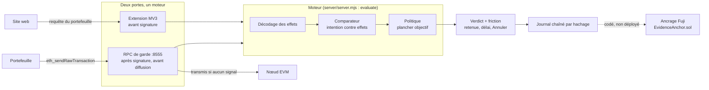

# Hold up

Avant qu'une personne signe ou envoie de la crypto, Hold up lui montre ce que l'opération fait vraiment, le compare à ce qu'elle croit faire, et la fait attendre si les deux ne collent pas.

Hackathon Secure Horizons, 10-11 octobre 2026. Track 1, Fintech Security. Hackathon blue team : le projet détecte et répond, il n'attaque rien. Équipe : Adem et Titouan.

Ancien nom : Sentinelle. Il reste dans quelques fichiers de recherche et dans des noms techniques (variables `SENTINELLE_*`, champ `service` du serveur local). C'est le même projet.

## Le problème

Un particulier qui signe dans son portefeuille voit des octets, pas des conséquences : un faux support ou un faux airdrop lui fait signer un droit de dépense (approve, permit) en croyant faire une chose banale. En 2025, ScamSniffer compte 83,85 M$ volés par hameçonnage de signatures et 106 106 victimes (chiffre de vendeur, non audité, repris dans `research/demo_reelle/RECHERCHE_demos.md`, ligne 9). Les outils existants jugent la réputation d'une adresse ; Hold up compare ce que la personne dit vouloir faire avec ce que la transaction fait.

## Ce que fait le PoC, de bout en bout

Détecter, puis répondre :

1. **Intercepter.** Deux portes, un seul moteur. L'extension navigateur retient la requête d'un site avant qu'elle atteigne le portefeuille (la seule porte qui voit les signatures hors chaîne). Le RPC de garde sert d'adresse réseau au portefeuille et retient une transaction déjà signée avant sa diffusion (envois tapés dans le portefeuille).
2. **Décoder l'effet réel.** Calldata, données typées EIP-712, Seaport, droits accordés, fonds sortants, adresses sosies.
3. **Comparer.** Ce que la personne a dit vouloir faire contre ce que l'opération fait. Un plancher objectif ne peut jamais être abaissé par ce que la personne déclare.
4. **Répondre.** Verdict à quatre niveaux (attention, danger, manipulation, « non vérifié » ; jamais de vert), phrases « tu crois / en vrai », délai avant de pouvoir continuer (30 s en danger, 10 min en manipulation, réglables), « Annuler » toujours disponible. La personne garde la décision.
5. **Tracer.** Chaque verdict est écrit dans un journal chaîné par hachage. L'ancrage de sa racine sur Avalanche Fuji est codé mais **pas déployé** (voir les limites).

## Lancer la démo en une commande

```bash
git clone <url-du-depot> hold-up && cd hold-up
node scripts/demo.mjs
```

Node 22.18 ou plus (essayé avec Node 25.6.0 sous Windows 11 uniquement). La première fois, le script lance `npm install` dans `blockchain/` (Hardhat, OpenZeppelin ; environ une minute, Internet requis, il télécharge aussi le compilateur Solidity). Il démarre ensuite, chacun sur son port, ce qui existe dans le dépôt, saute le reste en le disant, et s'arrête proprement avec Ctrl+C :

| Service | Port | Rôle |
|---|---|---|
| Nœud local Hardhat | 8545 | chaîne de répétition (chainId 31337 ; `--fork` : copie locale d'Avalanche, chainId 43114) |
| Console d'attaque simulée | 8792 | rejoue le vol (« drain ») pour montrer ce qui se passe sans Hold up |
| Site leurre « Glacier Rewards » | 8791 | faux airdrop qui demande un permit ; départ : `/lure.html` |
| Serveur de vérification | 8787 | `POST /check`, utilisé par l'extension version serveur |
| RPC de garde | 8555 | adresse réseau à mettre dans le portefeuille ; page des demandes retenues |
| Labo (serveur, interface) | 8800, 8801 | **en cours** : lancé seulement quand les fichiers existent |

`node scripts/demo.mjs --check` liste les prérequis et les ports pris sans rien lancer. Options : `--fork`, `--lookalike`, `--no-install`, `--victim 0x…`. Le pas à pas complet (extension dans Chrome, portefeuille de test) est dans [livrables/INSTALLATION.md](livrables/INSTALLATION.md).

## Architecture



Détail, séquences et pistes d'intégration : [livrables/ARCHITECTURE.md](livrables/ARCHITECTURE.md).

## Lancer les tests

Depuis la racine, sans `npm install` (sauf les contrats) :

| Commande | Ce qu'elle vérifie | Résultat observé sur un clone neuf |
|---|---|---|
| `npm run test:engine` | moteur d'effets | 290 tests, 288 passent. Les 2 échecs viennent de fichiers de données ignorés par git (`research/titouan/bench/data/permit2_logs.json`, `attack_approval_logs.json`). Certains tests lisent des RPC publics en lecture seule. |
| `npm run test:server` | serveur de vérification, journal | 33 sur 33 |
| `npm run test:rpc` | RPC de garde (lance son propre nœud jetable sur 8547) | 15 sur 15 |
| `npm run test:extension` | moteur de retenue de l'extension, avec un Chrome factice | 41 sur 41 |
| `npm run test:contracts` | contrats de démo (Hardhat, après `npm install` dans `blockchain/`) | 30 passent |

Ces tests valident le code. Ils ne mesurent pas la détection. `test:engine` et `test:server` réécrivent deux fichiers suivis (`engine/out/real_results.json`, `server/test/results.json`) : `git checkout` les remet en état. Le brouillon du dépôt annonçait « 447 tests du moteur » ; la commande ci-dessus en trouve 290.

## Chiffres mesurés, avec leur jeu et leurs limites

Tous viennent de jeux **écrits par nous**. Aucun jeu aveugle n'a été passé. Les intervalles (Wilson) supposent des cas indépendants, ce qu'ils ne sont pas (gabarits répétés). Lire ces chiffres comme de la couverture de nos règles, pas comme un taux face à un vrai attaquant.

| Mesure | Jeu | Valeur | Source |
|---|---|---|---|
| Rappel (warn ou critical), intention fausse soufflée par l'escroc | TEST synthétique, 110 malveillants, ouvert une fois avant les derniers correctifs | 94,5 % (104/110), dont 83,6 % en critical seul (92/110) | `research/titouan/T_banc_e2e/COUVERTURE.md`, tableau TEST_total |
| Fausses alertes critical, même bras | 78 bénins du même jeu | 23,1 % (18/78) ; 51,3 % reçoivent au moins un warn (40/78) | idem |
| Plancher seul, sans intention | même jeu | rappel 91,8 % (101/110), fausses alertes critical 5,1 % (4/78) | idem |
| Fixtures publiques, intention honnête | 144 fixtures, 134 exécutables | rappel 95,4 % (62/65), fausses alertes critical 3,0 % (2/67) | `research/titouan/T_banc_e2e/attacks_public/out/MESURE_001.md` |
| Opérations honnêtes écrites pour faire mentir l'outil | `redteam/jury_fp.jsonl`, 123 cas | 17,9 % critical (22/123), 51,2 % warn (63/123) | rejoué dans `redteam/angles_morts/03_chiffres_et_methode.md`, §1.4 |
| Filet à 5 règles sans intention sur trafic réel C-Chain | 6 325 transactions, présumées légitimes | 0,28 % signalées | `research/titouan/bench/RAPPORT_banc_reel_v0.md` |
| Même filet, droits de dépense réels vers adresses listées | n = 33, Ethereum, étiquettes d'un tiers | 24/33 retrouvés (72,7 %) | idem |
| Interposition de la couche d'interception | 96 sites réels, 89 accessibles | 0 casse sur 89 (IC95 0,0 à 4,1 %), mais 8/89 avec casse ou différence | `research/titouan/T_banc_e2e/compat/COMPAT_REEL.md` |
| Latence du calcul du verdict | 8 requêtes types répétées 50 fois, local, sans réseau | médiane 1,5 ms, p95 4,06 ms sur le clone d'essai (autre machine, autre valeur) | `node research/titouan/T_banc_e2e/server/test/server.test.mjs` |

À lire avec : le rappel compte un `warn` comme détection alors que la fausse alerte ne compte que le `critical` ; le « 0 % de fausses alertes, 100 % de rappel » sur le jeu de réglage DEV est un test de non-régression, pas une mesure ; le 0,28 % est celui d'un filet de 5 règles, pas de l'outil complet, dont le taux sur trafic réel est inconnu. Le raisonnement complet est dans `research/titouan/T_banc_e2e/redteam/angles_morts/03_chiffres_et_methode.md`.

## Limites connues

Écrites sans détour :

- **Chaque porte a un angle mort.** L'extension ne voit pas un envoi lancé depuis l'écran « Envoyer » du portefeuille, ni le mobile, ni WalletConnect, ni les applications natives. Le RPC de garde ne voit pas les signatures hors chaîne (permit, listings), qui ne passent jamais par le réseau. Les retraits d'une plateforme restent au geste manuel « coller et vérifier ». Source : `research/titouan/T_banc_e2e/extension/COMPAT.md`, `research/demo_reelle/rpc_garde/README.md`, `coord/DECISIONS.md` D-008.
- **Aucun jeu de test aveugle n'a été passé.** BLIND_v1 et V2_TEST n'ont jamais été exécutés ; leurs auteurs n'ont pas lu le moteur, mais leur indépendance ne se démontre pas.
- **Testé sur un portefeuille simulé, pas sur un vrai.** Aucun essai avec MetaMask, Rabby ou Core n'est consigné : `research/titouan/T_banc_e2e/essai_reel/ESSAI_REEL_RESULTATS.csv` ne contient aucun résultat. Tant qu'un humain ne l'a pas rempli, ne pas écrire le contraire.
- **Rien n'est déployé sur Fuji.** `blockchain/DEPLOYMENTS.md` ne contient que son en-tête. L'ancrage de la racine du journal (`research/titouan/T_banc_e2e/anchor/`, `EvidenceAnchor.sol`) est écrit et testé en local, jamais envoyé. Sans ancrage, le journal détecte la modification d'une ligne, pas sa réécriture complète.
- **Le produit livré voit moins que le banc.** Les détecteurs d'Adem (`detectors_adem/`) ne sont pas branchés dans le serveur ni dans l'extension à la rédaction ; le serveur de vérification et l'extension lisent un contexte hors ligne (carnet d'adresses, historique) sans interroger la chaîne ; seul le RPC de garde lit des faits sur la chaîne (variable `HOLDUP_LIVE`, active par défaut). Les chiffres du banc ne s'appliquent donc pas tels quels au produit.
- **Aucun modèle de langage n'est appelé.** La décision est du code et des mots-clés. Un modèle est prévu pour classer un message collé, sans pouvoir baisser un verdict ; il n'est pas branché.
- **Fausses alertes élevées.** Sur des opérations honnêtes, plus de la moitié reçoivent un avertissement et 12 à 18 % un écran critique selon les jeux. C'est la première limite du produit.
- **Fraude « conforme » non couverte.** Si la victime envoie volontairement à une adresse qu'elle a choisie sous la guidance d'un escroc, rien dans l'opération ne la distingue d'un envoi honnête.
- **Données surtout Ethereum.** Le seul jeu réel étiqueté est Ethereum ; l'EIP-7702 n'existe pas sur la C-Chain.
- **On avertit et on ralentit, on ne bloque pas.** Un utilisateur déterminé, ou coaché au téléphone, peut passer outre. Le service worker MV3 peut s'arrêter avant la fin d'une retenue de 10 minutes (testée à 2 s seulement).
- **Aucun test avec des personnes.** La compréhension des écrans n'est pas mesurée.
- **Le labo de démonstration (ports 8800 et 8801) est en cours** à la rédaction : `scripts/demo.mjs` le lance seulement s'il existe, rien n'est promis.

## Référentiels

Fonctions NIST CSF 2.0 visées : **Detect** (DE.CM-01, DE.CM-09, DE.AE-02, DE.AE-07) et **Respond** (RS.MI-01 au sens large ; RS.AN-06 pour la trace). Menaces : MITRE ATT&CK T1657 (Financial Theft), T1566 (Phishing), T1684.001 (Impersonation), T1070 (Indicator Removal, pour la chaîne de hachage) ; D3FEND D3-NTA, D3-ID, D3-MA ; OWASP Agentic ASI09 pour la confirmation des actions sensibles, ASI01/ASI02 seulement par analogie. Chaque identifiant a été vérifié sur sa source officielle dans [livrables/MAPPING_REFERENTIELS.md](livrables/MAPPING_REFERENTIELS.md), qui donne aussi ceux qui ont été retirés et pourquoi. Les commentaires du code contiennent encore des identifiants plus anciens, dont une dizaine sont faux : c'est ce fichier qui fait foi.

## Carte du dépôt

| Chemin | Contenu |
|---|---|
| `scripts/demo.mjs` | lance toute la démo locale |
| `livrables/` | documents du rendu : [INSTALLATION](livrables/INSTALLATION.md), [ARCHITECTURE](livrables/ARCHITECTURE.md), mapping des référentiels, pitchs, deck, playbook, vidéos |
| `research/titouan/T_banc_e2e/engine/`, `run/policy.mjs` | moteur d'effets, comparateur, politique |
| `research/titouan/T_banc_e2e/server/` | serveur de vérification (`evaluate`, `POST /check`), journal chaîné |
| `research/titouan/T_banc_e2e/extension/`, `extension_standalone/` | extension Chrome/Edge MV3 (avec serveur, ou moteur embarqué) |
| `research/titouan/T_banc_e2e/detectors_adem/`, `redteam/` | détecteurs supplémentaires (pas branchés au produit) et red team |
| `research/titouan/T_banc_e2e/context_live/`, `anchor/` | faits lus sur la chaîne (lecture seule), journal et ancrage |
| `research/demo_reelle/rpc_garde/` | RPC de garde, deuxième porte |
| `research/demo_reelle/chain/`, `site/`, `lab/` | outillage de la chaîne locale, site leurre, labo (en cours) |
| `blockchain/` | contrats de démo synthétiques (Hardhat), scripts de déploiement local et Fuji |
| `coord/`, `CLAUDE.md` | coordination de l'équipe et règles ; décisions dans `coord/DECISIONS.md` |
| `research/` (autres dossiers), `research/poc/` | recherche, et preuves de concept de tiers (Zodiac, Safe) : bibliothèques existantes, hors du code compté |

## Règle : aucun secret, données synthétiques seulement

Aucun secret n'est dans le dépôt. Les clés (`FUJI_PRIVATE_KEY`) vivent dans `.env` ou `blockchain/.env`, ignorés par git ; seuls des fichiers `*.example` sont suivis. Les comptes Hardhat de la démo ont des clés **publiques** : ne jamais y mettre de vrais fonds. Les jeux de test sont synthétiques (`synthetic: true`). Les mesures sur chaîne réelle lisent des RPC publics en lecture seule et n'envoient aucune transaction. Aucune action contre un système réel : les attaques sont simulées sur notre propre chaîne locale.

La coordination de l'équipe (agents, hooks, bus de messages) est décrite dans `CLAUDE.md` et `research/07_harness_design.md`.
