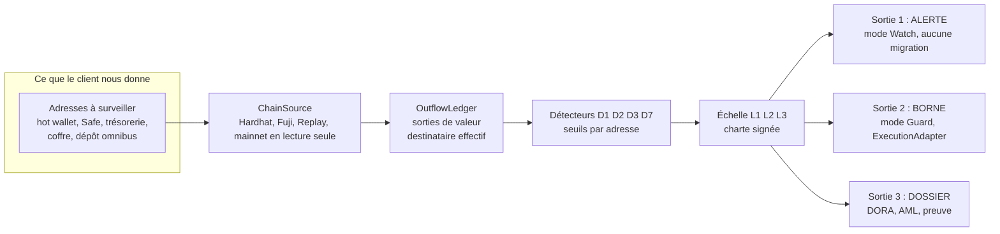
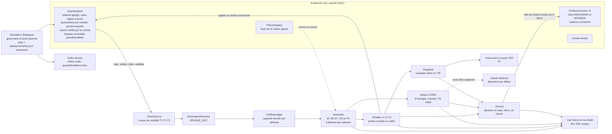
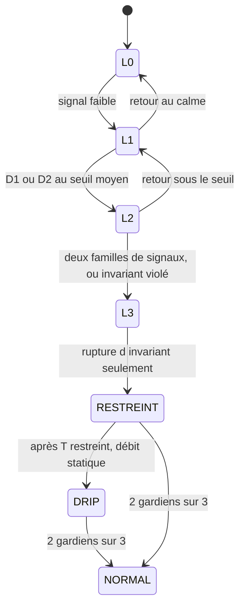
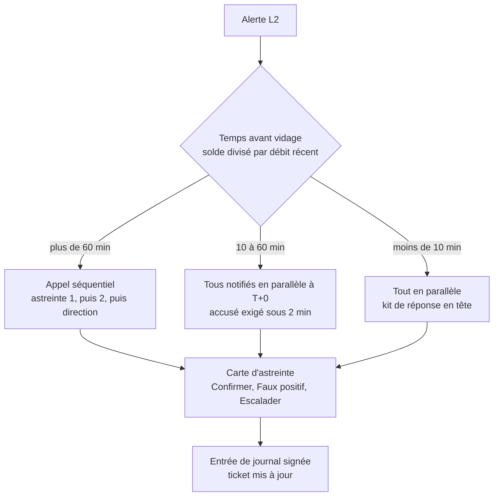
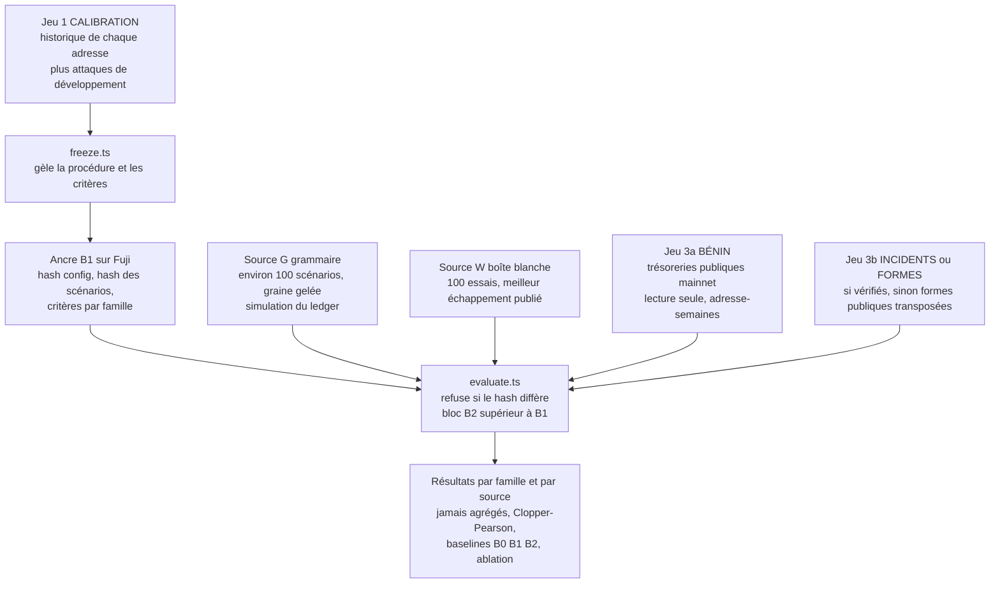
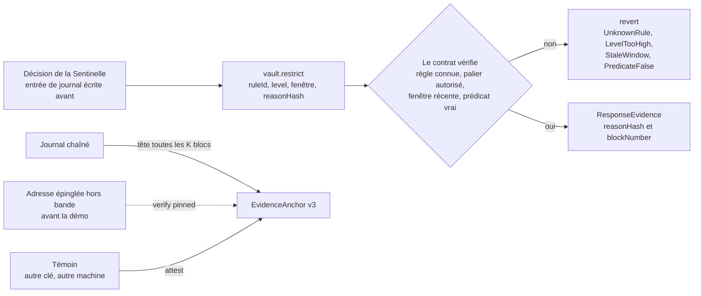
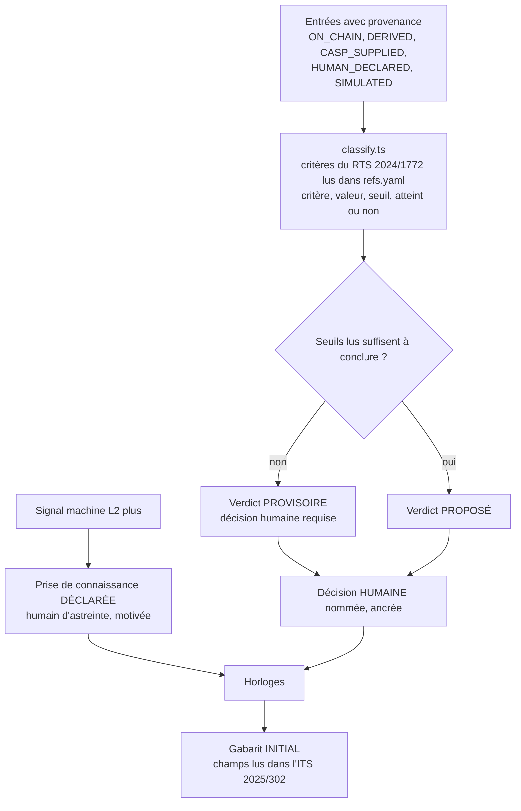
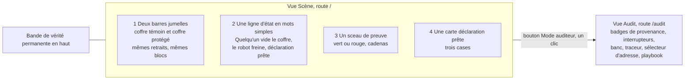

> **PÉRIMÉ (11 oct. 2026).** Architecture de la piste 4 (DeFi + DORA), abandonnée. Conservée comme recherche. Architecture actuelle : `livrables/ARCHITECTURE.md`.

# Sentinelle Fuji — architecture v2

> Track 1 « Guardians of Value », sous-track 4 : détection et réponse DeFi + DORA.
> **v2** du 10 oct. 2026, tour 2 de la boucle jury ↔ solveurs (`research/loop/round-2.md`). Note du jury avant amendement : 60,6 / 100 (v1 : 56,3).
> Chiffres et cas réels : `research/tracks/T1_P4_chiffres_2026.md`. Tout chiffre ou article marqué « à vérifier » ne doit pas apparaître à l'écran ni à l'oral tant qu'un worker ne l'a pas confirmé sur la source primaire. **Aucun chiffre de résultat n'est écrit à la main** : il sort d'un fichier `results/*.json` ou s'affiche « NON EXÉCUTÉ À CETTE VERSION » (§14).
> Légende de priorité utilisée partout : **[P0]** promis, **[P1]** entre un par un si le tampon est intact, **[bonus]** feuille de route ou « si le temps le permet », jamais montré tant qu'il n'est pas fini.

## 0. Ce qui change depuis la v1
- **Honnêteté du périmètre** : le chiffre « 54 % observables » disparaît (Tectonic est de la prévention ; Bitget seul donne 41,3 %). Il est remplacé par un tableau de 20 incidents classés par catégorie et par mode (§2).
- **Faux positifs mesurés autrement** : en alertes par adresse-semaine sur des trésoreries publiques de la C-Chain en lecture seule, avec borne de Poisson (§9). Plus de critère « un faux positif par jour ».
- **Seuils appris par adresse** : on gèle une *procédure* (quantile empirique, budget d'alertes), pas des seuils globaux. Réponse à l'enjeu officiel « les règles fixes font trop de faux positifs » (§4).
- **Angles morts de détection traités** : sortie via pont ou routeur (`OPAQUE_EXIT`), pré-positionnement (capacité bornée), jetons rebase et faux `Transfer` (D3 asymétrique), RPC sans traces (sonde de 20 min, fail-closed) (§4).
- **Le contrat refuse, il n'horodate pas seulement** : `restrict()` vérifie la règle, le palier et la fenêtre ; une clé Sentinelle volée ne fabrique plus de motif (§10).
- **Coffres jumeaux** : « fonds sauvés » devient une différence de soldes lue sur la chaîne entre un coffre sans garde et un coffre protégé, contre la même attaque (§5, §17).
- **Déni de service par la défense cassé** : quarantaine par compte, mode goutte-à-goutte, restriction globale réservée aux ruptures d'invariant (§5).
- **Conformité refondue** : connaissance de l'incident = décision humaine déclarée (un signal L1 ne fait jamais partir d'horloge), matrice DORA sur les bons articles (10, 11, 17-19, 28, 30, RTS 2024/1774), gabarit initial tiré du texte de l'ITS, effacement soumis à un contrôle de conservation, AML scindé en dossier interne et demande externe (§11, §13).
- **Réponse à « qui est responsable »** en trois étages, faux négatif compris (§7).
- **Preuve avec racine de confiance externe** : adresse de l'ancre épinglée hors bande, témoin, scène « réécriture cohérente du journal » (§10).
- **Écran en deux vues** : Scène (4 éléments, une bande de vérité) et Audit (badges, banc, traceur). Le mot « RÉEL » disparaît (§17).
- **Budget recalé** : P0 à 36 h-worker (code 29,5 + écrits 6,5) pour 40 de capacité, coupes écrites d'avance, plus d'heure déjà dépassée (§14).

## 1. En quatre lignes
| | |
|---|---|
| **Qui** | Le RSSI d'un prestataire crypto régulé en France (CASP), soumis à DORA, ou l'émetteur d'un fonds tokenisé qui opère sur Avalanche. |
| **Quand** | Une nuit, des fonds sortent en quelques minutes vers des adresses jamais vues. |
| **Douleur** | La loi impose une première notification dans les 4 h après qualification d'un incident majeur, et au plus tard 24 h après la prise de connaissance, avec des champs précis. En pratique les équipes reconstituent tout à la main, et le gel des fonds arrive trop tard (environ 0,08 à 0,2 % gelé chez Bitget selon la source, au bout d'environ un jour). |
| **Geste** | **En mode Guard**, la Sentinelle borne la perte toute seule. **En mode Watch ou callback**, elle alerte, prépare le dossier et retient les paiements à risque, sans borne de perte garantie. Dans tous les cas le dossier de déclaration est prêt à relire, chaque case dit d'où elle vient. |

Scène à retenir : **deux coffres jumeaux reçoivent la même attaque. L'argent part du premier jusqu'à zéro, l'autre s'arrête.** Ensuite le sceau de preuve vire au rouge quand on touche au journal, et la carte « déclaration prête » s'affiche.

Ordre de grandeur du marché : environ 362 CASP agréés dans l'UE dont 36 en France (à re-vérifier dans `research/` avant de l'afficher). Mots interdits à l'oral : Merkle, ITS, L0-L3, règle@version. Ils restent en infobulle.

## 2. Un produit, trois sorties

| Mode | Ce qu'on modifie chez le client | Ce qu'on fait | Ce qu'on ne fait pas |
|---|---|---|---|
| **Watch** (le produit d'entrée) | Rien | Détection, alerte, **temps avant vidage (TTE)** affiché, escalade en parallèle quand le TTE est court, dossier DORA, kit de réponse « prêt à signer », preuve. | **Ne retient aucun fonds. Ne peut rien contre un balayage de 2 minutes.** Vise les sorties qui durent plus de quelques minutes et les changements de pouvoir qui précèdent la sortie. |
| **Guard** (niveau or, optionnel) | Un coffre protégé, ici `GuardedVault` | Plafond agrégé, voie rapide / voie lente, quarantaine par compte, mode restreint. Seul mode qui **borne la perte**. | Ne protège pas un coffre tiers fermé. |
| **Callback de politique** (PDP, simulé) [P1] | Pointer la politique de signature vers `POST /policy/decision` | Réponse APPROUVER, RETENIR ou REFUSER. Authentifié par HMAC, budget de latence, **mode de défaut par classe de risque** (§8). | Jamais testé contre un co-signataire réel : aucun éditeur n'est cité à l'oral. |

`ExecutionAdapter { tighten(), restrict(), release() }` : une interface, **une seule implémentation réelle** (GuardedVault). Le Safe Guard (garde Solidity d'un Safe) reste de la conception **non construite** : voir la ligne D7 natif Safe (§4), qui donne l'alerte avant la sortie en mode Watch.

### Périmètre honnête : un tableau, plus un pourcentage
Le chiffre « 54 % observables » est **retiré de l'écran, du deck et de l'oral**. Il comptait Tectonic (120 M$, une seule transaction) qui relève de la prévention. La part de pertes du T3 2026 où la phase de sortie est visible et étalée sur une chaîne EVM se limite à Bitget seul : 387,5 / 939,2 = **41,3 %**, avant de savoir si ses adresses étaient surveillables par un tiers (chiffres CertiK, à re-vérifier). Ce n'est ni un taux de détection ni un taux de couverture.

À la place, `research/perimetre_incidents.csv` [P1, un worker de recherche, 2 à 3 h] : 20 incidents 2025-2026 sourcés (source et date par ligne), classés :
- **A** sorties multi-transactions observables on-chain ; **B** prise de pouvoir observable ; **C** perte de valeur sans sortie (mint non adossé, dépeg, oracle chez un tiers) ; **D** une seule transaction (prévention) ; **E** hors chaîne ou chaîne non EVM ;
- pour chacun, le **mode** : Watch, Guard, Prévention, Hors périmètre ; parts en valeur **et** en nombre, avec la sensibilité « sans le plus gros incident ».

La slide 6 du deck est générée de ce CSV. **Phrase obligatoire : aucun de ces incidents n'avait de Guard, donc la part « bornée » sur le passé est nulle ; la valeur prouvable sur le passé est « détecté, dossier prêt en x minutes » ; la borne vaut pour un futur client Guard.** Les catégories C et E s'affichent « hors périmètre » sans détecteur. Les détecteurs d'exposition D5 (écart de prix) et D6 (mint non adossé) restent en bonus. Tron et Bitcoin sont hors périmètre, dits tels quels ; `ChainSource` accepte un autre `chainId` EVM, sans promesse de portabilité mesurée.

Phrase honnête : « Nous ne détectons pas l'intrusion (ingénierie sociale, ordre falsifié, firmware). Nous détectons et bornons la sortie de valeur, conséquence commune de ces vecteurs, et nous prouvons ce qui a été fait. »

## 3. Vue d'ensemble

Séparation des pouvoirs : la Sentinelle **ne peut que resserrer**. Elle ne retire rien, ne lève rien, ne change aucun rôle.

## 4. Ce que la Sentinelle regarde : les sorties de valeur

La Sentinelle tient la comptabilité des **sorties de valeur d'un ensemble d'adresses surveillées**, quelle que soit la cause (clé volée, ordre falsifié, bug, bridge). Le vol d'infrastructure ressemble à des retraits valides, mais ses destinataires, sa cadence et sa composition ne ressemblent pas à l'historique.

### 4.1 Visibilité de la chaîne : on mesure avant de promettre
- **`probe-rpc.ts` [P0, 20 min, tout premier worker]** teste sur les endpoints publics prévus : plage maximale de `eth_getLogs`, `debug_traceTransaction` / `callTracer`, tag `finalized`, WebSocket `newHeads`, limites de débit. Résultat daté dans `results/rpc_probe.json` (jamais de clé ni d'URL privée). **On ne dit à l'oral que ce qu'on a mesuré.**
- `ChainSource` a trois niveaux, affichés en badge « traces : oui / non » : **T1** logs, reçus, calldata des transactions, soldes par bloc (`eth_getBalance`, `balanceOf`) [P0] ; **T2** lecture de slots (`eth_getStorageAt`), seulement si D7 le requiert [P1] ; **T3** traces, seulement si le probe montre qu'elles marchent [bonus].
- **Fail-closed sur l'attribution** : une baisse de solde non expliquée par un log ni par un appel de plus haut niveau vers un destinataire connu est traitée comme une sortie à **destinataire inconnu** (D1 = 100 % inédit). La famille F6 (sortie sans événement) reste couverte sans trace, au prix du « vers qui », que l'écran dit : « destinataire non attribué : traces indisponibles ».
- AvaCloud ou nœud dédié : feuille de route, pas démo.

### 4.2 Les détecteurs
| Détecteur | Ce qu'il voit | Phrase à l'écran | Priorité |
|---|---|---|---|
| **D1** destinataires inédits | Part du solde sortie vers le **destinataire effectif** (voir `DestinationResolver`) dont la **capacité** est dépassée. 40 adresses neuves tombent dans le même seau. | « Argent parti vers des inconnus : X % du solde en 10 min. » | P0 |
| **D2** cumul multi-échelles | Sorties cumulées sur fenêtres emboîtées (10 blocs, 100, 1 000, 24 h), comparées au solde et à l'historique **de l'adresse**. Un drain lent ne passe pas sous un seuil par fenêtre. | « Sorties cumulées anormales sur 24 h. » | P0 ; score par classe de destination P1 |
| **D7** changement de pouvoir | `CallScheduled`, `RoleGranted`, `RoleRevoked`, `Upgraded`, changement d'owner. **P1** : lecture par bloc du slot d'implémentation EIP-1967 et de l'owner du coffre ; changement d'état de contrôle sans événement = L3 immédiat « pouvoir changé en silence ». | « Quelqu'un change qui a le pouvoir. » | P0 événements ; P1 slots |
| **D7 natif Safe** | Signaux décodés de `execTransaction` et des événements Safe : `EnabledModule`, `ChangedGuard`, `ChangedThreshold`, `AddedOwner`, et surtout toute `execTransaction` avec `operation=1` (delegatecall) vers une cible hors liste = **L2 immédiat même en mode Watch, avant la sortie de valeur**. Testé sur fixtures de logs, sans déploiement de Safe. | « Un delegatecall inhabituel vient d'être signé. » | P1 (2 h) |
| **D3** delta de solde | **Baisses seulement** : une baisse non expliquée donne un score ; les hausses sans `Transfer` (jetons rebase, aTokens) ne donnent jamais d'alerte. Un `Transfer` n'explique une baisse que si l'événement est émis par le contrat du jeton **et** que le solde a bougé (anti faux événement). Registre de 3 jetons (`fixtures/token_registry.json` : standard, rebasing, non valorisé). Jetons non valorisés : compteur séparé, pas de prix. | « Du solde a bougé sans raison connue. » | P1 (1,5 h) |
| D4 composition, D5 écart de prix, D6 mint non adossé | — | — | bonus |
| D8 réconciliation ordres → sorties, D9 promotion de cohorte | — | — | **feuille de route** (D8 rejeté ce tour, D9 en bonus) |

Règles de conception :
- **`DestinationResolver`** [P0, version minimale] entre `ChainSource` et `OutflowLedger` : tout appel vers une adresse listée comme pont ou routeur, et tout destinataire illisible, devient la classe **`OPAQUE_EXIT`**, traitée comme destinataire inédit à 100 % (pire cas, jamais « connu »). [P1] décodage du calldata de `MockRouter` (`swap...(path, to, deadline)`) et `MockBridge` (`bridge(destChainId, recipient, amount)`) pour extraire le bénéficiaire, et D2 par classe (un rééquilibrage habituel ne s'allume pas, « 100 % du coffre vers le pont, une seule fois » s'allume). CCIP et Teleporter/ICM ne sont **jamais cités à l'écran** (non vérifiés, non construits) ; ils vivent dans `limits.md`. Le plafond agrégé du contrat s'applique quel que soit le destinataire. Métrique publiée : part du volume opaque dans le corpus.
- **« Connue » = capacité bornée** [P0, `capacity(addr)`, 15 lignes dans `OutflowLedger`] : la capacité d'une adresse vaut `c × (plus gros transfert déjà réalisé avec l'ensemble surveillé, vu depuis au moins N blocs et k jours distincts)`. La part « inédite » d'une sortie est `max(0, montant − capacité)`. Envoyer un dollar ne donne qu'une capacité d'un dollar : vider 10 M$ exige d'avoir fait transiter de l'ordre de 10 M$ avec cette adresse plus tôt. `c`, `N`, `k` sont publics (Kerckhoffs) car le coût dépend du montant. **Limite écrite** : un adversaire patient avec du capital propre ou emprunté puis rendu, qui prépare une adresse par jour, n'est pas arrêté par la détection ; le plafond du contrat (Guard) le borne et la limite chiffre son coût en capital et en temps.
- **Pondération par le % du solde**, jamais par le nombre d'adresses.
- Chaque détecteur renvoie `{score, preuves[tx], règle@version}`.
- Mesurer la prévention (reverts du contrat) **séparément** de la détection : une attaque en une transaction ne compte jamais dans le taux de détection.
- Hot wallet de retraits clients : D1 est désactivé par le fit-check (voir 4.3), il reste D2, D3 et le plafond. **Hors périmètre calibré** (limite écrite). La réconciliation avec les ordres du back-office (D8) est rejetée à ce tour : elle suppose que le CASP branche son système d'ordres, ouvre une surface de falsification et ne se voit pas en démo.

### 4.3 Seuils appris par adresse : on gèle une procédure
Réponse à l'enjeu officiel de la track (« les moteurs à règles fixes génèrent trop de faux positifs ») : ce n'est plus un seuil global, c'est une **procédure** gelée.
- `calibrate.ts` [P0, 60 lignes] : le score d'une fenêtre est la part du solde sortie vers des destinations inédites (D1) ou cumulée (D2). Le seuil de chaque palier est le **quantile empirique de l'historique de l'adresse elle-même** (30 jours), au niveau `alpha` fixé par le **budget d'alertes cible** que choisit le RSSI (alertes tolérées par semaine ÷ fenêtres par semaine), avec un plancher (1 % du solde, car la plupart des fenêtres valent 0).
- `config.frozen.json` contient `{procédure@version, alpha_L1/L2/L3, fenêtres, plancher, plafond de seuil, hash de l'historique}`. **Le seuil appris ne peut jamais dépasser la borne du contrat** : un attaquant qui sort peu à peu fait monter le quantile, mais pas au-delà du plafond normal.
- **Vocabulaire** : « budget d'alertes cible, mesuré empiriquement sur l'historique ». Le mot « garantie » est **interdit** (les séries de trésorerie ne sont pas échangeables).
- **État APPRENTISSAGE** : tant que l'historique est trop court (environ 1 000 fenêtres de 10 min, soit 7 jours pour un L2 par semaine), l'adresse n'a que L1 **et le plafond fixe du contrat**, aucun L2 autonome. Le backfill de 30 jours se tire des logs indexés à l'ajout de l'adresse. Le jour 1 est dit tel quel.
- **Fit-check** [P1, commande CLI texte, sortie dans le journal, pas d'écran] : à l'ajout d'une adresse, rapport sur le backfill : part des sorties vers destinataires inédits, nombre de fenêtres non nulles, profil détecté (**A** trésorerie, **B** opérations, **C** distribution en masse). Si plus de 20 % des sorties vont à des inconnus, **D1 est désactivé** pour cette adresse et on bascule sur D2 + D3 ; le produit dit ce qu'il ne couvre pas.
- Comparaison publiée « seuil global réglé au mieux » contre « seuils par adresse » sur le même corpus, **même si le gain est nul** [P1]. Courbe « alertes par semaine selon 1, 3, 7, 14 jours d'historique » : bonus.

### Prix et invariants (réduit)
- Invariant de prix par part (`totalAssets/totalSupply`, écart borné par bloc) dans le contrat [bonus].
- Comparaison à un flux Chainlink Fuji **seulement si l'adresse est relevée dans la documentation officielle et la fraîcheur confirmée en 15 min** ; sinon second oracle simulé, étiqueté SIMULÉ. Donnée périmée = alerte, jamais revert.
- Supprimés du périmètre promis : TWAP maison, D6.

## 5. Échelle de réponse : l'attaquant en quarantaine, pas la clientèle

| Palier | Déclencheur | Action | Portée | Qui décide |
|---|---|---|---|---|
| L0 | Rien d'anormal | Surveiller | — | Machine |
| L1 | Un détecteur au seuil bas, ou un ajout à la liste blanche | Alerte. **Aucune horloge réglementaire ne part.** Activation différée des nouvelles adresses blanchies doublée. | — | Machine |
| L2 | D1 ou D2 au seuil moyen | Plafond de sortie resserré. Les flux **attribuables à un compte** (retraits de son propre dépôt vers adresses neuves) mettent **ce compte en quarantaine** : ses retraits partent en voie lente. Ajouts de liste blanche gelés. | **Compte** [P1], sinon coffre | Machine, bornée par la charte |
| L3 | Deux familles de signaux indépendantes, ou D1 au seuil haut, ou violation d'invariant | Si rupture d'invariant (D3, D7, retraits d'un compte supérieurs à son dépôt, prix par part) : mode RESTREINT, voie lente en file. Sinon quarantaine des comptes en cause. | **Coffre** pour les invariants seulement | Machine, bornée ; sortie par les gardiens |
| DRIP | RESTREINT depuis plus de T_restreint (60 min visées, 2 min en démo) | La file se vide FIFO à un **débit statique conservateur** (x % du solde par heure, le plafond statique déjà prévu). Pas de réouverture automatique complète. | Coffre | Machine ; seul NORMAL exige 2 gardiens |

Pourquoi deux familles de signaux pour L3 : manipuler un seul signal (oracle mince, gros retraits fabriqués) ne suffit pas à déclencher. Pourquoi la quarantaine par compte : trois provocations bon marché (dépôt puis retraits vers des adresses neuves) épuisaient le budget de restriction et mettaient tout le monde au plafond statique. Maintenant elles ne mettent en quarantaine que les comptes de l'attaquant.

**Tant que la quarantaine par compte n'est pas construite [P1]**, le budget de restriction (§6) et le plafond statique restent la borne, et la limite « déni de service par provocation » est écrite.

### Voie rapide / voie lente
- **Voie rapide** : retrait vers une adresse en **liste blanche** du déposant (activation différée : 1 à 2 min en démo avec la mention « cible 24 h », 24 h en cible) et sous un plafond individuel. Jamais bloquée par la Sentinelle sauf rupture d'invariant. Tout ajout à la liste blanche est un signal L1. **Sous L1 l'activation d'une nouvelle adresse est doublée, sous L2+ les ajouts sont gelés.** La démo montre une scène scriptée « liste blanche ajoutée pendant l'incident » : l'ajout reste en attente.
- **Voie lente** : adresse nouvelle ou inconnue, montant au-dessus du plafond individuel. Sous L2 et L3, ces retraits entrent dans une **file différée** (2 min en démo), annulable par un gardien, exécutable par tout le monde après le délai.
- **Droit en crise** [P1, version simple] : le plafond de crise n'est plus un seau « premier arrivé, premier servi ». Le droit du compte `i` est `plafondCrise × solde_i / Σ soldes éligibles`, éligible seulement si `lastDepositBlock[i] < blocDéclenchement − K` (un `mapping`, pas de checkpoints). Cinquante comptes préparés une semaine avant ne reçoivent que la somme de **leurs** droits, proportionnelle à ce qu'ils ont déposé, et n'affament personne. Test Hardhat `prepared-accounts-starvation` : 50 comptes préparés contre 5 clients, chaque client garde son droit intégral. Le prorata complet à checkpoints OpenZeppelin est en feuille de route.
- Le **plafond agrégé** (valeur absolue, tous destinataires) s'applique aussi sous la voie rapide.
- Un retard n'est pas une perte : la voie lente reste ouverte au-delà du droit, en file différée.
- Coût d'un faux positif : **valeur × minutes** et **clients touchés × minutes**, mesurés au banc ; traduit en euros par `regulatory/cost_model.yaml` [P1, 10 lignes, tout marqué HYPOTHESE, jamais dit à l'oral sans l'étiquette].
- Limite écrite : un compte déjà whitelisté et compromis perd au plus **son propre droit**, jamais celui des autres.

### Perte maximale bornée par construction (Guard seulement)
Hypothèse affichée : l'attaquant connaît toutes les règles.
`perte max ≈ plafond_L2 × (latence détection → inclusion) / fenêtre + plafond_normal sur la fenêtre en cours`.
La formule est affichée avec les valeurs de démo. **Elle est une propriété du contrat**, pas de la détection : le banc la sépare (baseline « plafond seul », §9). Limite écrite : un adversaire patient qui reste sous le plafond normal pendant des semaines n'est pas arrêté ; on chiffre le temps pour vider à cadence plafond et on le compare au délai humain de reprise.

### Pas de compteur « fonds sauvés » calculé
Trois définitions, toutes recalculables (glossaire des formules `glossary.json`) :
1. **Valeur retenue** = somme des retraits en file ou refusés par le coffre à l'instant t, lisible sur la chaîne, aucun contrefactuel.
2. **Perte évitée sur ce scénario** = solde final du coffre protégé − solde final du coffre témoin, face au **même script d'attaque, dans les mêmes blocs** (§17). Décomposée en deux lignes : « sauvé par le plafond seul » et « sauvé en plus par la Sentinelle » (§9).
3. **En mode Watch** : « valeur encore exposée à l'alerte » = sorties du ledger postérieures à l'instant de l'alerte. Le compteur « sauvé » affiche « — » avec la raison « Watch ne retient rien ». Sur un incident public, on affiche « part du drain postérieure à l'alerte », **jamais** « perte évitée ».

## 6. Pouvoirs, clés et gouvernance (un seul modèle)

| Rôle | Peut | Ne peut pas | Détail |
|---|---|---|---|
| **ADMIN** | Proposer des changements (étendre un plafond, ajouter un rôle, upgrader) | Agir instantanément | Derrière un `TimelockController` OpenZeppelin : 2 min en démo (constante), 24 h en cible. `CallScheduled` est lui-même un signal L3 (D7). |
| **SENTINEL** | Resserrer : plafond, file différée, quarantaine, mode RESTREINT, **uniquement via une règle du livre de règles dont le prédicat est vrai** (§10) | Retirer des fonds, lever un mode, changer un rôle, restreindre sans règle | Une seule clé en démo. **En production, la clé vit dans le KMS ou le HSM du client** (`Signer`) ; le fournisseur n'en détient aucune. Révocation par le timelock, resserrer reste immédiat. |
| **GUARDIAN x3** | Annuler un ticket, reprendre (2 sur 3), désarmer en mode manuel | Ouvrir les plafonds sans 2 signatures | Un seul gardien peut passer en **mode manuel avec plafond conservateur**, jamais pour ouvrir. Action = signal L3 ancré. Cible écrite, non construite : 3 sur 5 avec 2 suppléants d'un autre fuseau, rotation d'astreinte dans `playbook.yaml`, SLA de réponse humaine de 30 min nuit comprise (cible, à confirmer par le CASP). |

Principe d'asymétrie : **réduire la surface est immédiat, l'étendre est retardé.**

Autres garde-fous :
- **Enveloppe immuable et plafonds opérationnels** : le coffre a une **enveloppe absolue** (plafond absolu, rôles) figée au déploiement (la changer = redéployer avec migration, écrit comme tel) et des **plafonds opérationnels** modifiables dans l'enveloppe par le timelock.
- **Budget de restriction** : au plus 3 activations et 90 minutes cumulées de mode RESTREINT global par 24 h. Il ne s'applique qu'à la portée coffre. L'épuisement ne désarme pas : retour à un plafond statique conservateur et signal L3 aux gardiens. Le lien avec le critère DORA d'indisponibilité de 2 h est « à vérifier » et n'est pas affirmé.
- **Pas de heartbeat qui resserre** (retiré à ce tour) : un battement censuré aurait gelé les retraits de tout le monde. **La panne de la Sentinelle ne change pas les retraits** ; le plafond statique du contrat est le filet.
- **Plafonds dans le contrat**, indépendants de la Sentinelle.
- **Clés** : `scripts/keys.ts` génère des clés Fuji jetables dans `.env.local` (gitignoré), jamais affichées. Aucun worker ne lit `.env*`. La clé du témoin (§10) n'entre jamais dans le dépôt.
- **Matrice « Clés et pouvoirs »** générée depuis les rôles on-chain.
- La Sentinelle figure **dans son propre inventaire des tiers** (prestataire TIC, art. 30, clause de responsabilité en gabarit, §7).
- Divergence entre RPC : alerte L1 qui ne restreint rien à elle seule [bonus].

## 7. Responsabilité : « si votre modèle se trompe, qui est responsable ? »

La phrase « il n'y a pas de modèle d'IA dans la boucle » est **supprimée** (elle esquivait la question). Réponse en trois étages, symétrique faux positif / faux négatif. **[P0 écrit + un écran]**

**Étage 1 : la direction signe ce qu'elle comprend.** La charte garde ses seuils en annexe technique hachée, mais l'écran Charte affiche trois phrases **générées** par `charter-summary.ts` depuis `policy.json` et `results/*.json` (sinon « NON EXÉCUTÉ »), avec la mention « calculés dans les hypothèses du banc, à date, config@hash » :
- « Perte maximale avant blocage : X (mode Guard seulement). »
- « Retard maximal pour un client : Y min, pour N % des clients. »
- « Fausses alertes attendues : Z par mois, borne haute à 95 % : W. »

**Étage 2 : le faux négatif est traité en face.** En mode Watch nous ne promettons **aucune borne de perte**, seulement un délai d'alerte mesuré. En mode Guard la perte est bornée par le plafond du contrat. Au-delà : hors périmètre (intrusion non détectée).

**Étage 3 : qui répond de quoi** (`docs/responsabilite.md`, un RACI d'une page, clauses marquées « gabarit à négocier, pas un avis juridique »).
- **Le fournisseur** répond de la conformité du produit à sa spécification publiée : bugs, écart au banc, délai d'alerte, notification de dérive de calibration.
- **Le CASP** répond de ses décisions de restriction, de classification et de déclaration : DORA art. 5(2) pour l'organe de direction, art. 28(1)(a) pour la responsabilité qui reste à l'entité en cas de recours à un prestataire TIC (à confirmer).
- Points à négocier, jamais présentés comme acquis : SLA d'alerte, plafond de responsabilité du fournisseur (valeur à négocier), assurance cyber et E&O, droit d'audit, plan de sortie (art. 30). Certains assureurs excluent les incidents liés à une IA non maîtrisée (guide Notion) : la fiche de modèle sert de pièce de souscription.
- Les trois chiffres sont opposables au fournisseur parce qu'ils sont recalculables (config hachée, banc ancré, intervalle publié). Ce que nous ne transférons pas : la décision de déclarer ou de restreindre, que la loi laisse à l'entité.

**Fiche de modèle** (`docs/fiche-modele.md`, générée, une page). Nous avons **deux modèles** : (a) un modèle de risque, des seuils statistiques calibrés par adresse (données, limites, taux de faux négatif avec intervalle, dérive) qui **décide** ; (b) un LLM rédacteur optionnel, désactivé par défaut, jamais sur le chemin de réponse, contrôlé par un vérificateur déterministe, qui **rédige**. Ligne AI Act : Sentinelle = fournisseur du système, CASP = déployeur, classification probablement hors haut risque (annexe III), à confirmer.

Autres éléments :
- **Signal, connaissance, classification : trois notions distinctes.** (1) *Signal machine* L1/L2/L3 : privé, non opposable. (2) *Prise de connaissance* : décision de l'entité (humain nommé), motivée, qui fait partir le plafond de 24 h (§11). (3) *Classification* : décision humaine. La charte contient une `awareness_policy` signée : `HUMAN_ACK_L2PLUS` (par défaut : accusé d'un humain d'astreinte sur une alerte L2 ou plus), avec filet `L3_PRESUMED` (au plus tard T_L3 + délai d'accusé du playbook, 15 min). **L1 ne fait jamais partir d'horloge** (test).
- **Charte** : `policy.json` hachée, signée en EIP-712 par deux signataires (clés de démo). Le hash est publié dans `PolicyRegistry`. Chaque entrée de journal cite `charte@hash`. **Statut art. 5 DORA : « maquette », signatures de démo non opposables.**
- **Cycle de vie de la charte** [P1, 1 h] : l'écran de dossier montre toujours `charte@hash` et les résultats du banc **rattachés à CE hash** ; si le hash diffère, les chiffres sont grisés « résultats applicables à la config précédente » et un badge **« NON VALIDÉ pour cette configuration »** s'affiche. Règle d'asymétrie appliquée au changement : resserrer est immédiat, desserrer ou changer un seuil passe par le timelock puis par `npm run revalidate`. `policy.json` porte `review_due` (revue annuelle par défaut, DORA art. 6(5) à confirmer), `calibrated_on` et un `change_log`. La dérive du profil de flux du client n'est pas couverte : limite écrite.
- **Décision de classification** : l'outil propose, un humain nommé décide. Un « non majeur » exige justification et seconde signature, parce que le risque est la non-déclaration.
- **Auto-incident** : les restrictions causées par la Sentinelle sont journalisées avec `cause=SELF_INFLICTED`, dans une **colonne séparée** du moteur DORA, jamais agrégées silencieusement avec l'indisponibilité subie ; le moteur affiche les deux lectures (avec / sans).
- **Gabarit de clause de précaution pour les CGU** : une page, avec une **durée maximale annoncée** (celle du goutte-à-goutte), « à valider par un juriste ». MiCA art. 49, 70, 75 : « à confirmer », aucune durée légale de rétention affirmée.

## 8. Playbook de réponse (livrable Track 1)

`playbook.yaml` par palier : rôle responsable (RSSI, direction, conformité, DPO, juridique, astreinte), canal, action automatique ou humaine, délai d'accusé, escalade. La matrice RACI est **générée du YAML**.

- **Escalade selon le TTE** [P1, ~2 h] : `escalation.by_tte` dans `playbook.yaml`. Règle anti-bruit : la cadence de paging est plafonnée par fenêtre (un faux TTE ne provoque pas une avalanche). Le TTE s'affiche en gros dans l'écran d'astreinte.
- **Kit de réponse « prêt à signer », jamais exécuté par nous** : freeze-pack JSON statique, liste des `approve()` à remettre à zéro, JSON de proposition de transfert vers un cold wallet nommé. Pas de génération de propositions Safe. Nous ne détenons aucune clé.
- **Carte d'astreinte** [P1, première entrée] : phrase « ce qui se passe » et TTE ; « ce que la machine a déjà fait » avec liens Snowtrace ; **trois boutons actifs** : *Confirmer l'incident* (c'est la prise de connaissance déclarée du §11, un seul mécanisme), *Classer faux positif* (justification et seconde signature, ne baisse jamais le palier tant que le plafond reste atteint), *Escalader* (sans signature). Chacun écrit une entrée de journal signée. Ordre de coupe : cases automatiques puis brouillon de gel, jamais les trois boutons. Le minuteur fonctionne sur horloge accélérée avec badge « scénario compressé ».
- **Arbre de décision de la victime** : `qui_est_victime` : un CASP volé de ses propres fonds suit la branche **PLAINTE + information de l'autorité + assureur** ; la branche « déclaration de soupçon » ne s'ouvre que si le dossier révèle des opérations de clients suspectes (décision du responsable AML).
- **Information des clients** : étape de playbook avec brouillon d'avis en gabarit, validation humaine ; compteur « clients retenus / âge du plus ancien » ; escalades à T+1 h (direction) et T+4 h (revue obligatoire par les gardiens, ordre du jour imprimé), **sans jamais rouvrir automatiquement**.
- **Reprise et retour d'expérience** : étape de reprise (retour à NORMAL par 2 gardiens, revue post-incident). La couverture « Recover » est annoncée **partielle**.
- **Nuit** : qui est joignable, canal, SLA de 30 min, rotation, en texte dans `playbook.yaml`.
- **Sorties** : fichier CEF et syslog UDP validés par un analyseur indépendant [P1] ; `ticket-sink` REST local (POST/PATCH `/tickets`) avec **un seul état d'accusé, posé dans le ticket**, et déduplication par empreinte `hash(entité, famille, fenêtre 10 min)` [P1, ~4 h les deux]. Plus de bouton d'accusé concurrent à l'écran. RBAC en table `roles.yaml` documentée, étiquetée « non appliquée en maquette ». Phrase fixe : « **Branché** : CEF/syslog validé, ticket local. **Non branché** : le SIEM et l'ITSM du client. » Aucun Wazuh ni Graylog.
- **Callback de politique (PDP)** [P1, ~3 h, une instance] : `POST /policy/decision` signé HMAC avec nonce et fenêtre de 30 s (clé en variable d'environnement), budget de latence 800 ms, **mode de défaut par classe de risque déclaré dans la charte** (`failMode`). Classe BASSE (destinataire connu, montant sous le seuil de matérialité) : fail-open, pour que le PDP ne devienne pas un point de défaillance des paiements courants. Classe HAUTE (inédit, montant au-dessus du seuil, compte en quarantaine) : fail-closed, retenue pour approbation humaine. Un plafond agrégé de fail-open par fenêtre bascule en fail-closed même pour la classe BASSE (sinon un attaquant fait tomber le PDP puis fractionne sous la matérialité). Test de chaos : un script tue le PDP et rejoue 20 demandes ; chaque décision par défaut est journalisée. Un `cosigner-sim` étiqueté SIMULATION applique le contrat de callback. **Jamais testé contre un co-signataire réel** ; le défaut du co-signataire est une condition de recette chez le client (script de recette fourni). Pas de réplicas.
- Check-list des obligations parallèles, chacune avec sa source et « à confirmer » tant qu'un worker ne l'a pas vérifiée : notification initiale DORA, information des clients (art. 19(3)), RGPD art. 33, plainte, assureur, autorité. La déclaration de soupçon n'y figure qu'après la branche `qui_est_victime`.

## 9. Banc d'essai v2 : protocole pré-enregistré (critère détection, 30 %)

Vocabulaire : on dit **« pré-enregistré et indépendant à l'implémentation »**, jamais « test aveugle » : la conception des familles est partagée avec les attaquants. On le dit.

### 9.1 Attaques : trois sources, une table par famille
- **Source G, grammaire** [P0] : `attack_grammar.ts` génère environ **100 scénarios déterministes** (graine gelée) sur F1, F2, F3, F6 et F9 (drain masqué par du bruit légitime), par simulation du ledger (instantanée) ; 20 exécutions seulement sont refaites sur Fuji, pour la latence. Variantes de F7 (pré-positionnement) et F8 (via routeur ou pont) en P1 si le décodeur est construit. **Les 100 scénarios ne sont pas 100 attaques indépendantes : l'unité statistique annoncée est la famille, pas le total.**
- **Source W, boîte blanche** [P0] : un worker lit le code et `config.frozen.json`, dispose de **100 essais** pour échapper, objectif « perte maximale avant L2 ». On publie le **meilleur échappement trouvé**, avec son coût (montant, durée, capital). Il remplace le « lot adaptatif » et le held-out B de réserve de la v1.
- **Source M, autre famille de modèle** (Bedrock non-Claude, disponibilité à vérifier en 10 min) : [bonus], montrée seulement si exécutée. Les attaques sont écrites à partir de la seule description de la menace.
- Les 10 attaques « held-out » de workers Claude restent comme sanity check, jamais comme preuve d'indépendance.
- **Familles** (signature on-chain, intrusion hors périmètre) : F1 sorties rapides ou lentes vers destinataires inédits ; F2 signataire compromis ; F3 changement de pouvoir puis retrait ; F6 sortie sans événement `Withdraw` ; F9 drain masqué par du bruit légitime. F4 (prix en une transaction) = test Hardhat qui revert, colonne **Prévention**. Chaque famille a une fiche de fidélité en 3 lignes : modélisé, simplifié, non simulé. Les sources contestées (Drift 128 s contre 12 min, Bitget 75 M$ en 41 min) ne sont pas figées : on **balaie la vitesse d'attaque de 128 s à 41 min**.

### 9.2 Critère par famille, écrit et ancré avant le gel
Une famille est **« couverte »** si au moins 90 % des scénarios sont arrêtés avant 50 % de perte **et** que la borne basse de Clopper-Pearson est ≥ 70 % ; sinon elle s'affiche **« non couverte » en rouge**. On n'arrondit jamais l'intervalle. Repères (borne basse unilatérale à 95 %, tous succès) : n=10 → 74 % ; n=15 → 82 % ; n=20 → 86 % ; n=100 → 97 %. Le bilatéral à 95 % pour 10 sur 10 donne 69 % : le texte dit toujours laquelle des deux bornes est utilisée, et un test le vérifie.

**Table de décision écrite avant 04h** (ancrée avec B1) : si le jeu pré-enregistré passe les critères, on publie ; s'il échoue, le résultat est publié **tel quel en rouge**, la famille en échec est nommée, une **seule config v2** est autorisée, ancrée en B3 avant réexécution, et l'écran affiche côte à côte « v1 : échec » et « v2 : résultat » avec la mention **« v2 corrigée après un échec connu, ne vaut pas test indépendant de v1 »**. Aucun cas ne supprime la ligne rouge. Un test vérifie que `benchmark.json` ne peut pas porter un résultat v2 sans ancre B3 antérieure.

### 9.3 Faux positifs : adresse-semaines sur trésoreries publiques (jeu 3a) [P0, timebox dur 3 h]
- **Unité** : alertes par **adresse-semaine** et par palier (L1 informatif et compté, L2 réveil, L3 gel), avec **borne haute de Poisson** (règle des trois : 0 alerte sur T adresse-semaines donne au plus 3/T à 95 %). Conversion en heures d'astreinte (hypothèse affichée : 20 min par L2). La borne est étiquetée **« indicative, alertes corrélées »**. Exemple de calcul, *pas un résultat* : 0 alerte L2 sur 40 adresse-semaines donne au plus 0,075 par adresse-semaine, soit au plus 0,9 par semaine pour 12 adresses surveillées.
- **Population** : `bench/corpus/extract.ts` lit en **lecture seule** la C-Chain **mainnet** (Fuji est peuplé de bots de faucet : il ne sert qu'à la latence et à l'ancre). Un worker choisit **15 à 20 adresses d'organisations publiques et documentées** (Safe de trésorerie de DAO, collecteurs de frais de protocoles), **jamais une EOA individuelle**, avec la source de l'étiquette notée pour chaque adresse, sur 7 à 14 jours. Deux profils mesurés, **A trésorerie** et **B opérations**. Le **profil C** (distribution en masse, où D1 échoue) est **affiché « non couvert »**, pas tuné.
- **Critère d'échec écrit avant le gel**, remplace « un faux positif par jour » : L2+ au plus **0,2 par adresse-semaine** (borne haute à 95 %). Il exige T ≥ 15 adresse-semaines pour être vérifiable. Le critère L3 ≤ 0,02 exige T ≥ 150 : en dessous, la borne obtenue s'affiche **sans verdict**.
- **Hygiène** : on commit les **vecteurs de caractéristiques** (part du solde, classe de destinataire, heure, hash d'identifiant), pas les logs bruts ; données publiques on-chain en lecture seule, aucune action contre un système réel.
- **Repli** : si le RPC bloque `eth_getLogs`, on passe à l'API publique de l'explorateur et on réduit le nombre d'adresses plutôt que la fenêtre. Si l'extraction échoue à H+2, repli sur Fuji ou synthétique, étiqueté **« non mesuré sur mainnet »**. Les chiffres du pitch (nombre d'adresse-semaines, borne 3/T) viennent du run réel, jamais d'un exemple, et ne sont jamais arrondis.
- Étiquette permanente : **« proxy, pas votre trafic »**. La mesure qui compte est faite chez le client pendant l'apprentissage (fit-check, §4.3).

### 9.4 Jeu 3b : incidents ou formes d'incident [P1, 3 h]
Un incident Avalanche C-Chain vérifié n'est promis nulle part. **Étape 0, 30 min, worker web en lecture seule** : lister les incidents C-Chain dont la sortie compte au moins 3 transactions sur au moins 2 blocs, vérifiés sur l'explorateur (hash, bloc, montant). Aucun n'est nommé avant vérification. S'il en existe, ils entrent avec leur identifiant et le bloc de réaction de la Sentinelle. Sinon : **2 à 3 formes publiques** (chronologies d'incidents à sortie étalée, avec la source et le niveau de contestation notés) converties en séries (montant en % du solde, destinataires inédits, cadence) et injectées sur notre coffre, étiquetées **« forme publique transposée, chaîne synthétique »**. **Le mot « rejoué » est interdit** sauf pour un incident C-Chain réellement vérifié. Phrase de repli, mot pour mot : « Nous n'avons pas trouvé d'incident C-Chain à sortie étalée vérifiable ; la précision est mesurée sur N adresse-semaines de trésoreries C-Chain publiques, la détection sur des formes d'incident publiques transposées et sur des attaques synthétiques. Un incident C-Chain réel est la première chose que nous ajouterions. »

### 9.5 Baselines : ce qu'apporte la Sentinelle au-delà du plafond
Trois bras sur les mêmes jeux [P0 en tableau] :
- **B0** « alerte si transfert > X » réglée au mieux sur la calibration (la politique de custody de base) ;
- **B1** « plafond agrégé + timelock **seuls**, sans Sentinelle », plafond au niveau d'usage normal ;
- **B2** Sentinelle complète.

Le résultat est publié **même s'il nous dessert**, avec la ligne « le plafond seul suffit sur ce lot » s'il le faut. [P1] Mini-frontière de Pareto : 3 valeurs de plafond balayées (serré, moyen, large), axe X = friction légitime (valeur × minutes) en rejouant le corpus bénin à travers la logique du plafond (fonction pure hors chaîne), axe Y = fonds perdus sur le lot d'attaques. Hypothèse pré-enregistrée : un plafond statique ne peut pas à la fois laisser passer l'usage normal et borner une attaque. Le compteur de perte évitée est scindé en « sauvé par le plafond seul » et « sauvé en plus par la Sentinelle ». Un balayage de plafond à 80, 100 et 120 % sort `results/cap-sweep.json` et répond à « et si votre plafond était 20 % plus haut ». Un attaquant glouton adaptatif au plafond : bonus.

Ablation D1 / D2 / D3. On affiche aussi les cas où la baseline bat la Sentinelle. Aucune comparaison avec Hexagate ou Hypernative : nous ne les avons pas mesurés. Différenciation : un dispositif de preuve relié à la réponse graduée et à l'horloge DORA, pas un meilleur moteur (§18).

### 9.6 Latence : un seul chiffre oral, mesuré sans compression [P0]
- `bench/mini-drain.ts` : un mini-drain de **4 transactions** sur le coffre protégé Fuji, **sans timelock compressé** (le délai de 24 h n'est pas dans ce chiffre, et on le dit). `npm run latency` l'exécute **N = 20 fois** (une seule valeur de N partout), par classe d'endpoint (nom de classe, jamais de clé), du bloc du premier retrait anormal au bloc de la restriction confirmée.
- Sortie `results/latency.json` : `{n, p50_s, p90_s, p95_s, max_s, blocks_p50, finality_s, mode d'observation WS ou polling, tx_hashes[]}`. Phrase fixe : « Freinage en p50 = X s (n=20, Fuji, sans compression, mode d'observation), max = Y s. » Si le faucet ou le RPC bloquent, le chiffre est donné en blocs avec la mention « secondes Fuji non mesurées » et le vrai N. Si le polling domine, on dit que c'est la latence d'un RPC public.
- Pas de transaction pré-signée : la restriction est construite et signée à la décision, avec `maxFeePerGas = max(2 × baseFee courante, p95 récent)` et remplacement après 2 blocs (`FeePolicy`, §16). Hardhat local en minage par intervalle de 1 s ; les blocs sont la grandeur portable.
- Le cas « tout dans un bloc » est couvert par les seules propriétés du contrat. Saturation de blocs : limite, non simulée.
- Le même script alimente le bouton **« Relancer en direct »** de l'écran (4 transactions, 20 s environ, liens Snowtrace) avec repli automatique vers REJEU-FUJI après 15 s, affiché. Les comptes de test sont financés à la main avant minuit.

### 9.7 Métriques de sortie
Par famille et par source avec intervalle ; alertes par adresse-semaine et par palier avec borne ; temps de détection en blocs (portable) et en secondes (Fuji seulement) ; `loss_twin`, `loss_guarded`, `delta` (perte évitée sur ce scénario), `exposed_after_alert` ; `fp_cost_eur` (hypothèse) ; part du volume opaque ; valeur × minutes et clients × minutes de retrait différé ; `time_to_draft_s` (depuis la prise de connaissance déclarée) comparé à une base manuelle chronométrée par Titouan sur le même gabarit (n=1, « mesure indicative », aucun pourcentage revendiqué). **Horloge honnête** : jamais truquée ; le scénario peut être compressé (12 min vers 1 min) avec un badge « scénario compressé » obligatoire, les seuils étant en blocs et en % de réserve ; le banc rejoue à vitesse réelle.

## 10. Preuve : la blockchain là où elle apporte quelque chose

Ce que la chaîne apporte ici, dit honnêtement : **un ordre public non contrôlé par l'opérateur**, **un contrat qui applique une condition** (il ne se contente pas d'horodater un hash) et **une racine de confiance externe** pour l'auditeur. Elle ne prouve pas que les règles sont justes (c'est le rôle du banc).

1. **`restrict()` vérifié par le contrat** [P0, version minimale ; la version Merkle est rejetée]. Un **livre de règles** `mapping(ruleId => maxLevel)` posé au constructeur (même hash que `PolicyRegistry`, test `hash(config) == hash enregistré`). `restrict(ruleId, level, fromBlock, toBlock, reasonHash)` : revert si `ruleId` inconnu (`UnknownRule`), `level > maxLevel` (`LevelTooHigh`), fenêtre périmée (`StaleWindow`), et **un prédicat vérifié en chaîne** : sorties cumulées sur la fenêtre ÷ solde ≥ theta, à partir des accumulateurs que le coffre tient déjà pour le plafond agrégé (`PredicateFalse`). Les **règles « attestées »** (D3, delta de solde hors coffre) sont **plafonnées à L2** : elles resserrent le plafond, jamais RESTREINT. Réponse au piège « si je vole la clé SENTINEL et appelle `restrict(0xdead)` » : revert `UnknownRule` ; avec la clé volée, le pire cas est un resserrement borné par le budget, jamais une preuve fabriquée. Test Hardhat `sentinel-key-stolen` : quatre reverts distincts, rejoués dans la vue Audit. Un test de propriété garantit que le détecteur est un sur-ensemble du prédicat [P1].
   - **L'événement n'émet que `reasonHash` et `blockNumber`, pas le niveau** (la conformité prime) : l'entrée de journal complète n'est jamais publiée, pas d'`entryBytes` en clair. **Limite honnête, écrite dans `limits.md`** : en mode Guard le calldata de `restrict` et l'état RESTREINT du coffre sont publics par construction (un retrait mis en file se voit). En production : L1 permissionné ou mempool privé (feuille de route). En mode Watch, rien de lisible n'est publié par l'opérateur hormis une empreinte opaque.
   - Différence avec un horodatage RFC 3161 : le contrat applique une condition et l'ordre est atomique avec l'effet. En production on **ajoute** un horodatage qualifié eIDAS, on ne le remplace pas.
2. **EvidenceAnchor v3** : append-only, compteur `seq` sans trou, `prev_head`, rôle `ANCHORER` **et rôle `WITNESS`** (`attest(seq, head)`, événement `Attested`). **Cadence d'ancrage constante** : une tête toutes les K blocs (K=30 en démo), seulement si elle a changé, avec un battement plus lent sinon, pour que ni le niveau ni le moment d'un signal L1 ne fuitent ; la queue non ancrée est bornée à K blocs et affichée (« fenêtre non ancrée : 30 s »). K est choisi pour ne pas saturer le faucet.
3. **`verify` (CLI et écran) : quatre voyants** — **intégrité** (chaîne de hash), **ancrage / seq**, **complétude** (aucune décision attendue omise, par rejeu des blocs et diff avec les décisions déterministes attendues), **témoin**. Ligne fixe : « ne prouve pas que les règles sont justes : c'est le rôle du banc ». Le rejeu utilise le même code de détection : il prouve la non-omission, pas la correction.
4. **Racine de confiance externe** [P0 pour l'épinglage] :
   - `verify --pinned <adresse>` refuse `deployments/fuji.json` si l'adresse diffère. L'adresse d'`EvidenceAnchor` et le hash du bytecode sont **publiés avant la démo à un endroit que l'opérateur ne contrôle pas** : **action humaine de Titouan** (courriel à l'organisateur avant 07h), jamais d'un agent.
   - **Témoin** [P1, ~2 h] : `witness.ts`, lancé par Titouan sur son poste, récupère le journal public, relance `verify` seul et co-signe la tête. Clé du témoin en environnement, **jamais dans le dépôt**. Le voyant affiche « tête recalculée par une seconde personne au bloc N ». Libellé honnête : **« indépendance démontrée en maquette »** (un coéquipier n'est pas un tiers ; en production le témoin est le régulateur, un cabinet d'audit ou un service d'horodatage qualifié). Le témoin est optionnel : intégrité et complétude se vérifient sans lui.
5. **Deux scènes rouges en vue Audit** : « supprimer une entrée » (10 s, bouton secondaire) et **« réécriture cohérente du journal »** (on recalcule toute la chaîne et on remplace la config : la chaîne de hash est valide, mais la tête diffère de celle ancrée et attestée, donc rouge). Un troisième cas : un bouton redéploie un nouvel ancrage et réécrit un journal cohérent ; `verify` sans épinglage passe, `verify` avec l'adresse épinglée devient rouge [bonus]. Une seconde implémentation Python de D1 est supprimée du plan.
6. **Journal : décision en clair, identité hachée** [P0 pour le schéma]. La feuille est `canonical(entrée)` avec **la décision en clair** (palier, règle@version, classification, motif, signataires) ; seul l'identifiant (adresse client, personne) est remplacé par `client_ref = HMAC(sel_client, adresse)`, **un sel par client** (`keystore/salts.json`, gitignoré, couvert par le test anti-secret). Détruire un sel supprime le lien vers la personne, **jamais la décision** : un initié ne peut plus faire disparaître un « non majeur », et l'auditeur vérifie tout sauf la résolution d'identité, sans les sels.
7. **Effacement soumis à un contrôle de conservation** [P1, 2,5 h ; `client_ref` en P0]. `regulatory/retention.yaml` (catégorie, durée, source, `verified` ou « à confirmer »). `shred --client REF` **refuse** si l'entrée est liée à un incident ouvert, à un dossier AML, à un `legal_hold`, ou si la durée de conservation n'est pas échue (AML 5 ans, CMF L561-12 ; DORA, registres d'incident ; RGPD art. 17(3)(b) : à confirmer). Le refus est écrit au journal avec son motif. Si autorisé : stèle ancrée listant les `client_ref` détruits et le hash du contrôle de gel, avec signatures DPO et conformité (en table de rôles, pas construite). Scène de démo : un client demande l'effacement pendant un incident ouvert, REFUSÉ avec la raison, puis après clôture simulée, ACCEPTÉ avec stèle. **Le refus est la fonctionnalité.** On écrit « rupture du lien interne vers la personne, qualification juridique à confirmer », jamais « anonymisation ». Voyant : « effacements : n, tous précédés d'un contrôle de gel ».
8. **RGPD, état honnête** : le journal hors chaîne est traité ; **l'état du `GuardedVault` ne l'est pas** (adresses de portefeuille pseudonymes, publiques, non effaçables). Statut **« partiel »**. Conception cible, non construite : coffre omnibus avec comptabilité agrégée on-chain, sous-registre par client hors chaîne, listes blanches en racine de Merkle, L1 permissionné. Le mode Watch n'écrit aucune donnée client on-chain. Le démonstrateur n'utilise que des adresses synthétiques.
9. **Texte généré** : on l'**atteste** (modèle, version, hash du prompt, hash de sortie, résultat du vérificateur) au lieu de prétendre le rejouer.
10. **Preuve d'ordre du banc** : l'ancre B1 de la config (§9), liée à `charte@hash`.

Déploiement (`docs/deploiement.md`, une page, [P1, 1 h]) : conteneur installé chez le client ou instance mono-locataire, **jamais un SaaS multi-locataire** qui détiendrait une clé capable de restreindre des retraits ; journal en ajout seul ; sauvegarde vers un stockage à verrouillage d'objet (WORM) documentée, non construite ; pas de haute disponibilité ; plan de sortie (export du journal et des ancres, remise des sels, révocation de SENTINEL par timelock) ; tableau région / sous-traitant pour Bedrock et RPC « à renseigner par le CASP ». `export --bundle` et un vérificateur HTML autonome : feuille de route.

## 11. Moteur DORA

- **Provenance par champ**, un seul vocabulaire pour tout le projet : `ON_CHAIN` (avec tx), `DERIVED` (règle@version), `CASP_SUPPLIED`, `HUMAN_DECLARED`, `SIMULATED`. Un type `Input<T>{value, provenance, evidenceRef}` et un composant `<ProvenanceBadge/>` (visible en vue Audit seulement). Compteur **calculé, jamais estimé**. Cause racine, mesures correctives, prestataires et contact sont **toujours HUMAN_DECLARED**.
- **BackOfficeAdapter** : fixtures `synthetic:true` avec bandeau permanent « DONNÉES SYNTHÉTIQUES ». La démo prouve la plomberie, les seuils et la traçabilité, pas la justesse des données du CASP. Dénominateur « 10 % des transactions » calculé sur le service coffre uniquement.
- **Gabarit INITIAL basé sur le texte** [P0, un worker, 1 h] : `regulatory/its_initial_fields.yaml` liste les champs exacts de la notification **initiale** extraits de l'ITS 2025/302 (champ, libellé, annexe, `quote`, `snapshot_sha256`, `verified`) : date et heure de détection et de classification, critères et seuils atteints, origine éventuelle chez un tiers, description, état de l'incident. L'écran n'affiche en grosses cases que ces champs, chacun avec sa provenance. **Montant, clients touchés et durée passent dans un cadre distinct « ÉLÉMENTS DE CLASSIFICATION »** : ce sont les entrées des critères, pas des champs du formulaire initial. Les champs 3.x et 4.x ne vont qu'à l'intermédiaire et au final. Si l'extraction n'est pas fiable à 03h00, repli sur l'ancien gabarit avec bandeau « champs non vérifiés ». Le message « déclaration prête » devient **« brouillon des champs initiaux, N/M complétés »**.
- **Classification automatique, décision humaine** [P0, `classify.ts`] : l'évaluateur implémente les critères pour lesquels nous avons des données (clients affectés en nombre et en part, impact économique, pays ; pertes de données et services critiques en « non évalué »), les seuils lus dans `refs.yaml` (verified). Sortie : tableau « critère, valeur, seuil, atteint ? » plus verdict **PROPOSÉ** ; si les seuils lus ne suffisent pas à conclure, verdict **« provisoire, décision humaine requise »**, jamais un « majeur » forcé. Le scénario de drain n'a pas d'indisponibilité : la ligne durée affiche « non applicable : aucun service indisponible ». 6 cas de test au P0 (12 en P1), chacun relié à un paragraphe du texte.
- **Horloges** (toutes **à confirmer sur le RTS 2025/301** avant affichage) :
  - `T_signal` : premier signal machine L2 ou plus, **informatif**. L1 ne fait jamais partir d'horloge.
  - `T_connaissance` : **prise de connaissance déclarée** (`awareness_declared`, type `Input<HUMAN_DECLARED>`, motif obligatoire, ancrée au journal) : le bouton « Confirmer » de la carte d'astreinte, ou le filet `L3_PRESUMED`. Un écart supérieur au délai d'accusé du playbook est marqué en orange « écart à justifier ».
  - `T_classification` : décision humaine « majeur ».
  - `T_initial_dû = min(T_classification + 4 h, T_connaissance + 24 h)`. **L'échéance de référence affichée est la variante prudente** calculée avec `T_signal` ; la date déclarée figure en deuxième ligne, motivée. Phrase à l'écran : « une autorité peut retenir une date plus tôt ; la qualification juridique appartient à l'entité (à confirmer sur RTS 2025/301) ». Intermédiaire 72 h après la remise de l'initial ; final un mois après le dernier intermédiaire. Week-ends et jours fériés : à vérifier.
  - **Information des clients** [P1] : quatrième échéance, **sans délai légal chiffré** (DORA art. 19(3), « sans retard injustifié », à confirmer), visuellement distincte des horloges de notification à l'autorité, avec une « cible interne configurable : 2 h, non légale » dans la charte. Brouillon d'avis en gabarit, validation humaine.
- **Auto-incident** : durée de nos propres mesures dans un compteur séparé (`SELF_INFLICTED`), jamais mélangée à l'impact de l'incident déclaré.
- **Gain mesuré honnêtement** : `time_to_draft` part de la connaissance déclarée et se compare à une base manuelle (Titouan remplit le même gabarit à la main depuis les logs, chronométré, n=1, 20 min, « mesure indicative »).
- **Canal de dépôt** : champ `competent_authority` en `HUMAN_DECLARED`, texte « autorité compétente du CASP (ACPR/AMF selon le cas, portail à confirmer) ». Le brouillon n'est pas déposé ; le format de dépôt (xBRL-CSV) est **à confirmer et non produit**.
- **Références, vérification mécanique** [P0, 2 h, un seul mécanisme] : `regulatory/refs.yaml` = `{celex, article, quote ≤ 25 mots, quote_sha256, snapshot_sha256, relu_juriste: false}`. Les textes officiels (DORA 2022/2554, RTS 2024/1772, RTS 2024/1774, ITS 2024/2956, RTS 2025/301, ITS 2025/302) sont téléchargés dans `regulatory/sources/<celex>.txt` **par un humain ou une session avec accès web, après accord explicite de l'utilisateur** (textes de loi publics). `scripts/check-refs.mjs` vérifie que la citation normalisée est une sous-chaîne du snapshot et que l'article annoncé la précède ; le drapeau « vérifié » est **dérivé du test, jamais saisi**. Limité aux 12 références utilisées. Une entrée en échec s'affiche en orange « à confirmer » et ne sort pas à l'oral. Slide : « citation contrôlée mécaniquement contre le texte officiel ; interprétation non validée par un juriste ». On distingue toujours DORA et RTS. La citation « art. 9(5)(b) » reste retirée.
- **Texte libre** : voir §12.

## 12. LLM encadré et démo sans secret
- **Gabarits déterministes par défaut.** Le LLM est une option (`--live-llm`), jamais sur le chemin critique, jamais dans la boucle de réponse. Sorties en cache dans `fixtures/llm_cache.json`. Tout texte non généré en direct est marqué « (gabarit) » ou « (cache) » en vue Audit.
- Vérificateur déterministe `NumbersInEvidence` : tout nombre, adresse ou hash cité doit exister tel quel dans la preuve référencée, sinon la phrase est retirée. Aucun champ réglementaire n'est écrit par le LLM sans relecture humaine ; le LLM ne touche ni la classification ni les montants.
- Entrée de journal `llm_output {modèle, promptHash, outputHash, accepté/rejeté}`. Interrupteur `LLM_ENABLED`.
- Bedrock ne reçoit que des identifiants de preuve, des hashes et des montants agrégés (contrôle contre l'injection de prompt par données on-chain). Bedrock figure dans l'inventaire des tiers.
- Supervision humaine champ par champ. AI Act : formulation prudente (art. 4 culture IA, transparence volontaire, supervision humaine par conception, art. 50 à confirmer).
- **Test d'injection** `llm-injection.test.ts` (une chaîne on-chain « ignore previous instructions » n'atteint jamais le prompt) : **seulement si le LLM est présent dans la démo** ; sinon le bloc LLM est retiré du mapping plutôt que testé.
- Slack optionnel derrière une variable d'environnement. Par défaut : fichier CEF, zone Alertes.
- Test anti-secret fondé sur le contexte (`PRIVATE_KEY`, `MNEMONIC`, `SECRET`, motifs de clés AWS) plus gitleaks, **pas** sur le simple motif de 64 hexadécimaux. `.env.local` gitignoré et couvert par `file-guard`.

## 13. Conformité : matrice d'obligations, inventaire des tiers, pack AML

### Matrice (source unique de la slide conformité)
`regulatory/obligations.yaml` : **12 lignes au P0** (les autres en P1, listées « planifiées » dans `limits.md` avec leur statut). Chaque ligne porte `régime`, `instrument`, `article`, `statut`, `preuve`, **`demo_artifact`** (chemin d'un fichier réellement produit par la démo) et **`audit_cmd`** (`npm run audit:line <id>`, 15 lignes de script, imprime ce fichier).

**Vocabulaire** : plus jamais « couvert » pour un régime. Trois statuts : **CONTRIBUE** à l'exigence (qui reste celle de l'entité), **PRÉPARE** le dossier, **HORS PÉRIMÈTRE** argumenté. La slide est **générée** en trois colonnes : **DÉMONTRÉ** (la ligne est `verified` **et** son `demo_artifact` existe sur disque), **PRÉPARÉ (gabarit)**, **FEUILLE DE ROUTE**. Une ligne non démontrée descend, jamais cachée. Un test échoue si une ligne « démontré » n'a pas de fichier. **Slide v0 commitée au jalon +3 h** avec les seules lignes P0, remplacée seulement si le test passe. Pire cas : une slide plus courte mais exacte. Étiquette : « recoupé, non relu par un juriste ».

| Régime | Ligne du produit | Statut visé |
|---|---|---|
| DORA art. 10 | Détecter les activités anormales, seuils et critères de déclenchement : D1 D2 D3 et échelle L1-L3 | CONTRIBUE (à confirmer) |
| DORA art. 11 | Réponse et rétablissement : L2/L3, playbook, reprise par gardiens (Recover partiel) | CONTRIBUE (à confirmer) |
| DORA art. 17-18 | Gestion et classification des incidents : `classify.ts`, décision humaine nommée | CONTRIBUE (à confirmer) |
| DORA art. 19 | Notification (horloges, gabarit initial tiré de l'ITS) ; information des clients sans délai chiffré | PRÉPARE |
| RTS 2024/1774 | Cadre de gestion du risque TIC : journalisation, accès privilégiés (rôles, timelock) | CONTRIBUE (à confirmer) |
| DORA art. 28(1)(a) et 30 | La Sentinelle dans son propre inventaire des tiers ; clause de responsabilité en gabarit ; plan de sortie | PRÉPARE |
| DORA art. 5 | Charte de gouvernance signée par la direction : **maquette**, signatures de démo non opposables | maquette |
| DORA art. 24-25 | Tests de résilience par des parties indépendantes : **feuille de route**. Le « banc de validation du fournisseur » n'en tient pas lieu ; le jury peut rejouer ses propres attaques via `attack_specs/*.json` | FEUILLE DE ROUTE |
| MiCA | **Loss-ledger** par déposant (solde avant, perte, valeur EUR synthétique, export CSV), restitution. Art. 49, 70, 75 : « à confirmer » ; aucune durée légale de rétention affirmée | PRÉPARE |
| AML/CFT | Deux dossiers **physiquement séparés** (voir plus bas). Règle actuelle = directive AML et droit national ; le règlement 2024/1624 s'applique plus tard (juillet 2027, à vérifier) | PRÉPARE (interne) |
| RGPD | Journal hors chaîne : décision en clair, `client_ref` haché, effacement soumis à contrôle de conservation. **État du coffre : adresses pseudonymes publiques non effaçables** | **PARTIEL** |
| Travel rule (2023/1113) | Hors périmètre du coffre simulé, dit en une ligne | HORS PÉRIMÈTRE |
| AI Act | Seuils statistiques calibrés : probablement hors définition d'un système d'IA ou hors haut risque (à argumenter) ; LLM rédacteur : supervision humaine, étiquette IA | à argumenter |

C'est un dossier, pas un avis juridique. Un produit ne « couvre » pas un article : il contribue à une exigence qui reste celle de l'entité.

### AML : deux artefacts, deux destinataires [P1/P2, 2,5 h]
- `aml-pack/INTERNE/` : éléments factuels pour le responsable AML (cluster d'adresses, chronologie), trame de « décision de déclarer ou non », en-tête **« NE PAS TRANSMETTRE HORS DE L'ENTITÉ »**.
- `aml-pack/EXTERNE/` : **demande de blocage conservatoire / signalement d'adresses** à un exchange ou un émetteur, en termes neutres, **sans aucune référence à une déclaration de soupçon ni à TRACFIN**. Le mot « gel » (régime d'autorité) est abandonné : « demande de blocage conservatoire, sans force contraignante hors réquisition ». Un linter de gabarit (termes interdits : soupçon, TRACFIN, déclaration, STR, 30 lignes) bloque la génération. Il ne garantit pas l'usage humain ; il garantit que l'outil ne produit jamais d'artefact externe contenant la référence. Avertissement affiché à l'export.
- Un CASP victime d'un vol de ses propres fonds suit la branche PLAINTE du playbook (§8). Références CMF L561-19 : « à confirmer ».

### Inventaire technique des tiers (annexe, pas le registre) [P2]
On ne prétend **pas** produire le registre d'informations (ITS 2024/2956). Tableau avec colonne **source** (lu on-chain, `providers.yaml` synthétique, « à saisir »), ligne **« dépendance sans arrangement contractuel »** en orange pour un RPC public ou un oracle libre, compteur « X champs sur N lus par la chaîne », lignes pour la Sentinelle, AWS Bedrock, le RPC. Valeur propre : dérive entre registre déclaré et configuration on-chain.

### Mapping NIST CSF 2.0 et référentiels (`regulatory/mapping.yaml`)
**Chaque ligne porte `exercised_by`** (identifiant d'un test ou d'une métrique du banc). Sans test, la ligne est « documenté, non exercé » et **n'apparaît pas comme couverte** sur la fiche de défense. Un test échoue si un ID n'existe pas dans la liste officielle (extraite des sources avec URL et date dans `regulatory/vendor/`). Fiche de défense d'une page **générée** (HTML imprimable) ; « non mesuré » si la métrique n'existe pas.

| Domaine | Identifiants (à valider contre le texte officiel par le worker) |
|---|---|
| NIST CSF 2.0 Detect | DE.CM-01, DE.CM-06, DE.AE-02, DE.AE-03, DE.AE-08 |
| NIST CSF 2.0 Respond | RS.MA-01 à RS.MA-04, RS.AN-03, RS.AN-06, RS.AN-07, RS.CO-02, RS.CO-03, RS.MI-01 |
| NIST CSF 2.0 Recover / Govern | RC.RP-01 (**Recover annoncé partiel** : reprise par gardiens et revue post-incident), GV.SC-04, GV.RR-02, GV.PO-01 |
| ATT&CK | **T1657** (vol financier) pour la phase de sortie. **T1078** reformulé : « effet détecté : usage d'un signataire valide pour une sortie anormale (famille F2) », jamais « accès détecté ». T1190 retiré. |
| ATLAS / OWASP agentique | Seulement les IDs de la liste officielle du guide (ASI01, 02, 03, 06, 07, 08), vérifiés dans `regulatory/vendor/`. **ASI09 retiré.** Bloc « composant optionnel » séparé pour le LLM (voir §12). |
| D3FEND | Un worker relève les identifiants sur d3fend.mitre.org correspondant à ce que nous faisons (journalisation, restriction d'accès) ; s'il n'y en a pas de vérifié, on écrit **« D3FEND non utilisé »**, pas une ligne vide. |

Les tâches `coord/tasks/T-1xx` avec `nist_csf` et `threat_refs` dans le frontmatter sont **générées** par `scripts/mk-tasks.mjs` depuis `plan/p0.yaml` (action d'Adem, 30 min).

## 14. Budget de construction et priorités (gel démo dimanche 08h00)

Capacité : 1 dev (Adem) qui câble, plus des workers Sonnet headless, environ **40 h-worker au total** sur la nuit. **Cible P0 : 36 h (code 29,5 + écrits 6,5), tampon 4 h (10 %)**, au lieu des 42,5 h de la v1 qui dépassaient la capacité avant tout aléa. Toute autre solution n'entre qu'**en échange d'une sortie** du P0. Un seul décideur du périmètre : Adem. **Aucune réunion à 01h** : chaque coupe est écrite d'avance.

Règles : le **premier worker lancé** est celui des schémas (`schemas/*.json` : Event, Decision, JournalEntry, DoraField, Provenance) ; tout module est développé d'abord **contre fixtures**, jamais contre un module frère non fini. `plan/p0.yaml` + `scripts/mk-tasks.mjs` génèrent les tâches T-1xx (frontmatter status, files, nist_csf, threat_refs) puis `node scripts/board.mjs`. Aucun fichier réservé à Adem (`package.json`, `infra/**`, `.github/**`) n'est touché sans son accord.

**Fusions décidées** : un seul modèle de pouvoirs, un seul `PolicyRegistry`, un seul modèle de retrait, une seule taxonomie de provenance, un seul `ChainSource`, un seul `LatencyProbe` (N=20), un seul `refs.yaml`, un seul jumeau (`guardsEnabled`), un seul mécanisme de held-out, un seul module d'export, un seul `limits.md`.

| Prio | Contenu | Heures | Si coupé, l'écran montre |
|---|---|---|---|
| **P0 code** | Adem : `schemas/*.json`, `keys.ts`, `deployments/fuji.json`, `assertTargetAllowed()`, `plan/p0.yaml` + `mk-tasks.mjs` | 1,5 | — |
| | `GuardedVault` : plafond agrégé, voies rapide / lente, NORMAL / RESTREINT, rôles + timelock en constante, `guardsEnabled`, `restrict(ruleId…)` minimal avec 3 reverts, tests Hardhat | 5 | un seul revert, jumeau par script |
| | `probe-rpc` (20 min), `ChainSource` T1, `OutflowLedger` (capacité, `OPAQUE_EXIT`, fail-closed), D1 D2 D7, `calibrate.ts` + APPRENTISSAGE, échelle, `config.frozen.json` | 5 | seuils globaux gelés, D7 événements seuls |
| | Journal (décision en clair, `client_ref`) + `EvidenceAnchor` cadence constante + `verify` 3 voyants + `--pinned` + 2 scènes rouges | 3,5 | une seule scène rouge, pas de scène réécriture |
| | Moteur DORA : `its_initial_fields`, `classify.ts` 3 critères, horloges + prise de connaissance déclarée, 6 cas | 3 | gabarit ancien avec bandeau |
| | Banc : sources G + W, critère par famille, baselines B0 B1 B2 en tableau, ancre B1/B2, table de décision | 3 | IC larges affichés, W en bonus |
| | Corpus FP mainnet lecture seule (timebox dur 3 h) | 3 | « non mesuré sur mainnet » |
| | Écran vue Scène (jumeaux, ligne d'état, sceau, carte déclaration, bande de vérité) + vue Audit minimale | 3,5 | REJEU-FUJI, sans Audit |
| | `LatencyProbe` + `mini-drain` + bouton « Relancer en direct » | 1,5 | chiffre en blocs seulement |
| | **Sous-total code** | **29,5** | |
| **P0 écrits** (workers texte, en parallèle) | `limits.md` + corrections de surclaims (RGPD partiel, 41,3 %, Watch honnête) | 1 | — |
| | Matrice 12 lignes sur la bonne ossature, `refs.yaml` mécanique + `check-refs`, slide 3 colonnes | 2,5 | slide v0 |
| | `responsabilite.md`, `charter-summary.ts`, fiche de modèle | 1,5 | réponse orale seule |
| | Squelettes pitch 4 temps, deck 8 slides, fiche de défense, `build-deliverables.mjs` | 1,5 | — |
| | **Sous-total écrits** | **6,5** | |
| **P0 total** | | **36** | tampon 4 h |

**P1 : ordre d'entrée strict, un seul à la fois, seulement si le tampon est intact** (heures amendées par le jury ; chaque entrée = une sortie ailleurs ou du tampon) :
1. Carte d'astreinte, trois boutons (3 h)
2. Quarantaine par compte + goutte-à-goutte + `SELF_INFLICTED` (4 h)
3. D3 asymétrique + registre de 3 jetons (1,5 h)
4. Périmètre : `perimetre_incidents.csv` (2 à 3 h, worker de recherche)
5. Mapping `exercised_by` + tâches T-1xx (2 h)
6. Pareto 3 points + `cap-sweep` (1,5 h)
7. TTE + escalade par TTE + kit de réponse JSON (2,5 h)
8. Corpus incidents ou formes (3 h)
9. Witness + `attest` (2 h)
10. D7 natif Safe (2 h)
11. `ticket-sink` + CEF/syslog + déduplication (4 h)
12. Shred avec contrôle de conservation (2,5 h)
13. Voie rapide : gel des ajouts, activation doublée, droit en crise simple, test 50 comptes (2 h)
14. `deploy:fuji` + vérification Snowtrace + `FeePolicy` testée (2,5 h)
15. Décodeur `MockRouter` / `MockBridge`, D2 par classe (2 h)
16. Fit-check CLI (1 h)
17. PDP avec HMAC et chaos (3 h)
18. Information des clients (1,5 h), charte@hash (1 h), `cost_model.yaml` (1 h), `deploiement.md` (1 h)

**P2 / bonus si le temps le permet** : AML interne / externe + linter (2,5 h), inventaire des tiers, traceur (§15), source M Bedrock, D4 D5 D6 D9, frontière de Pareto complète, attaquant glouton, F10 Safe, prorata à checkpoints, `releaseTicket`, 3 sur 5 gardiens, spike L1 (supprimé du plan : feuille de route d'une ligne), `export --bundle`. **Feuille de route, jamais montrée** : Safe Guard Solidity, ExternalAlertAdapter (rejeté), D8 (rejeté), CCIP, Teleporter, AvaCloud.

Total P0 + P1 + P2 > 100 h-worker : **seul P0 est promis**. Le README annonce « P0 réel, P1 dans l'ordre de ce qui reste, le reste en limite connue ».

**Jalons (plus aucune heure déjà dépassée)**
- **T0 = maintenant** : schémas figés, tâches générées, `probe-rpc` lancé, comptes de test préfinancés au faucet (à la main).
- **+3 h** : L3 de bout en bout sur Hardhat local, **slide conformité v0 commitée**, sinon on gèle P1 et P2. Plan B : démo en rejeu local.
- **+7 h (avant 04h)** : chemin complet sur Fuji, sinon la démo bascule en REJEU-FUJI. Config gelée et critères écrits (ancre B1) avant la révélation du jeu pré-enregistré.
- **05h30** : test des 20 secondes sans son, 3 lecteurs extérieurs (§17).
- **06h30** : **plus de nouvelle fonction**. Dernier redéploiement Fuji et réalignement des fixtures (`deploy:fuji`), run de référence final, chiffres injectés (`build-deliverables.mjs`), puis vidéo et répétition. Adresse de l'ancre envoyée par Titouan avant 07h.
- **07h00** : second test à 3 lecteurs. **07h30** : tag `demo-ok-0730`. **08h00** : gel démo.
- Run de référence enregistré dès la première exécution complète réussie, ré-enregistré après chaque changement de contrat.

**Si le jeu pré-enregistré sort « insuffisant » à 05h** : la table de décision du §9.2 s'applique, personne ne rouvre les seuils. La slide 3 du deck affiche le rouge, la famille en échec et la v2 étiquetée.

Démo à deux modes avec bascule toujours annoncée à l'écran : **LIVE** (Fuji) et **REJEU-FUJI** (`fixtures/run-*.json` : hashes de tx, blocs, adresses publiques ; liens Snowtrace). `RpcPool` avec timeout de 2 s et 2 endpoints, bandeau « Fuji lent, bascule en REJEU-FUJI », jamais silencieux. **Deux prises vidéo horodatées** : LIVE complet (tentée dès la première exécution réussie, puis à 05h30) et REJEU ; le générique indique la prise utilisée, la fiche de défense aussi. Un seul scénario d'environ 35 transactions.

**Livrables générés depuis les résultats** : `scripts/build-deliverables.mjs` lit `results/benchmark.json`, `latency.json`, `cap-sweep.json`, `fp.json`, `deployments/fuji.json` et `refs.yaml` (avec son test), et génère les blocs de chiffres de la fiche de défense, du README (limites) et de la slide de détection. Fichier absent : le bloc devient **« NON EXÉCUTÉ À CETTE VERSION »**. Squelettes avec champs `{{variable}}` rédigés tôt ; chiffres injectés à 06h30 ; vidéo montée à partir de 07h00 sur la version gelée. Un test échoue si un pourcentage ou une durée en secondes apparaît dans `docs/defense-sheet.md`, `pitch/deck-8-slides.md` ou le README hors d'un bloc généré (liste blanche : dates, versions, numéros d'articles, sources externes balisées). La vidéo ne montre aucun chiffre absent de l'application.

## 15. Traçage et gel : honnête sur ce qu'on améliore (P2)
Le traceur ne change pas le délai de l'émetteur (Circle a gelé environ un jour après, ~0,08 % ; BlockSec dit ~0,2 %). Il **supprime nos propres heures** et dit si la demande a encore un sens.
- **Classifier** par saut sur un annuaire de labels **synthétique** : bloquable par l'émetteur (jeton à liste noire), natif, pont connu, mixeur, exchange. Sortie `{part_bloquable, part_tracable, piste perdue à, raison, canal recommandé}`.
- **Canal adapté** : stablecoin = dossier pour l'émetteur et les autorités ; exchange = contact conformité ; pont = demande au gestionnaire ; mixeur = aucune action, signalement. Annuaire de contacts d'urgence « non vérifié ». Une demande privée n'a pas de force contraignante hors réquisition.
- **Demande de blocage conservatoire** : le « freeze-pack » devient `blocage-conservatoire.json` (JSON signé et hashé : adresses, hashes, racine, horodatage), **neutre, sans référence à une déclaration de soupçon** (voir §13). Pas de PDF.
- **Démo honnête** : `MockStablecoin` avec liste noire et `MockIssuerDesk` étiquetés **SIMULATION**, 2 sauts réels sur Fuji, un cas d'échec `MixerMock` « piste perdue ici, X % encore traçable ». Le délai de l'émetteur est une hypothèse affichée, jamais un résultat. Pas de seconde chaîne locale. Badge « traçage réel sur sauts simulés ». Vue Audit, hors parcours principal. On n'utilise pas l'USDC de test de Circle pour le gel.

## 16. Usage concret d'Avalanche (sans sur-promesse)
**Ce que nous disons** : « Rien dans le code de détection n'est propre à Avalanche, et nous le disons. Ce qui dépend de la chaîne : (a) les actifs surveillés vivent sur la C-Chain ou un L1 Avalanche, donc la Sentinelle doit y tourner ; (b) la finalité en quelques secondes rend l'ancrage de preuve utilisable en temps réel : la restriction est irréversible avant que l'attaquant ait fini, là où une chaîne à finalité probabiliste imposerait d'attendre des minutes pour une preuve opposable. » La finalité est montrée comme **contexte** (tableau comparatif sourcé sur la documentation, une ligne), plus comme une mesure maison présentée en apport de la Sentinelle. À « qu'est-ce qui ne marcherait pas sur Sepolia » : sur le plan du code, rien, et affirmer le contraire serait faux.

Trois ajouts constructibles :
- **`npm run deploy:fuji`** [P1] : déploie, **vérifie le code sur Snowtrace** (clé d'explorateur dans l'environnement si exigée, jamais dans le dépôt ; le mécanisme de vérification et ce que sa clé exige sont à vérifier à l'avance), écrit `deployments/fuji.json` avec `verified:true` lu depuis l'explorateur. Un test échoue si une adresse d'une fixture REJEU ne figure pas dans la version courante des déploiements. **Dernier redéploiement à 06h30 au plus tard**, fixtures réalignées avant le gel (plus de redéploiement à 07h).
- **`FeePolicy`** dans l'`ExecutionAdapter` [P1] : `maxFeePerGas = max(2 × baseFee courante, p95 récent)`, remplacement de la transaction après 2 blocs. Test sur Hardhat local avec `hardhat_setNextBlockBaseFeePerGas` : inclusion de la restriction sous base fee multipliée par 5.
- **Chainlink Fuji** seulement si l'adresse du flux est relevée dans la documentation officielle et la fraîcheur confirmée en 15 min ; sinon oracle simulé étiqueté SIMULÉ.

`deployments/fuji.json` (adresses, chainId, hash de déploiement) reste le premier artefact P0, comme le demande le mail Avalanche. **L1 permissionné avec allowlist protocolaire, ICM/Teleporter, AvaCloud : feuille de route, une ligne.** Le spike Subnet-EVM est supprimé du plan. Les temps de bloc de Hardhat et de Fuji diffèrent : le temps de détection s'annonce en blocs, les secondes sont une mesure Fuji. Nous préférons perdre le point « usage avancé d'Avalanche » que celui de la crédibilité.

## 17. Écran autoporteur : une Scène pour le jury, un Audit pour l'auditeur

Deux vues, car deux publics. **Vue Scène (route `/`, celle du jury et de la vidéo)** : une seule composition, quatre éléments, aucun badge par champ.

- **Bande de vérité**, fixe, lisible, en toutes lettres, présente sur chaque capture et dans la vidéo : « **Attaque jouée par notre équipe sur nos contrats Fuji, fonds sans valeur. Vérifiable : les transactions (clic = Snowtrace). Simulés : oracle, stablecoin, données clients (synthétiques).** » Le mot « **RÉEL** » disparaît partout, remplacé par « **TX VÉRIFIABLE** ». La hiérarchie est portée par la composition : ce qui est on-chain est au centre en couleur pleine, le simulé en périphérie grisé. La taxonomie de provenance gagne l'attribut `scenario_origin = authored_by_team`, rendu dans la bande.
- **Les deux barres jumelles** : le coffre témoin (`guardsEnabled=false`) se vide jusqu'à zéro, le coffre protégé s'arrête. Compteur **« Perte évitée sur ce scénario »**, sous-ligne « attaque jouée par notre équipe, pas une prévision », lu sur deux soldes on-chain avec deux liens Snowtrace ; l'auditeur refait la soustraction. Test : `loss_twin − loss_guarded == compteur affiché`. Le compteur « Temps avant brouillon » est remplacé par **« Temps de freinage p50 »** avec n et date (§9.6). En mode Watch : « Valeur encore exposée à l'alerte » et « sauvé : — ».
- **Scène « supprimer une entrée »** : 10 s, sous la barre, en conclusion de l'acte Preuve ; le curseur de vitesse sort du parcours principal.
- **Vue Audit** : tous les badges de provenance (ON_CHAIN avec lien Snowtrace, DERIVED avec règle@version, SIMULÉ en gris hachuré), les interrupteurs [Couper le LLM] [Couper le traceur] [Rejouer sans réseau] (chemin dégradé testé, état journalisé), le traceur, l'onglet Banc d'essai (critères d'échec en rouge, table par famille, baselines B0 B1 B2, courbe vitesse, meilleur échappement de la source W), le sélecteur d'adresse libre, le playbook, l'écran Charte (trois phrases générées), l'écran Responsabilité (RACI), le badge de niveau de visibilité T1/T2/T3, la ligne `charte@hash`, les 4 reverts rejoués. Le bouton « Mode auditeur » est accessible **en un clic depuis chaque écran** : la provenance n'est pas masquée, elle est à un clic.
- **Vocabulaire** sans jargon : Surveillance / Alerte / Frein / Restreint, le jargon en infobulle (`glossary.json`).
- L'acte avance sur événement (flux SSE unique) ; flèches manuelles pour la finale. Le test d'acceptation « voleur, robot, déclaration » de la v1 est remplacé par le test ci-dessous.
- **Test des 20 secondes, planifié** : écran sans son devant **3 personnes qui n'ont pas vu le projet** (autres équipes, mentors) à **05h30 puis à 07h00**. Réussite : chacune écrit une phrase contenant « vole », « freine » et « prêt ». **Moins de 2 sur 3 : on retire un élément avant le gel.** Un grep de CI interdit le mot « RÉEL » et vérifie la présence de la bande de vérité (Playwright limité à ces deux points).

## 18. Pitch, script et deck

**Quatre temps identiques à 5 min et à 3 min**, seule la durée change. Chaque chiffre dit est généré depuis `results/` (§14).

| Temps | 5 min (4 min 30 s de contenu + marge) | Finale 3 min (2 min 40 s + marge) |
|---|---|---|
| 1 La douleur (une ligne sourcée) | 30 s | 20 s |
| 2 Les coffres jumeaux : l'argent part, puis s'arrête | 80 s | 55 s |
| 3 La preuve et la déclaration : sceau vert, une entrée supprimée, sceau rouge, déclaration prête | 80 s | 45 s |
| 4 Combien ça détecte et qui est responsable | 60 s dont 20 s de conformité et responsabilité | 40 s dont 15 s de conformité et responsabilité |
| Business (hypothèse de prix, 2 appels) | 20 s | 0 s |

Temps 4 : **un chiffre à l'écran**, généré, de la forme « k scénarios arrêtés sur n par famille, f alertes L2 sur m adresse-semaines, p50 de freinage X s », l'intervalle en petit, plus la réponse en une phrase à la question piège. **Le chiffre de détection n'est jamais coupé, y compris en finale.** Ordre de coupe écrit : le business d'abord, puis le détail de la déclaration (la carte reste), jamais le chiffre. Titouan chronomètre à voix haute avant 09h.

- On dit « inspiré des sorties rapides observées en 2026 », jamais « on rejoue Drift » ni un chiffre contesté. Chaque chiffre renvoie à une ligne de `T1_P4_chiffres_2026.md`, sinon il saute.
- **Phrase de cadrage mot pour mot** : « Ce que vous voyez est une attaque jouée par notre équipe contre nos contrats sur Fuji. Les transactions sont vérifiables, les fonds n'ont aucune valeur. Nous mesurons ce que la Sentinelle fait contre ce que nous avons modélisé, pas contre le monde réel ; voici la liste de ce que nous n'avons pas mesuré. » Elle figure dans `limits.md`, la fiche de défense et la bande de vérité. Jamais « détection en conditions réelles ».
- **Différenciation** (une slide, formulée « à notre connaissance publique, à vérifier », jamais « ils n'ont pas » ; chaque ligne n'existe que si l'artefact est livré) : « Ce qu'un moniteur à seuils gratuit plus un tableur DORA ne font pas » : (1) une preuve qu'un auditeur vérifie sans nous ; (2) une perte bornée dans le contrat, pas une alerte (Guard) ; (3) un moteur d'horloges DORA avec provenance par champ et critères lus du texte ; (4) une charte en trois chiffres lisibles par la direction, fondée sur un banc pré-enregistré avec baselines mesurées ; (5) un refus motivé d'effacement sous gel légal. Comparaison avec Hypernative, Hexagate, Forta, Regnology, OneTrust : une phrase chacun sur le type de produit (détection, reporting), pas sur la qualité.
- **Réponse à « sans IA »** : « Notre IA est là où elle est sûre : elle rédige, un vérificateur déterministe la contrôle, un humain valide. Ce qui décide du blocage est un modèle de risque calibré, déterministe, et c'est volontaire : un régulateur peut le rejouer. »
- **Deck de 8 slides** : 1 douleur ; 2 solution et démo ; 3 détection (le chiffre généré et la ligne de config gelée ; un rouge s'il y en a un) ; 4 réponse et playbook ; 5 conformité et responsabilité (slide 3 colonnes Démontré / Préparé / Feuille de route) ; 6 périmètre honnête (généré du CSV) et limites ; 7 marché, prix hypothèse et chemin de vente ; 8 équipe et prochaines étapes. **Marché** : Titouan fait 2 à 3 appels avant 10h ; à défaut, la slide 7 affiche « prix non validé » et le segment, pas de faux prix. On ne cite une conversation que si elle a eu lieu.
- Livrables : `docs/demo-script.md` (deux versions minutées, phrases mot pour mot), `docs/pitch-4-lignes.md`, `pitch/deck-8-slides.md`, fiche de défense générée de `results/benchmark.json`.

## 19. Stack
- Solidity 0.8.24 + Hardhat (`blockchain/`), OpenZeppelin (`AccessControl`, `TimelockController`).
- Node 20 + TypeScript + ethers v6 : Sentinelle, ChainSource, détecteurs, Calibrator, moteur DORA, journal, banc.
- React + Vite + Tailwind pour l'écran, SSE pour le flux, Mermaid pour la documentation.
- Bedrock (Claude) optionnel, texte libre seulement. Clés dans `.env`, jamais commitées.
- Garde-fous : `assertTargetAllowed()` refuse toute adresse absente de `deployments/fuji.json` ou tout chainId autre que 43113 ou local (test unitaire du refus) ; **la lecture seule du mainnet pour le corpus bénin passe par un mode `READ_ONLY_MAINNET` qui n'a aucune clé de signature** ; toutes les données synthétiques portent `synthetic:true` et un bandeau permanent ; hooks `secret-guard` + gitleaks (`.github/**` réservé à Adem).
- Documents générés ou rédigés : `limits.md`, `docs/responsabilite.md`, `docs/fiche-modele.md`, `docs/deploiement.md`, `docs/demo-script.md`, `docs/defense-sheet.md`.

## 20. Questions pièges et réponses

| Question | Réponse en deux phrases |
|---|---|
| **Si votre modèle se trompe, qui est responsable ?** | Nous avons deux modèles : un modèle de risque qui décide, un LLM optionnel qui rédige. Le fournisseur répond de la conformité à sa spécification publiée (trois chiffres recalculables : perte maximale en Guard, retard maximal, fausses alertes avec borne), le CASP répond de ses décisions de restriction et de déclaration (DORA art. 5(2) et 28(1)(a), à confirmer) ; en Watch nous ne promettons aucune borne de perte, et SLA, plafond et assurance sont un gabarit à négocier. |
| Votre Sentinelle rate un vol de 20 M€ ou en restreint un à tort : que garantit votre contrat ? | Rien n'est signé : c'est un gabarit à négocier (SLA d'alerte, plafond, assurance, droit d'audit, plan de sortie). Ce que nous garantissons est mesurable : le faux négatif est dit en face, la direction signe trois chiffres qu'elle comprend et que l'auditeur peut recalculer. |
| Quel pourcentage des pertes aurait été détecté ? | Nous ne donnons plus de pourcentage global. Sur 20 incidents classés, la part étalée et observable est un tableau par catégorie et par mode ; Bitget seul, c'est 41,3 % des 4 plus gros, plafond d'observabilité, pas un taux. La part bornée sur le passé est nulle car aucun n'avait de Guard. |
| Citez un incident Avalanche C-Chain que vous auriez détecté. | Nous n'en avons pas trouvé de vérifiable à sortie étalée, et nous ne nommons rien sans hash ni bloc. La précision est mesurée sur des trésoreries C-Chain réelles en lecture seule, la détection sur des formes publiques transposées et des attaques synthétiques. |
| Combien de faux positifs ? | Nous mesurons en alertes par adresse-semaine : N adresse-semaines de trésoreries publiques, borne haute 3/N, chiffres générés du run. C'est un proxy ; chez vous, la phase d'apprentissage fixe votre budget d'alertes et le fit-check dit ce qui n'est pas couvert. |
| Vos règles fixes font trop de faux positifs (énoncé de la track). | Le seuil n'est pas fixe : c'est le quantile de l'historique de chaque adresse, avec un plancher et un plafond du contrat. Nous publions la comparaison avec le seuil global même si elle ne nous avantage pas. |
| Ma trésorerie bouge 3 fois par mois, en quoi battez-vous « alerte si transfert > X » ? | Nous la mesurons : baseline B0 réglée au mieux, publiée sur les mêmes jeux, y compris quand elle gagne. Sur un hot wallet de retraits clients D1 est désactivé et nous le disons. |
| Si je supprime la Sentinelle et que je garde le plafond du contrat ? | Deux lignes à l'écran : « sauvé par le plafond seul » et « sauvé en plus par la Sentinelle », sur le même lot, plafond balayé. Si le plafond seul suffit sur ce lot, la ligne est affichée. |
| L'attaquant envoie 100 % du coffre au pont officiel. | La destination effective est lue dans le calldata pour les routeurs et ponts connus ; tout destinataire illisible est `OPAQUE_EXIT`, traité comme 100 % inédit. Le plafond agrégé du contrat s'applique de toute façon. |
| Je rends mes 40 adresses « connues » une heure avant. | Une adresse n'a que la capacité de ce qu'elle a déjà fait transiter : envoyer 1 $ donne 1 $. Rester sous le radar avec du capital réel pendant des semaines n'est pas arrêté par la détection, c'est une limite écrite et bornée par le plafond. |
| Safe : implémentation remplacée par delegatecall sans événement attendu. | D7 décode les signaux natifs du Safe et alerte en L2 sur tout delegatecall vers une cible hors liste, avant la sortie, même en Watch ; le Guard Solidity n'est pas construit. Le mécanisme exact de l'incident Bybit n'est cité qu'après vérification par un worker. |
| Votre RPC public n'a pas de traces. | Nous l'avons mesuré (`rpc_probe.json`) : sans traces, une baisse de solde non expliquée est traitée comme sortie à destinataire inconnu (fail-closed), le badge dit « traces : non ». |
| Qu'est-ce qui arrive en Watch à 128 secondes ? | Rien ne peut l'arrêter : aucun humain n'agit en 128 s. Watch vise les sorties plus longues et alerte avant la sortie sur les changements de pouvoir ; la courbe Watch contre Guard montre la défaite à 128 s. Borner la perte demande Guard. |
| Un client qui n'a que Watch perd la même somme avec ou sans vous. | Oui sur le montant d'un balayage rapide, et nous ne revendiquons jamais une « perte évitée » sur un incident où nous n'avions pas la main. Nous mesurons la part du drain postérieure à l'alerte, c'est la fenêtre addressable par un humain. |
| Si je vole la clé SENTINEL et appelle `restrict(0xdead)` ? | Le contrat revert `UnknownRule` : il vérifie la règle, le palier, la fenêtre et un prédicat sur les accumulateurs. Au pire un resserrement borné par le budget, jamais une preuve fabriquée ; les règles attestées sont plafonnées à L2. |
| Où est la clé de la Sentinelle ? | Dans le KMS du client en production ; le fournisseur n'en détient aucune. Son vol donne au pire de la gêne bornée. Les gardiens humains restent une cible : limite écrite. |
| Mon callback tombe à 3 h du matin : paiements bloqués ou libres ? | Par classe de risque, déclaré dans la charte : classe BASSE fail-open, classe HAUTE fail-closed, avec un plafond agrégé de fail-open. Testé par un script de chaos contre un simulateur ; jamais contre un co-signataire réel, c'est une condition de recette chez vous. |
| Il est 3 h, deux gardiens dorment, un inconnu a brûlé votre budget de restriction. | Il n'a mis en quarantaine que ses propres comptes ; le mode RESTREINT global est réservé aux ruptures d'invariant, puis il passe en goutte-à-goutte à un débit statique avec une attente calculée. Les minutes de retrait différé sont journalisées `SELF_INFLICTED`, hors de l'impact déclaré. |
| 8 000 clients sans liste blanche ne peuvent plus retirer. | Ils restent en voie lente, en file différée, avec un âge affiché ; escalade à T+1 h puis revue obligatoire à T+4 h, jamais de réouverture automatique. Nous n'affirmons aucune durée légale de rétention (MiCA, à confirmer). |
| Mes 50 comptes préparés vident la voie rapide. | Le droit en crise est individuel et proportionnel au dépôt éligible : vos comptes ne touchent que la somme de leurs droits et n'affament personne. Test Hardhat 50 contre 5. |
| Votre tag « RÉEL » : qui a envoyé ces transactions ? | Il n'y a plus de tag « RÉEL ». La bande dit : attaque jouée par notre équipe sur nos contrats Fuji, fonds sans valeur, transactions vérifiables, oracle et stablecoin simulés. |
| « Fonds sauvés » : sauvés par rapport à quoi ? | Au coffre témoin de même code et même solde, attaqué par le même script dans les mêmes blocs. C'est « perte évitée sur ce scénario », deux soldes, deux liens, une soustraction. |
| Vos 15 attaques viennent de la liste de familles de vos détecteurs. | Oui, et nous ne disons plus « test aveugle » mais « pré-enregistré, indépendant à l'implémentation ». L'unité statistique est la famille, l'intervalle n'est jamais arrondi, la source W publie le meilleur échappement et une famille qui ne passe pas s'affiche en rouge. |
| L'ancrage ne prouve rien : vous pouvez tout redéployer. | L'adresse de l'ancre est épinglée hors bande avant la démo et `verify --pinned` refuse une autre ; un témoin sur une autre machine co-signe la tête. Indépendance démontrée en maquette. |
| Pourquoi pas un horodatage RFC 3161 ? | Le contrat refuse ce qui ne correspond pas à une règle signée et l'ordre est atomique avec l'effet ; en production nous ajoutons un horodatage qualifié, nous ne le remplaçons pas. |
| Un administrateur veut faire disparaître la décision de ne pas déclarer. | La décision est en clair dans la feuille : détruire un sel supprime le lien vers la personne, jamais la décision, et `shred` refuse sous incident ouvert, dossier AML ou conservation non échue. |
| Un client sous enquête demande l'effacement. | L'outil vérifie d'abord les obligations de conservation (AML, DORA, légal hold) et répond REFUSÉ avec le motif, sinon ACCEPTÉ avec stèle. L'état du coffre en mode Guard contient des adresses pseudonymes publiques non effaçables : le statut RGPD est « partiel ». |
| Votre signal L1 à 02h00 fait-il partir les 24 h ? | Non : un signal machine ne fait jamais partir d'horloge. La connaissance est déclarée par un humain, motivée ; l'échéance de référence affichée est la variante prudente avec le premier signal L2, et l'écart est marqué « à justifier ». |
| Pourquoi publier votre niveau de crise sur une chaîne publique ? | L'événement n'émet ni niveau ni entrée de journal, l'ancrage est à cadence constante. En mode Guard l'état RESTREINT d'un coffre est observable par construction : limite écrite, L1 permissionné en feuille de route. |
| Champ par champ, où est le montant dans l'ITS 2025/302 ? | Le montant n'est pas un champ de la notification initiale : il alimente la classification. Les champs initiaux sont lus du texte, avec citation et hash du snapshot ; l'extraction est à confirmer par un humain. |
| Votre drain n'a causé aucune indisponibilité. | La ligne durée affiche « non applicable » ; la classification se fonde sur les critères pour lesquels nous avons des données, le verdict est proposé ou provisoire et l'humain nommé décide. |
| Qui a vérifié que `verified:true` est vrai ? | Il n'y a plus de drapeau saisi : le test vérifie que la citation figure dans le snapshot du texte officiel. L'interprétation reste « non relue par un juriste ». |
| Vous citez l'art. 5 et l'art. 30 mais pas l'art. 10 ; et « test de résilience » ? | La matrice est refondue : art. 10, 11, 17-19, 28, 30, RTS 2024/1774. Le banc est un « banc de validation du fournisseur » ; les tests indépendants de l'art. 24-25 sont en feuille de route. On ne dit plus « couvert » : CONTRIBUE, PRÉPARE, HORS PÉRIMÈTRE. |
| Votre pack AML contient la déclaration de soupçon et la lettre de gel. | Deux dossiers physiquement séparés : INTERNE pour le responsable AML, EXTERNE neutre sans référence au soupçon, vérifié par un linter. Un CASP volé de ses propres fonds suit la branche plainte, pas la déclaration. |
| Le CASP change de profil de flux et recalibre. | Les résultats sont rattachés au hash de la config : tout changement affiche « NON VALIDÉ pour cette configuration » et grise les chiffres jusqu'à revalidation. Resserrer est immédiat, desserrer passe par le timelock. |
| Montrez l'alerte dans un outil que mon client utilise déjà. | Branché : CEF/syslog validé par un analyseur indépendant et un ticket local avec accusé unique. Non branché : votre SIEM et votre ITSM ; l'adaptateur est un format standard, pas un développement. |
| Qu'est-ce qui ne marcherait pas sur Sepolia ? | Sur le plan du code, rien, et nous le disons. La décision d'un CASP est de surveiller ses actifs là où ils sont émis, ici Avalanche, et la finalité en secondes rend l'ancrage utilisable en temps réel. |
| Quel hot wallet ou quelle chaîne couvrez-vous lundi ? | Une chaîne EVM à la fois, C-Chain mesurée ; Tron et Bitcoin sont hors périmètre, dits tels quels. La part de vos flux couverte dépend de leur répartition, nous ne l'inventons pas. |
| Si votre produit n'a pas d'IA et vos seuils sont publics, que fait-il de plus qu'un moniteur gratuit et un tableur ? | Cinq choses démontrées : preuve vérifiable sans nous, perte bornée par le contrat, horloges DORA avec provenance, charte en trois chiffres, refus d'effacement sous gel légal. Notre IA rédige, un vérificateur déterministe la contrôle, un humain valide ; à notre connaissance publique, à vérifier. |
| Dans la vidéo, qu'est-ce qui a vraiment tourné en direct ? | Le générique indique l'horodatage et la prise utilisée (LIVE ou REJEU) ; le bouton « Relancer en direct » rejoue 4 transactions en vrai sur Fuji avec liens Snowtrace. |
| Si tout est de votre fabrication, que reste-t-il de prouvé ? | Sont prouvés et vérifiables par le jury : l'enchaînement détection, restriction, preuve, déclaration sur transactions Fuji, la différence mesurée entre les deux coffres, l'ordre des ancres avant le test, la citation mécanique des textes. Ne sont pas prouvés, et listés : la couverture du monde réel et la valeur économique. |

## 21. Limites connues (source unique : `limits.md`, dont dérivent README, fiche de défense, slide 6 et cette section)
Toute formulation chiffrée est un champ **généré** depuis `results/*.json`, jamais un texte saisi. Ce qui n'est pas construit est écrit en feuille de route, jamais montré.
- **Attaque en une seule transaction** : seule la prévention dans le contrat agit ; mesurée à part, pas comptée comme de la détection. Détecter avant la transaction exige la simulation du mempool, non faite.
- **Intrusion en amont** (ingénierie sociale, ordre falsifié, firmware) : non détectée. Nous bornons la sortie de valeur sur les chaînes EVM. Bitget seul, c'est 41,3 % des 4 plus gros incidents du T3 2026 (plafond d'observabilité, à re-vérifier) ; Bitcoin/Elements, seeds personnels, Solana et Tron hors périmètre. Pertes de valeur sans sortie (mint non adossé, dépeg, oracle tiers) : hors périmètre, D5 et D6 en bonus.
- **Watch ne retient rien** : nous ne battons pas un balayage de 2 minutes (aucun humain n'agit en 128 s). Watch vise les sorties de plus de quelques minutes, prépare le gel et la déclaration, et alerte avant la sortie sur les changements de pouvoir. Borner la perte demande Guard : coffre maison sur Fuji, callback custodian simulé, Safe Guard non construit. Nous ne disons jamais « perte évitée » sur un incident où nous n'avions pas la main.
- **Faux positifs** : mesurés en alertes par adresse-semaine sur des trésoreries publiques de la C-Chain, deux profils mesurés, profil C affiché non couvert, **proxy et jamais votre trafic** ; borne de Poisson indicative (alertes corrélées) ; le critère L3 n'est vérifiable qu'à partir de 150 adresse-semaines. Nous ne pouvons pas annoncer un taux sur votre trafic avant votre phase d'apprentissage.
- **Cible calibrée** : trésorerie ou coffre à destinataires récurrents ; hot wallets de retraits clients : D1 désactivé, D2, D3 et plafond seulement. Apprentissage de 7 jours environ avant tout L2 autonome.
- **Pré-positionnement lent avec capital réel** (une adresse par jour pendant des semaines) : non arrêté par la détection, borné par le plafond du contrat en Guard, coût en capital et en temps chiffré. Rebasing négatif, nouveau type de proxy non reconnu, Safe : liste de motifs de contrôle, pas une garantie.
- **Visibilité** : sans traces, destinataire non attribué (fail-closed) ; agrégateurs à routes opaques : `OPAQUE_EXIT`, pas de bénéficiaire final connu. CCIP et Teleporter non construits.
- **Banc** : attaques écrites par des modèles et un worker boîte blanche, pas par un red team humain ; un score élevé ne vaut pas probabilité de détection d'un attaquant réel ; 100 variantes d'une grammaire ne sont pas 100 attaques indépendantes (l'unité est la famille). Aucun incident C-Chain rejouable garanti. Latence : temps Fuji, ne vaut pas pour le mainnet sous congestion.
- **Scénario** : exercice de red team interne sur nos contrats avec des AVAX sans valeur ; oracle et stablecoin simulés ; seuils calibrés sur des données publiques et des attaques synthétiques ; couverture du monde réel non mesurée.
- **Intégration** : aucun test contre un co-signataire réel (le défaut en cas de panne est une condition de recette chez le client) ; SIEM et ITSM du client non testés ; pas de SSO ni RBAC appliqués ; pas de haute disponibilité, sauvegarde WORM documentée non construite ; le fournisseur ne détient aucune clé de production.
- **Gouvernance** : le multisig des gardiens peut être compromis (Bybit, Drift) ; nous ajoutons des délais, des suppléants et un SLA cible, pas une garantie. Un compte whitelisté compromis perd au plus son propre droit en crise. Les règles attestées hors coffre reposent sur la clé Sentinelle ; le contrat plafonne leur effet à L2.
- **Preuve** : Fuji est un démonstrateur, sans horodatage qualifié eIDAS (production : RFC 3161 ajouté) ; indépendance du témoin démontrée en maquette ; en mode Guard le niveau et l'état RESTREINT sont publics par construction ; `verify` prouve l'intégrité et la complétude, pas la justesse des règles.
- **RGPD** : statut **partiel**. En mode Guard, l'état du coffre contient des adresses pseudonymes publiques, non effaçables ; cible (agrégé + racine de Merkle, L1 permissionné) non construite.
- **Juridique** : qualification d'un exploit de code comme « accès malveillant » non tranchée (deux branches, humain décide) ; textes recoupés mécaniquement mais interprétation non relue par un juriste ; signatures de démo non opposables (art. 5 : maquette) ; données back-office synthétiques ; MiCA (art. 49, 70, 75) et durée légale de rétention non affirmées ; dépôt xBRL-CSV non produit.
- **Dérive** : changement de profil de flux du client non couvert ; indicateur d'écart seulement.
- Tout élément simulé porte l'étiquette SIMULATION.

## 22. Journal des versions
| Version | Date | Résumé |
|---|---|---|
| v0 | 10 oct. 2026, 21h30 | Architecture initiale : coffre gardé, Sentinelle sur événements `Withdraw`, échelle L0-L3 avec pause expirante, moteur DORA, registre des tiers, journal ancré, tableau de bord à six panneaux. |
| v1 | 10 oct. 2026, tour 1 de la boucle | Intègre les 43 solutions retenues (note jury 56,3 / 100 avant). Détection sur les sorties de valeur (D1 D2 D3 D7), modes Watch / Guard, voie rapide / voie lente sans pause expirante, gouvernance unique (timelock, Sentinelle qui ne fait que resserrer), banc scellé en 2 jeux avec baseline et IC, preuve liée à l'action (`reasonHash`, `seq`, `verify`), matrice d'obligations 5 régimes, moteur DORA à provenance et 3 horloges, LLM désactivé par défaut, écran en 4 actes, budget P0-P3 avec coupe-feu, section Questions pièges, limites unifiées. Détail : `research/loop/round-1.md`. |
| v2 | 10 oct. 2026, tour 2 de la boucle | Intègre les 47 solutions retenues sur 49 (note jury 60,6 / 100 avant ; D8 et l'adaptateur d'alertes externes rejetés). Périmètre honnête (54 % retiré, tableau d'incidents), faux positifs en adresse-semaines sur mainnet en lecture seule, seuils appris par adresse, capacité bornée, `OPAQUE_EXIT`, sonde RPC et fail-closed, banc par famille (sources G et W, pré-enregistré), baselines dont « plafond seul », `restrict()` vérifié par le contrat, coffres jumeaux, quarantaine par compte et goutte-à-goutte, TTE et carte d'astreinte, prise de connaissance déclarée (L1 sans horloge), matrice DORA refondue (trois statuts, slide trois colonnes), réponse à « qui est responsable » en trois étages, racine de confiance externe (épinglage, témoin), effacement soumis à contrôle de conservation, AML interne / externe, RGPD « partiel », écran Scène / Audit, pitch en quatre temps, livrables générés des résultats, budget P0 recalé à 36 h. Détail : `research/loop/round-2.md`. |
