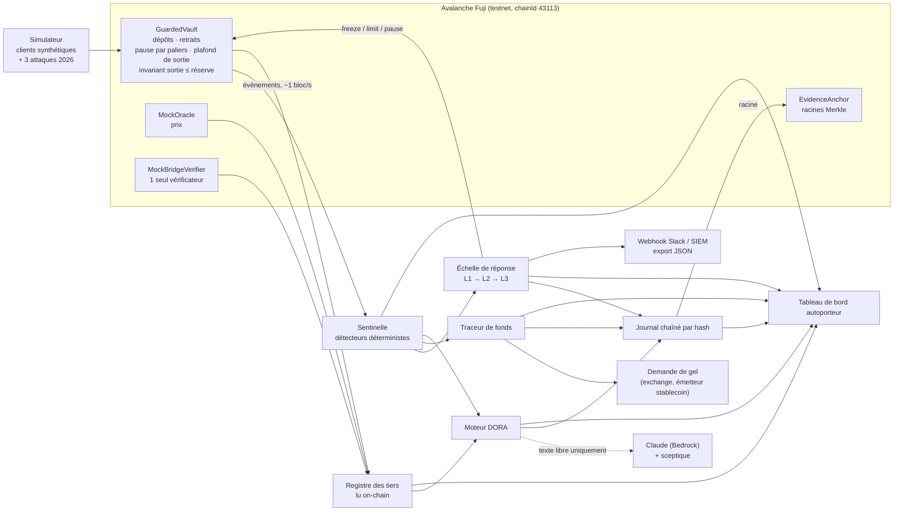
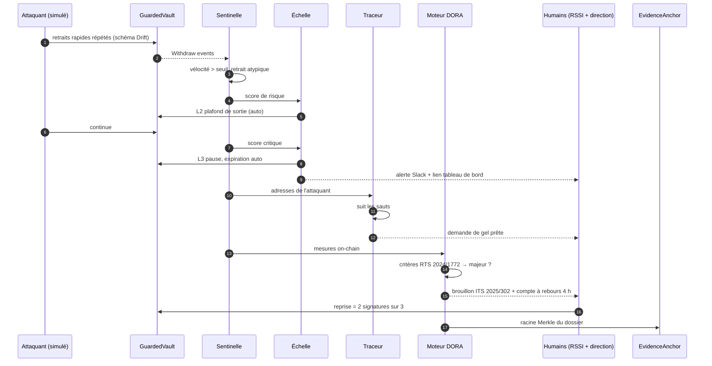
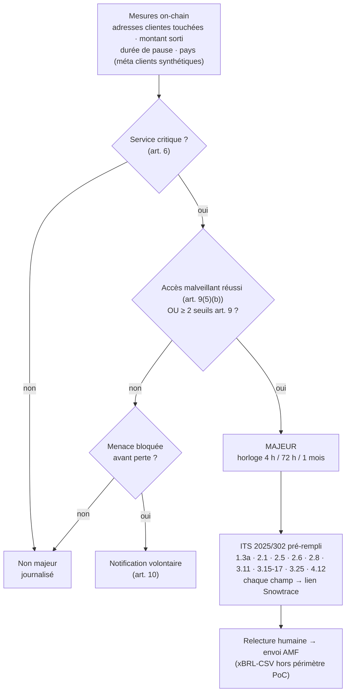

# Sentinelle Fuji — architecture v0

> Track 1 « Guardians of Value », sous-track 4 : détection et réponse DeFi + DORA.
> v0 du 10 oct. 2026, 21h30. Cette version va être critiquée puis amendée par la boucle jury ↔ solveurs (`research/loop/`).
> Chiffres et cas réels : `research/tracks/T1_P4_chiffres_2026.md`.

## 1. En une phrase
**Quand le coffre on-chain d'un prestataire crypto régulé est attaqué, la Sentinelle détecte, freine ou met en pause, suit l'argent, et sort la déclaration DORA prête à relire, chaque champ prouvé par une transaction.**

Client : un prestataire crypto agréé MiCA (CASP), soumis à DORA. Environ 362 sont agréés dans l'UE, dont 36 en France (registre ESMA via agrégateur, 7 oct. 2026). Ce peut aussi être un émetteur de fonds tokenisé qui opère un coffre sur Avalanche.

Pourquoi maintenant :
- 1,26 Md$ ont été volés au T3 2026 (CertiK).
- Chez Bitget, environ 0,08 % des fonds volés ont été gelés, au bout d'environ un jour.
- L'AMF et l'ACPR constatent que les délais DORA sont « rarement respectés » et que les champs sont souvent faux.

## 2. Vue d'ensemble

## 3. Un incident, du premier bloc à la déclaration

## 4. Échelle de réponse

Les règles sont signées à l'avance par la direction (DORA art. 5).

| Palier | Déclencheur (exemple, à calibrer sur le banc d'essai) | Action | Qui décide | Effet DORA |
|---|---|---|---|---|
| L0 | Rien d'anormal | Surveiller | Machine | — |
| L1 | Signal faible : retrait atypique isolé, nouveau contrat appelant | Alerte | Machine | — |
| L2 | Vélocité de sortie > X % de la réserve en N blocs | Plafond de sortie par fenêtre | Machine, réversible | — |
| L3 | Signal fort : invariant violé, changement de rôle non prévu, écart d'oracle, vélocité critique | Pause avec expiration automatique | Machine, réversible | Une pause de plus de 2 h coche le critère « indisponibilité » |
| Reprise | — | Lever la pause | 2 gardiens humains sur 3 | Clôt la durée d'indisponibilité |

Garde-fou en une transaction : l'invariant « sortie ≤ réserve, prix borné » est vérifié **dans** le contrat. C'est la seule parade contre un Tectonic, puisque la Sentinelle arrive forcément après.

## 5. Moteur DORA

Seuils de l'art. 9 :
- clients touchés : plus de 10 % ou plus de 100 000 ;
- transactions touchées : plus de 10 % ;
- durée plus de 24 h, ou indisponibilité plus de 2 h ;
- au moins 2 États membres ;
- perte de données ;
- impact économique plus de 100 k€, sans déduire les sommes récupérées ;
- réputation.

Rôle du LLM : il rédige seulement les champs en texte libre. Un « sceptique » retire toute phrase qui ne pointe vers aucune preuve.

## 6. Registre des tiers lu on-chain
Ce qu'on lit sur la chaîne :
- détenteurs de rôles (admin, pauser) ;
- adresse et fraîcheur de l'oracle ;
- configuration du vérificateur cross-chain : un seul vérificateur est signalé comme à risque, à la KelpDAO ;
- RPC utilisés : si deux RPC donnent des réponses différentes, c'est une alerte.

Ce qu'on produit :
- des lignes du registre d'informations ;
- les points uniques de défaillance ;
- le champ 2.8 au format `NOM;CODE;LEI|EUID;info`.

## 7. Journal de preuve
- Chaque décision (détection, palier, demande de gel, champ DORA) devient une entrée `{t, bloc, tx, règle@version, entrée, sortie, hash_prec}`.
- La racine Merkle de chaque incident est ancrée dans `EvidenceAnchor` sur Fuji.
- Mode auditeur : rejouer les mêmes blocs avec les mêmes règles donne les mêmes décisions et le même hash.
- Pas de donnée personnelle on-chain, seulement des empreintes.

## 8. Banc d'essai (critère détection, 30 %)
- Hardhat local, graine fixe, N clients synthétiques, trafic normal qui inclut de gros retraits légitimes (faux positifs potentiels).
- Attaques modelées sur 2026 :

| Attaque | Inspirée de | Ce qu'on attend |
|---|---|---|
| Drain rapide (retraits répétés) | Drift (31 retraits en 12 min) | L2 puis L3, fonds sauvés |
| Clé admin compromise qui change un rôle puis retire | Bitget, Resolv | L3 sur changement de rôle |
| Manipulation d'oracle en une transaction | Tectonic | Revert sur l'invariant dans le contrat |

- Métriques sorties :
  - taux de détection par attaque ;
  - faux positifs pour 10 000 transactions ;
  - temps de détection en blocs et en secondes ;
  - fonds sauvés en % ;
  - durée de pause.
- La même chose est rejouée en démo sur Fuji.

## 9. Tableau de bord autoporteur
Un écran qui se lit de gauche à droite sans narration. Chaque panneau a un titre et une phrase.

| Panneau | Phrase affichée | Contenu |
|---|---|---|
| Coffre | « Ce que nos clients ont déposé, en direct. » | Solde, sorties par bloc |
| Menace | « Ce que la Sentinelle voit d'anormal. » | Détecteurs allumés, score |
| Réponse | « Ce qu'on a fait, et qui l'a décidé. » | Échelle L0-L3, compte à rebours de l'expiration, bouton reprise 2/3 |
| Argent | « Où part l'argent volé. » | Graphe des sauts, demande de gel |
| Régulateur | « Ce que la loi exige, déjà rempli. » | Verdict majeur oui/non avec critères cochés, horloge 4 h, formulaire (clic sur un champ = transaction) |
| Preuve | « Pourquoi on peut nous croire. » | Racine ancrée, lien Snowtrace, bouton « rejouer comme un auditeur » |

Onglet « Banc d'essai » : tableau des métriques et matrice de confusion.

## 10. Stack
- Solidity 0.8.24 + Hardhat (déjà configuré dans `blockchain/`).
- Node 20 + TypeScript + ethers v6 pour la Sentinelle, le traceur, le moteur DORA, le registre et le journal.
- React + Vite + Tailwind pour le tableau de bord, Mermaid pour la documentation.
- Bedrock (Claude) pour le texte libre uniquement. Clés dans `.env`, jamais commitées.

## 11. Mapping (provisoire, à vérifier)
- NIST CSF 2.0 : DE.CM, DE.AE, RS.MA, RS.AN, RS.CO, RS.MI, RC.RP, GV.SC (tiers).
- ATT&CK : T1657 (vol financier), T1078 (comptes valides), T1190 (exploitation d'application exposée).
- D3FEND : identifiants à confirmer, pour l'analyse de transactions et l'isolation.

## 12. Limites connues
- **Attaque en une transaction** : seul l'invariant du contrat agit, la Sentinelle arrive après.
- **Notre périmètre** : on sécurise notre propre coffre, pas un protocole tiers.
- **Interprétation DORA** : un exploit de code compte-t-il comme « accès non autorisé » ? On choisit l'option prudente et un humain tranche.
- **Format de dépôt** : on produit un brouillon JSON/PDF, pas le xBRL-CSV, et on n'envoie rien à l'AMF.
- **Traçage** : limité à Fuji et à nos adresses simulées.
