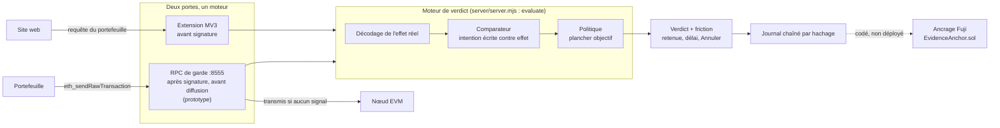

# Hold up - architecture

Avant qu'une personne signe ou envoie de la crypto, Hold up lui montre ce que l'opération fait vraiment, le compare à ce qu'elle a écrit vouloir faire, et la fait attendre si les deux ne collent pas.

Ce document décrit le produit actuel : son problème, son flux, ses composants réels et leurs limites. Il reste aligné sur [PRODUCT.md](../PRODUCT.md), le [README](../README.md) racine, [livrables/ARCHITECTURE.md](../livrables/ARCHITECTURE.md) (architecture de rendu, avec diagrammes de séquence et pistes d'intégration) et sur les décisions `coord/DECISIONS.md` D-007, D-008, D-009.

Ancien nom : Sentinelle. Il reste dans quelques fichiers de recherche et dans des noms techniques (variables `SENTINELLE_*`, champ `service` du serveur local). C'est le même projet.

Convention de ce document : chaque élément dit s'il **existe** dans le dépôt ou s'il est **conçu seulement**. Aucun chiffre de résultat n'est écrit à la main ici : les mesures renvoient aux fichiers sources, comme dans le README. Priorités : **[P0]** cœur de la démo, **[P1]** utile si le temps le permet, **[bonus]** feuille de route.

## 1. Le problème visé

Un particulier qui signe dans son portefeuille voit des octets, pas des conséquences. Un faux support, un faux airdrop ou un faux site de remboursement lui fait signer un droit de dépense (`approve`, `permit`, `permit2`) ou envoyer des fonds en croyant faire une chose banale. Trois formes reviennent :

- **la signature piégée** : une donnée typée EIP-712 (Permit, Permit2, ordre Seaport) accorde un droit, souvent illimité, sans sortie de fonds visible au moment de la signature ;
- **l'adresse piégée** : le destinataire tapé ou collé ressemble à une adresse connue (préfixe et suffixe identiques) mais ne l'est pas ;
- **le faux support et la manipulation** : quelqu'un presse la personne, au téléphone ou dans un chat, de signer « pour débloquer », « pour vérifier » ou « pour recevoir ».

Les outils existants jugent la réputation d'une adresse ou affichent un bilan technique. MetaMask couvre déjà, par défaut, l'adresse sosie, le premier envoi vers une adresse jamais vue, les alertes de sécurité sur transactions et signatures, et l'affichage lisible des Permit (`coord/DECISIONS.md`, D-009). Hold up ne refait pas ce travail. Son positionnement : « MetaMask te prévient de ce qu'il reconnaît ; Hold up vérifie ce que tu voulais faire. » Il compare **ce que la personne a écrit vouloir faire** avec **l'effet réel de l'opération**.

Ce n'est pas un produit régulé pour institutions. DORA, CASP et la conformité réglementaire sont hors du cœur (au plus une slide), conformément au pivot D-007.

## 2. Un moteur, deux portes

Hold up a un seul moteur de verdict et deux endroits où il peut intercepter une opération (`coord/DECISIONS.md`, D-008). Le diagramme et les séquences détaillées sont dans [livrables/ARCHITECTURE.md](../livrables/ARCHITECTURE.md) ; voici l'essentiel.

| Porte | Voit | Ne voit pas | État |
|---|---|---|---|
| **Extension MV3** (`research/titouan/T_banc_e2e/extension*/`) | toute requête qu'une page envoie au portefeuille, y compris les signatures hors chaîne (permit, listings, `personal_sign`) | un envoi lancé depuis l'écran « Envoyer » du portefeuille, le mobile, WalletConnect, les applications natives (`extension/COMPAT.md`) | existe, c'est la porte des scènes de démo |
| **RPC de garde** (`research/demo_reelle/rpc_garde/`) | toute transaction signée qui passe par l'adresse RPC du portefeuille, quelle que soit sa provenance | les signatures hors chaîne, qui ne sont jamais diffusées | prototype dans le dépôt, **sorti des scènes de démo** par D-009 |

La seule porte qui voit les signatures hors chaîne est l'extension : c'est pourquoi elle porte la démo. Le RPC de garde reste un prototype complémentaire. Les retraits depuis une plateforme d'échange ne passent par aucune des deux portes : ils restent au geste manuel « coller et vérifier » (`coord/DECISIONS.md`, D-008).

## 3. Le flux en cinq temps

Détecter, puis répondre. Chaque temps correspond à du code réel.

### 3.1 Capter l'intention écrite

Quand une opération donne un droit ou fait sortir des fonds, l'extension demande à la personne, en mots simples, ce qu'elle veut faire : « Que veux-tu faire sur ce site ? », avec un exemple (« échanger 50 USDC contre AVAX »). Le texte est **une donnée**, jamais une instruction.

- La classification de la phrase en une famille d'opération (`pay_someone`, `send_to_my_account`, `buy_or_swap`, `connect_or_accept_offer`, `asked_by_someone`) est faite par `extension/intent_text.js` et, côté pipeline, par `research/titouan/T_banc_e2e/pipeline/intent_clef.mjs`.
- Le **code** extrait le montant, le jeton et l'adresse (expressions régulières, virgule décimale française comprise). Un modèle ne fait jamais cette extraction.
- Si la phrase reste trop vague, une **seule** question de relance est posée (`written_check.js`, `relance`), jamais deux.

### 3.2 Calculer l'effet réel

L'extension mesure ce que l'opération fait vraiment, sans l'exécuter :

- pour une signature hors chaîne (EIP-712, Permit, Permit2, Seaport), l'effet est lu dans les données typées (`written_check.js`, `requestFacts`) : jetons concernés, bénéficiaire (`spender`), montant, et surtout si le droit est **illimité** ;
- pour une transaction, `extension/effect_sim.js` rejoue l'appel sur le dernier bloc du nœud que le portefeuille utilise déjà (`debug_traceCall`, en lecture seule) et lit dans la trace les événements émis (`Transfer`, `Approval`, `ApprovalForAll`, transferts ERC-1155) : jetons sortants, entrants, droits accordés, NFT. Rien ici ne connaît un contrat, un sélecteur ni une adresse à l'avance.

Toute impossibilité de lire (pas de trace, appel qui échoue, jeton illisible, moteur indisponible) donne « non vérifié », jamais un feu vert.

### 3.3 Comparer

Le comparateur confronte l'effet mesuré à l'intention écrite (`written_check.js`, `writtenCheck` et `effectCheck`) :

- un montant écrit contre un droit de dépense : le droit ne doit pas dépasser le montant. Illimité, ou plus que ce qui est écrit, est un **écart**, quel que soit le site ou le contrat ;
- un paiement : le destinataire et le montant de la requête doivent être ceux qui sont écrits ; une adresse nommée sans adresse collée ne peut pas être vérifiée, et la fenêtre le dit ;
- un droit donné par une **signature** n'a aucun plafond que la personne puisse éditer dans le portefeuille : la ligne le dit sans donner de conseil que personne ne peut suivre.

Principe central (`run/policy.mjs`, `PRODUCT.md` principe 3) : il existe un **plancher objectif** que l'intention déclarée ne peut jamais abaisser. Ce que la personne écrit peut **relever** un verdict, jamais le descendre. Le serveur garde le plus strict des deux verdicts : avec intention et sans intention.

### 3.4 Répondre

La traduction du niveau interne du moteur vers la réponse lue par la personne est faite en un seul endroit (`extension/outcome.js`) :

- la réponse de l'écran est **binaire** : « Ça correspond à ce que tu as écrit » ou « Ça ne correspond pas à ce que tu as écrit », plus une ligne et, quand c'est utile, les phrases « tu crois / en vrai » ;
- les niveaux de friction sont multiples (`extension/hold_core.js`, `frictionFor`) : **attention** (lire et continuer), **danger** (phrase à retaper puis délai, 30 s par défaut), **manipulation** (délai long, 10 min par défaut), et **non vérifié** qui prend la friction du danger pour qu'une requête rendue illisible exprès ne saute ni l'écran ni le délai ;
- **jamais de vert** : « correspond » n'est jamais affiché en vert et ne dit jamais « sûr » ;
- **Annuler est toujours disponible**, à toute étape, et ne pénalise jamais. Annuler l'emporte sur un « continuer » que la page n'a pas encore consommé ;
- la retenue est pilotée par le niveau du moteur, jamais par le texte binaire affiché ;
- la personne garde la décision : Hold up retient et explique, il ne décide pas à sa place.

### 3.5 Tracer

Chaque verdict est écrit dans un **journal chaîné par hachage** (serveur de vérification, `server/server.mjs`). Le journal ne contient ni texte libre ni adresse en clair. L'ancrage de sa racine sur Avalanche Fuji est **codé mais pas déployé** : `research/titouan/T_banc_e2e/anchor/`, contrat `EvidenceAnchor.sol`, écrit et testé en local, jamais envoyé (`blockchain/DEPLOYMENTS.md` est vide). Sans ancrage, le journal détecte la modification d'une ligne, pas la réécriture complète du fichier.

## 4. Le moteur de verdict

Le cœur est la fonction `evaluate(body, local)` de `research/titouan/T_banc_e2e/server/server.mjs`, importée telle quelle par le RPC de garde. L'extension l'appelle soit via le serveur local (`POST /check`, variante serveur), soit avec un moteur embarqué (variante autonome, sans accès réseau).

Étapes du pipeline (détail et diagramme dans [livrables/ARCHITECTURE.md](../livrables/ARCHITECTURE.md), section 4) : contexte hors ligne (carnet d'adresses, historique, protocoles connus) → décodage de l'effet → règles supplémentaires → intention déclarée → comparateur → politique (plancher objectif) → présentation.

Propriétés vérifiables :

- un échec d'analyse donne « non vérifié », jamais un feu vert ;
- l'intention peut relever un verdict, jamais l'abaisser (`run/policy.mjs`) ;
- le contexte est hors ligne par défaut ; seul le RPC de garde ajoute des faits lus sur la chaîne en lecture seule (variable `HOLDUP_LIVE`, `context_live/provider.mjs` : lectures JSON-RPC seulement, budget de temps strict, un fait non obtenu reste inconnu) ;
- la décision est du code et des mots-clés : **aucun modèle de langage n'est appelé sur le chemin de réponse**.

## 5. Le classifieur d'intention (Clef / Jev)

Un classifieur est prévu pour lire la phrase écrite par la personne, ou un message collé (un chat de faux support), et en déduire la **famille** d'opération. Il est décrit par `pipeline/intent_clef.mjs` et sa mesure par `pipeline/measure_intent.mjs` (résultats dans `pipeline/RESULTATS_INTENTION_CLEF.md`).

Partage des rôles :

- le **modèle** (Clef / Clef-flash) décide la famille et répond à quelques questions oui/non (un montant est donné, la personne pense ne rien dépenser, elle agit parce qu'on le lui a demandé, le texte est trop vague) ;
- le **code** extrait le montant, le jeton, l'adresse ; le modèle ne le fait jamais ;
- le texte est traité comme une **donnée** : il voyage dans un champ `user_intent_text`, les questions sont fixes et ne nomment que ce champ ;
- sous un seuil de confiance (0,6 par défaut), l'intention est « non classée » : aucune famille n'est transmise, et le moteur garde le plus strict des deux verdicts. Une intention non classée ne peut donc que **relever** un verdict, jamais l'abaisser ;
- quand le modèle ne répond pas (pas de clé, erreur, délai), la famille vient d'un repli par mots-clés (`extension/intent_text.js`, `keyword_intent.js`), et le résultat le signale.

État : ce classifieur **n'est pas branché** dans le serveur ni dans l'extension du produit livré à la rédaction. L'intégration passerait par `pipeline/evaluate_plus.mjs`. Le repli par mots-clés, lui, est présent dans l'extension. Même branché, le classifieur ne peut jamais baisser un verdict ; la règle « on m'a demandé de le faire » prime sur toute famille.

## 6. Composants réels et chemins de code

| Composant | Chemin | Rôle |
|---|---|---|
| Extension MV3 (variante serveur et variante autonome) | `research/titouan/T_banc_e2e/extension/`, `extension_standalone/` | interception avant signature, écrans, retenue |
| Manifeste de l'extension | `extension/manifest.json` | Manifest V3, nom « Hold up », permissions `storage` et `alarms` |
| Injection dans la page | `extension/inject.js` (monde de la page), `extension/bridge.js` (monde isolé) | enveloppe `window.ethereum`, relaie la requête vers le service worker |
| Service worker | `extension/background.js`, `gatekeeper.js` | reçoit la requête, appelle le moteur, pilote la retenue |
| Machine de retenue | `extension/hold_core.js` | état par requête dans `chrome.storage.session`, échéances absolues (survit à l'arrêt du service worker), fermé par défaut |
| Capture de l'intention écrite | `extension/intent_text.js`, `keyword_intent.js` | classification de la phrase, repli par mots-clés |
| Mesure de l'effet réel | `extension/effect_sim.js` | `debug_traceCall` en lecture seule, lecture des événements |
| Comparaison écrit contre effet | `extension/written_check.js` | droits, paiements, montant illimité, adresse collée, SIWE |
| Traduction en réponse lisible | `extension/outcome.js` | correspond / ne correspond pas / non vérifié ; jamais de vert |
| Fenêtre de verdict | `extension/window.html`, `window.js`, `window.css` | « Tu crois / En vrai », compte à rebours, Annuler |
| Moteur de verdict | `server/server.mjs` (`evaluate`), `engine/src`, `run/policy.mjs` | décodage, comparateur, politique, journal |
| Serveur de vérification | `server/server.mjs` | `POST /check`, `POST /log`, 127.0.0.1 uniquement |
| RPC de garde (deuxième porte, prototype) | `research/demo_reelle/rpc_garde/` | proxy JSON-RPC, retenue d'une transaction signée |
| Classifieur d'intention (non branché) | `pipeline/intent_clef.mjs`, `measure_intent.mjs`, `evaluate_plus.mjs` | famille d'opération depuis le texte ou un message collé |
| Journal et ancrage | `anchor/`, `EvidenceAnchor.sol` | chaîne de hachage ; ancrage Fuji écrit, non déployé |
| Contrats de démo | `blockchain/contracts/demo/` | DemoUSDC, DemoWAVAX, DemoNFT, DemoRouter, FreshDrainer (joue l'attaquant) |

## 7. Mesures

Aucun chiffre de détection n'est écrit à la main dans ce document. Les mesures (rappel, fausses alertes, latence, interposition, trafic réel) sont rassemblées dans le [README](../README.md#chiffres-mesurés-avec-leur-jeu-et-leurs-limites), avec pour chaque ligne son jeu de test et son fichier source (`research/titouan/T_banc_e2e/COUVERTURE.md`, `.../attacks_public/out/MESURE_001.md`, `.../redteam/angles_morts/03_chiffres_et_methode.md`, `research/titouan/bench/RAPPORT_banc_reel_v0.md`, et la latence par `server/test/server.test.mjs`).

À retenir sur la méthode : les jeux sont écrits par l'équipe, aucun jeu aveugle n'a été passé, et les chiffres se lisent comme de la couverture des règles, pas comme un taux face à un vrai attaquant.

## 8. Limites connues

Écrites sans détour, cohérentes avec le [README](../README.md#limites-connues) :

- **Chaque porte a un angle mort.** L'extension ne voit pas un envoi lancé depuis l'écran « Envoyer » du portefeuille, ni le mobile, ni WalletConnect, ni les applications natives. Le RPC de garde ne voit pas les signatures hors chaîne. Les retraits d'une plateforme restent au geste manuel.
- **Le RPC de garde reste un prototype**, sorti des scènes de démo par D-009. L'hébergement pour de vrais utilisateurs (authentification, limitation de débit, TLS, vie privée des transactions) n'est pas écrit.
- **Le classifieur d'intention n'est pas branché** dans le produit livré. Aucun modèle de langage n'est appelé sur le chemin de réponse ; le produit décide par code et mots-clés.
- **Rien n'est déployé sur Fuji.** L'ancrage de la racine du journal est écrit et testé en local, jamais envoyé. Sans ancrage, le journal ne détecte pas une réécriture complète.
- **Testé sur un portefeuille simulé, pas sur un vrai.** Aucun essai consigné avec MetaMask, Rabby ou Core (`essai_reel/ESSAI_REEL_RESULTATS.csv` vide).
- **Fausses alertes élevées** sur des opérations honnêtes : c'est la première limite du produit.
- **Fraude « conforme » non couverte** : une victime qui envoie volontairement à une adresse choisie sous la guidance d'un escroc ne se distingue pas d'un envoi honnête.
- **On avertit et on ralentit, on ne bloque pas.** Un utilisateur déterminé, ou coaché au téléphone, peut passer outre. Le service worker MV3 peut s'arrêter avant la fin d'une retenue longue.
- **Aucun test avec des personnes** : la compréhension des écrans n'est pas mesurée.

## 9. Correspondance avec les référentiels

NIST CSF 2.0 et menaces par fonction sont dans [livrables/MAPPING_REFERENTIELS.md](../livrables/MAPPING_REFERENTIELS.md), qui fait foi (les identifiants dans les commentaires du code peuvent être plus anciens). En résumé : interception et comparaison relèvent de **Detect** (DE.CM, DE.AE), friction et trace de **Respond** (RS.MI, RS.AN). Menaces visées : MITRE ATT&CK T1657 (vol financier), T1566 (hameçonnage), T1684.001 (usurpation) ; OWASP Agentic ASI09 pour la confirmation des actions sensibles. Il ne s'agit pas d'un produit de conformité réglementaire.
