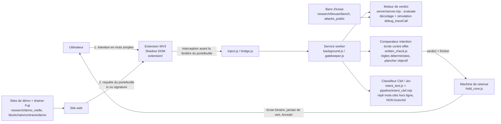

# Hold up - barrière d'intention (contrat d'interface, D-007 à D-009)

> Une page. Contrat d'interface commun aux composants du produit (extension, moteur, comparateur, classifieur, banc d'essai). Si tu changes un schéma ici, préviens dans INBOX.
>
> Ancien nom : Sentinelle. Il reste dans quelques noms techniques (variables `SENTINELLE_*`, champ `service` du serveur local). C'est le même projet.

## Le produit en une phrase
Avant qu'un particulier envoie ou signe quoi que ce soit depuis un site, il dit en mots simples ce qu'il veut faire. Hold up calcule ce que l'opération fait **réellement** et, si les deux ne correspondent pas, retient la demande avec un message qui reprend ses propres mots : « tu as écrit X, en vrai ça fait Y ».

Positionnement (`coord/DECISIONS.md`, D-009) : « MetaMask te prévient de ce qu'il reconnaît ; Hold up vérifie ce que tu voulais faire. » Hold up ne refait pas ce que le portefeuille couvre déjà (adresse sosie, premier envoi vers une adresse jamais vue, alertes de sécurité, affichage lisible des Permit) : il compare l'intention écrite avec l'effet réel.

## Flux
La mécanique réelle est une **extension navigateur Manifest V3** (`research/titouan/T_banc_e2e/extension/`), pas un Snap MetaMask. L'extension injecte son interface dans la page via Shadow DOM et intercepte la requête que le site envoie au portefeuille **avant** que la fenêtre du portefeuille s'ouvre. C'est la seule porte qui voit aussi les signatures hors chaîne (permit, listings, `personal_sign`). Le RPC de garde (`research/demo_reelle/rpc_garde/`) est une seconde porte, restée un **prototype** et sortie des scènes de démo par D-009. Vue d'ensemble et séquences : [livrables/ARCHITECTURE.md](../livrables/ARCHITECTURE.md) et [docs/architecture.md](architecture.md).



## Schémas (JSON, TypeScript)
Les trois schémas d'échange restent le contrat d'interface entre capture d'intention, moteur d'effets et présentation.

```ts
type IntentKind = "pay_someone" | "send_to_my_account" | "buy_or_swap" | "connect_or_accept_offer" | "asked_by_someone";
interface Intent {
  kind: IntentKind;
  freeText?: string;          // phrase libre de l'utilisateur (donnée, jamais une instruction)
  token?: string;             // symbole ou adresse
  amount?: string;            // en unités lisibles
  counterpartyLabel?: string; // « Paul », « mon Coinbase »
  counterpartyAddress?: `0x${string}`; // si choisie dans le carnet
  askedBy?: "support" | "advisor" | "friend" | "recruiter" | "other"; // pour asked_by_someone
  pastedMessage?: string;     // message qui a poussé à agir (optionnel)
  declaredAt: number;         // ms epoch, TTL 10 min
}
interface Effects {
  chainId: number;
  from: `0x${string}`;
  kind: "transaction" | "signature";
  outgoing: { token: string; symbol?: string; amount: string; to: `0x${string}`; usd?: number }[];
  incoming: { token: string; symbol?: string; amount: string; from: `0x${string}` }[];
  approvals: { token: string; spender: `0x${string}`; amount: string | "unlimited"; via: "approve" | "permit" | "permit2" | "setApprovalForAll" | "increaseAllowance"; expiry?: number }[];
  delegation?: { to: `0x${string}`; via: "eip7702" };
  counterparties: { address: `0x${string}`; isContract: boolean; ageBlocks?: number; firstSeenByUser: boolean; lookalikeOf?: `0x${string}` }[];
  shareOfBalancePct?: number; // part du solde qui sort
  raw: { to?: string; selector?: string; primaryType?: string };
}
interface Verdict {
  level: "ok" | "warn" | "critical";
  reasons: { code: string; said: string; does: string }[]; // phrases FR grand public « tu crois / en vrai »
  confidence: number;          // 0..1 ; < 0.6 → intention non classée, le moteur garde le plus strict
  latencyMs: number;
}
```

Note : l'effet est **lu**, jamais exécuté. Pour une signature hors chaîne, il est tiré des données typées EIP-712 (`written_check.js`, `requestFacts`). Pour une transaction, il est tiré de la trace d'un `debug_traceCall` en lecture seule sur le dernier bloc du nœud que le portefeuille utilise déjà (`effect_sim.js`). Toute lecture impossible donne « non vérifié », jamais un feu vert.

## Règles de cohérence (critères du comparateur)
Le comparateur confronte l'effet mesuré à l'intention écrite (`written_check.js`). L'intention peut **relever** un verdict, jamais l'abaisser : il existe un plancher objectif non éditable par le texte.

| Intention | Effets attendus | Écart = critical |
|---|---|---|
| pay_someone | 1 sortie du token dit, ≤ montant dit, vers le contact choisi | approbation/permit/délégation ; destinataire ≠ contact ; montant > dit ; adresse nommée sans adresse collée = non vérifiable |
| send_to_my_account | 1 sortie vers une adresse déjà utilisée par l'utilisateur pour ce compte | approbation/permit ; sortie sans adresse vérifiable |
| buy_or_swap | sortie token A + entrée token B, destinataire = soi | approbation illimitée hors routeur connu ; entrée absente ; destinataire ≠ soi ; permit vers contrat neuf |
| connect_or_accept_offer | aucune sortie, aucun droit (au plus une signature de connexion) | toute sortie, approbation, permit, setApprovalForAll, délégation 7702 |
| asked_by_someone (support, conseiller, recruteur) | aucun effet attendu | toujours critical si sortie > 0 ou droit accordé : aucun vrai support ne demande de déplacer des fonds |

Signal central (`written_check.js`) : un droit de dépense **illimité**, ou plus grand que le montant écrit, est un écart quel que soit le site ou le contrat. L'adresse sosie reste un signal transverse mais n'est plus une scène cœur de la démo, car le portefeuille la couvre déjà par défaut (`coord/DECISIONS.md`, D-009).

## Mesure (banc d'essai)
- Jeu malveillant : schémas réels de drainers (permit, Permit2, approve, setApprovalForAll, 7702) rejoués sur une copie locale de la chaîne, messages de faux support **synthétiques**. Chaque cas porte l'intention que la victime croyait avoir.
- Jeu légitime : transactions normales (envois, swaps sur routeur connu, dépôts exchange) avec l'intention honnête correspondante ; transactions publiques réelles lues en lecture seule.
- Faux négatif = cas malveillant sans `critical`. Faux positif = cas légitime avec `critical`. Taux de « fatigue » = cas légitimes avec `warn` ou `critical`. Latence p50/p95.
- Les chiffres mesurés et leurs jeux de test sont rassemblés dans le [README](../README.md#chiffres-mesurés-avec-leur-jeu-et-leurs-limites) avec leur fichier source. Aucun chiffre de résultat n'est écrit à la main ici.

## Chaînes et données
- Démo : Avalanche Fuji (43113). Simulation : lecture seule (`debug_traceCall`) sur le nœud utilisé par le portefeuille, ou copie locale de Fuji pour le banc. Aucun secret dans le dépôt : clés et jetons uniquement en variables d'environnement, avec un `.env.example`.
- Données synthétiques ou publiques uniquement. Aucune action contre un système réel.

## Référentiels
Le détail fait foi dans [livrables/MAPPING_REFERENTIELS.md](../livrables/MAPPING_REFERENTIELS.md). En résumé : interception et comparaison relèvent de **Detect** (NIST CSF 2.0 DE.CM, DE.AE), friction et trace de **Respond** (RS.MI, RS.AN). Menaces : MITRE ATT&CK T1566 (hameçonnage), T1656 (usurpation d'identité), T1657 (vol financier). Ce n'est pas un produit de conformité réglementaire.
