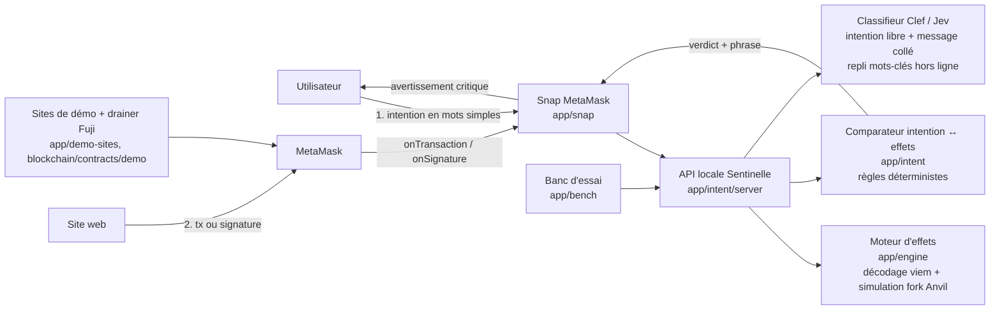

> **PÉRIMÉ (11 oct. 2026).** Contrat de D-007 : choix d'intention par boutons, démo sur Fuji, deux portes. Le produit figé utilise une phrase libre. Voir `coord/HANDOFF_ADEM_SESSION_2.md`.

# Sentinelle — barrière d'intention (architecture v3, D-007)

> Une page. Contrat d'interface commun à toutes les tâches T-101 à T-106. Si tu changes un schéma ici, préviens dans INBOX.

## Le produit en une phrase
Avant qu'un particulier envoie ou signe quoi que ce soit dans MetaMask, il dit en mots simples ce qu'il veut faire. Sentinelle calcule ce que la transaction fait **réellement** et, si les deux ne correspondent pas, affiche un avertissement critique qui reprend ses propres mots : « tu as dit X, ça fait Y ».

## Flux


## Schémas (JSON, TypeScript)
```ts
type IntentKind = "pay_someone" | "send_to_my_account" | "buy_or_swap" | "connect_or_accept_offer" | "asked_by_someone";
interface Intent {
  kind: IntentKind;
  freeText?: string;          // phrase libre de l'utilisateur
  token?: string;             // symbole ou adresse
  amount?: string;            // en unités lisibles
  counterpartyLabel?: string; // « Paul », « mon Coinbase »
  counterpartyAddress?: `0x${string}`; // si choisie dans le carnet
  askedBy?: "support" | "advisor" | "friend" | "recruiter" | "other"; // pour asked_by_someone
  pastedMessage?: string;     // message qui a poussé à agir (optionnel)
  declaredAt: number;         // ms epoch, TTL 10 min
}
interface Effects {
  chainId: number;
  from: `0x${string}`;
  kind: "transaction" | "signature";
  outgoing: { token: string; symbol?: string; amount: string; to: `0x${string}`; usd?: number }[];
  incoming: { token: string; symbol?: string; amount: string; from: `0x${string}` }[];
  approvals: { token: string; spender: `0x${string}`; amount: string | "unlimited"; via: "approve" | "permit" | "permit2" | "setApprovalForAll" | "increaseAllowance"; expiry?: number }[];
  delegation?: { to: `0x${string}`; via: "eip7702" };
  counterparties: { address: `0x${string}`; isContract: boolean; ageBlocks?: number; firstSeenByUser: boolean; lookalikeOf?: `0x${string}` }[];
  shareOfBalancePct?: number; // part du solde qui sort
  raw: { to?: string; selector?: string; primaryType?: string };
}
interface Verdict {
  level: "ok" | "warn" | "critical";
  reasons: { code: string; said: string; does: string }[]; // phrases FR grand public
  confidence: number;          // 0..1 ; < 0.6 → escalade humaine
  latencyMs: number;
}
```

## Règles de cohérence (critères du comparateur, v0)
| Intention | Effets attendus | Écart = critical |
|---|---|---|
| pay_someone | 1 sortie du token dit, ≤ montant dit, vers le contact choisi | approbation/permit/délégation ; destinataire ≠ contact ; destinataire sosie d'une adresse connue ; montant > dit |
| send_to_my_account | 1 sortie vers une adresse déjà utilisée par l'utilisateur pour ce compte | destinataire jamais vu ou sosie ; approbation/permit |
| buy_or_swap | sortie token A + entrée token B, destinataire = soi | approbation illimitée hors routeur connu ; entrée absente ; destinataire ≠ soi ; permit vers contrat neuf |
| connect_or_accept_offer | aucune sortie, aucun droit (au plus une signature de connexion) | toute sortie, approbation, permit, setApprovalForAll, délégation 7702 |
| asked_by_someone (support, conseiller, recruteur) | — | toujours critical si sortie > 0 ou droit accordé : aucun vrai support ne demande de déplacer des fonds |

Signaux transverses : contrat âgé de moins de N blocs, part du solde > 50 %, adresse sosie (mêmes 4 premiers et 4 derniers caractères hexa qu'une adresse de l'historique sans être identique).

## Mesure (banc d'essai)
- Jeu malveillant : schémas réels de drainers (permit, Permit2, approve, setApprovalForAll, 7702) rejoués sur fork, paires d'adresses sosies, messages de faux support **synthétiques**. Chaque cas porte l'intention que la victime croyait avoir.
- Jeu légitime : transactions normales (envois, swaps sur routeur connu, dépôts exchange) avec l'intention honnête correspondante ; transactions publiques réelles lues en lecture seule.
- Faux négatif = cas malveillant sans `critical`. Faux positif = cas légitime avec `critical`. Taux de « fatigue » = cas légitimes avec `warn` ou `critical`. Latence p50/p95.
- Objectifs : FN = 0 sur le jeu de démo ; FP critical < 2 % ; p95 < 1,5 s sans Clef, < 3 s avec.

## Chaînes et données
- Démo : Avalanche Fuji (43113). Simulation : fork Anvil de Fuji (RPC public). Aucun secret dans le repo : `CF_ACCOUNT_ID`, `CF_API_TOKEN`, `JEV_API_KEY`, `FUJI_PRIVATE_KEY` uniquement en variables d'environnement, avec un `.env.example`.
- Données synthétiques ou publiques uniquement. Aucune action contre un système réel.

## Référentiels
NIST CSF 2.0 : DE.CM (surveillance), DE.AE (analyse d'événements), PR.AT (sensibilisation au moment de l'action). ATT&CK : T1566 (phishing), T1656 (usurpation d'identité), T1657 (vol financier).
