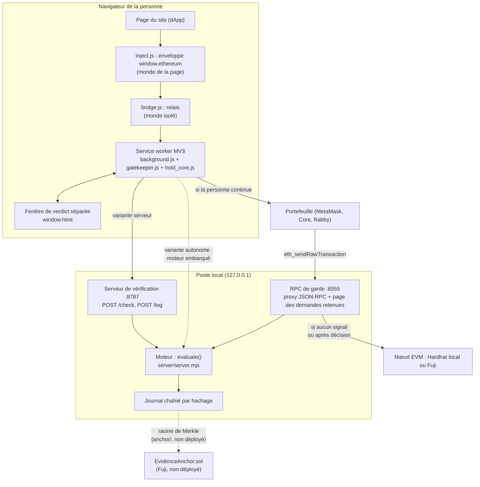
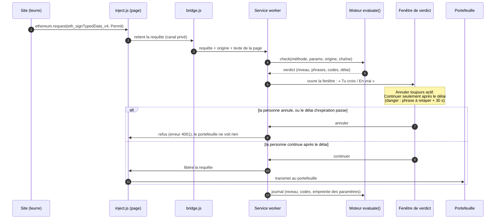
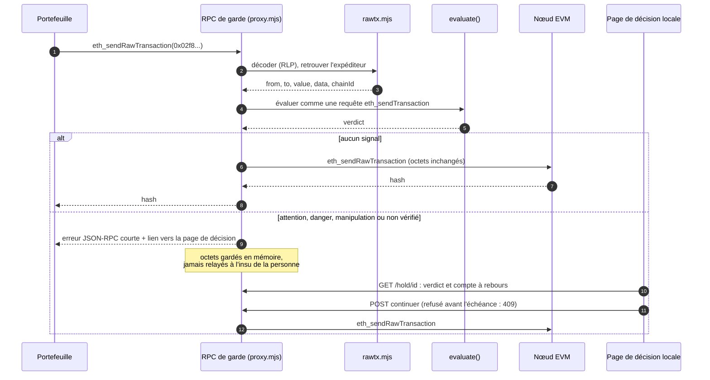
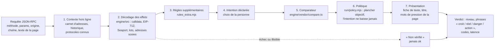

# Architecture de Hold up

Ce document décrit ce qui tourne aujourd'hui, avec le fichier qui le prouve, puis comment le même moteur se brancherait sur un portefeuille, une fintech ou une plateforme. Dans la section 5, chaque ligne dit si elle **existe** ou si elle est **conçue seulement**. Pour lancer le tout : [INSTALLATION.md](INSTALLATION.md).

## 1. Vue d'ensemble : un moteur, deux portes



| Porte | Voit | Ne voit pas |
|---|---|---|
| Extension MV3 (`research/titouan/T_banc_e2e/extension*/`) | toute requête qu'une page envoie au portefeuille, y compris les signatures hors chaîne (permit, listings, `personal_sign`) | un envoi lancé depuis l'écran « Envoyer » du portefeuille, le mobile, WalletConnect, les applications natives (`extension/COMPAT.md`) |
| RPC de garde (`research/demo_reelle/rpc_garde/`) | toute transaction signée qui passe par l'adresse RPC du portefeuille, quelle que soit sa provenance | les signatures hors chaîne, qui ne sont jamais diffusées |

Les retraits depuis une plateforme d'échange ne passent par aucune des deux portes : ils restent au geste manuel « coller et vérifier » (`coord/DECISIONS.md`, D-008).

## 2. Une signature interceptée (extension)



Règles de la retenue (`extension/hold_core.js`, commentaire d'en-tête) : l'état de chaque requête vit dans `chrome.storage.session`, avec des échéances absolues, donc il survit à l'arrêt du service worker ; « autoriser » n'existe que comme décision humaine prise après la friction ; toute erreur donne un refus (fermé par défaut) ; une décision périmée ou répétée est ignorée.

## 3. Une transaction brute retenue (RPC de garde)



Garde-fous du proxy (`rpc_garde/proxy.mjs`, en-tête) : écoute sur 127.0.0.1 uniquement ; toute erreur interne sur `eth_sendRawTransaction` est un refus, toute erreur sur une lecture est transmise ; les mêmes octets ne donnent jamais deux retenues ; une retenue annulée ou expirée est rejugée à zéro si la personne resigne la même chose.

## 4. Le pipeline de verdict

Fonction `evaluate(body, local)` de `research/titouan/T_banc_e2e/server/server.mjs`, importée telle quelle par le RPC de garde.



Propriétés vérifiables : un échec d'analyse donne « non vérifié » (fiche F25), jamais un feu vert ; le niveau le plus bas affiché est « info » ; l'intention peut relever un verdict, jamais l'abaisser (`run/policy.mjs`, `PRODUCT.md` principe 3) ; le contexte est hors ligne par défaut. Le RPC de garde ajoute des faits lus sur la chaîne en lecture seule (variable `HOLDUP_LIVE`, `context_live/provider.mjs` : méthodes JSON-RPC de lecture seulement, budget de temps strict, un fait non obtenu reste inconnu).

**Pas dans ce pipeline à la rédaction** : les détecteurs de `detectors_adem/` (lots, droits via signature, ordres NFT à prix nul, jetons piégés, etc.) tournent dans le banc de mesure (`redteam/check_plus.mjs`), pas dans `evaluate()`. L'intégration par `pipeline/evaluate_plus.mjs` est en cours : ce fichier n'existe pas encore. Aucun modèle de langage n'est appelé.

## 5. Intégration : brancher le même moteur ailleurs

Ce qu'un portefeuille, une fintech ou une plateforme d'échange aurait à faire, et ce qui existe aujourd'hui.

| Cas d'usage | Ce qu'il appelle | Existe aujourd'hui | Conçu seulement |
|---|---|---|---|
| **Extension de portefeuille tiers** (MetaMask, Rabby, Core) | rien : l'extension Hold up enveloppe `window.ethereum` de la page | Oui, `extension/` et `extension_standalone/`. Essayée avec un portefeuille simulé, pas avec un vrai (aucun résultat consigné). | Module intégré par l'éditeur du portefeuille ; Snap (ne peut pas retenir une requête, `O_barriere_intention.md`) |
| **Portefeuille mobile, envoi tapé dans le portefeuille, WalletConnect** | l'adresse RPC du réseau : le portefeuille la remplace par `http://hôte:8555` | Oui, `rpc_garde/proxy.mjs`, testé sur nœud jetable (15 tests) ; fonctionne aussi devant le RPC public Fuji pour les lectures (`rpc_garde/README.md`) | Hébergement du proxy pour de vrais utilisateurs : authentification, limitation de débit, TLS, haute disponibilité, respect de la vie privée des transactions. Aucun n'est écrit. |
| **Application web ou fintech qui prépare une opération pour son client** | `POST http://127.0.0.1:8787/check` avec le corps ci-dessous | Oui en local : le serveur n'accepte que 127.0.0.1 et les origines d'extension Chrome ; une page web ordinaire est refusée en CORS (`server.mjs`, serveur HTTP) | Une version réseau avec authentification par clé d'application ; un schéma de réponse versionné publié |
| **Plateforme d'échange : contrôle avant retrait** | le même `POST /check` avec `method: eth_sendTransaction`, `params: [{from, to, value, data}]`, `chainId`, ou le RPC avec la transaction signée | Le moteur sait juger cette transaction (décodage, adresse sosie du carnet, destinataire jamais vu). **Aucun connecteur plateforme n'existe.** Côté plateforme, aujourd'hui, le geste est manuel : « coller et vérifier » l'adresse de retrait. | Appel serveur à serveur depuis le service de retrait, carnet d'adresses fourni par la plateforme (`context.local.json` a déjà le format), retenue du retrait en attente de confirmation du client, journal ancré. Rien de cela n'est construit. |
| **Protocole (contrat intelligent)** | rien côté chaîne : Hold up ne s'installe pas dans un contrat | non | Un protocole peut publier ses adresses et ses ABI dans le registre local du moteur (`engine/src/registry.mjs`) pour que ses opérations soient décodées et nommées ; non fait pour de vrais protocoles au-delà du registre actuel |
| **Preuve et audit** (équipe conformité) | `node server/server.mjs --verify-journal` ; `anchor/verify_anchor.mjs` | Journal chaîné et vérificateur : oui. Contrat d'ancrage `EvidenceAnchor.sol` et scripts : écrits, testés en local, **jamais déployés** (`blockchain/DEPLOYMENTS.md` vide). | Ancrage périodique sur Fuji, publication de la racine |

### Exemple de corps d'appel au moteur

Forme reprise de `server/server.mjs` (`evaluate`) ; le serveur lit `method`, `params`, `origin`, `chainId`, `pageText` et, si présent, l'intention choisie.

```json
{
  "method": "eth_sendTransaction",
  "params": [{ "from": "0x…", "to": "0x…", "value": "0x0", "data": "0x095ea7b3…" }],
  "origin": "https://exemple.test",
  "chainId": "0xa869"
}
```

Réponse (champs principaux) : `level` (`attention`, `danger`, `manipulation`, `unknown`), `niveau`, `texts` (`croit`, `reel`, `danger`, `action`), `fiche`, `codes`, `effects` (`grants_right`, `funds_out`), `latency_ms`. Mesuré en local : médiane 1,5 ms sur 400 requêtes qui reprennent 8 formes types (`server/test/server.test.mjs`). Cette mesure ne comprend ni réseau, ni lecture de chaîne, ni affichage.

### Ce qu'une fintech devrait savoir avant d'intégrer

- Les chiffres de détection viennent de jeux écrits par nous, sans jeu aveugle passé : voir le [README](../README.md#chiffres-mesurés-avec-leur-jeu-et-leurs-limites).
- Les fausses alertes sont élevées sur des opérations honnêtes (plus de la moitié avertie sur certains jeux). Pour une plateforme, cela veut dire une file de retraits retenus à traiter.
- Le produit avertit et ralentit, il ne bloque pas. Si un client doit être empêché, c'est à la plateforme de décider de la politique.
- Aucune donnée ne quitte le poste dans la version actuelle : le serveur est local, l'extension autonome n'a aucun accès réseau, le journal ne contient ni texte libre ni adresse en clair.

## 6. Ce qui est sur la chaîne

Uniquement des contrats de démonstration synthétiques (`blockchain/contracts/demo/` : DemoUSDC, DemoWAVAX, DemoNFT, DemoRouter, FreshDrainer qui joue l'attaquant), plus `EvidenceAnchor.sol` (ancrage, `research/titouan/T_banc_e2e/anchor/contracts/`). Sur le nœud local, tout est jetable. Sur Fuji : rien n'est déployé à ce jour, la table `blockchain/DEPLOYMENTS.md` est vide. Les contrats du « drainer » sont des accessoires pédagogiques qui ne tournent que sur le nœud local ou Fuji.

## 7. Correspondance avec les référentiels

NIST CSF 2.0 et menaces par fonction : [MAPPING_REFERENTIELS.md](MAPPING_REFERENTIELS.md), section 1 (interception : DE.CM-09 ; RPC de garde : DE.CM-01 et DE.CM-09 ; décodage : DE.AE-02 ; comparaison : DE.AE-02 et DE.AE-07 ; friction : RS.MI-01 au sens large ; journal et ancrage : PR.PS-04, RS.AN-06, RS.AN-07).
