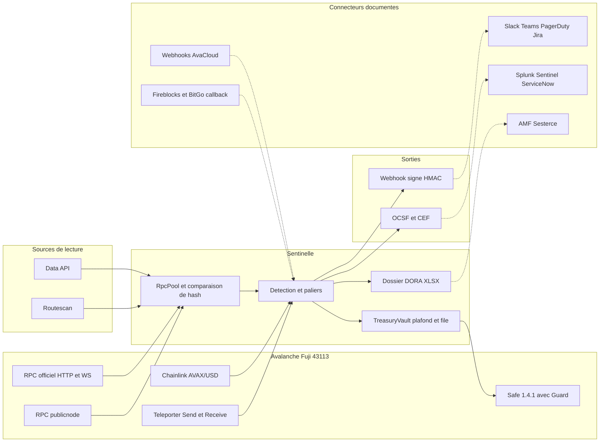

# Sentinelle Fuji : connecteurs testés en direct (10 oct. 2026)

Tous les tests sont en **lecture seule** : aucune clé, aucun compte, aucune transaction signée, aucun déploiement sur Fuji. Les données utilisées sont publiques ou synthétiques. Les résultats viennent de 9 sondes (RPC, Data API, Safe, Chainlink, ICM, OpenZeppelin, registres réglementaires, alerting, custodians). Les scripts de test sont dans le dossier de brouillon de la session, pas dans le repo.

## Glossaire court

- **Fuji** : le réseau de test d'Avalanche (chainId 43113). L'argent n'y a aucune valeur.
- **RPC** : la porte d'entrée qui permet de lire la blockchain (ou d'y envoyer une transaction).
- **Safe** : le portefeuille multi-signatures le plus répandu (il faut par exemple 2 signatures sur 3). **Guard** : un petit contrat qui peut refuser une transaction du Safe.
- **Custodian** : le prestataire qui garde les clés des clients (Fireblocks, BitGo...). **Callback** : un appel que le custodian fait à notre serveur avant de signer, pour demander « on y va ? ».
- **Data feed** : un prix publié sur la chaîne par Chainlink. **Heartbeat** : délai maximal entre deux mises à jour du prix.
- **ICM / Teleporter** : le système de messages entre chaînes Avalanche.
- **Webhook** : une alerte envoyée par HTTP à une adresse que nous fournissons.
- **OCSF, CEF, STIX** : formats standards pour envoyer des alertes de sécurité à un SIEM (outil de supervision d'un SOC).
- **DORA** : le règlement européen sur la résilience numérique. **PSCA/CASP** : prestataire de services sur crypto-actifs. **LEI** : identifiant mondial d'une entreprise. **GLEIF** : l'annuaire public des LEI.

## 1. Tableau maître

Heures = effort d'intégration estimé. Verdicts : fonctionne, partiel, bloqué (clé ou compte requis), absent sur Fuji.

| Connecteur | Testé comment | Verdict | Ce que ça apporte | Heures | Doc officielle |
|---|---|---|---|---|---|
| RPC officiel Avalanche (HTTP + WebSocket) | `eth_chainId`, blocs `finalized`/`safe`, `newHeads`, logs, 1000 appels en rafale | fonctionne | Lecture temps réel, finalité mesurable | 1 à 3 | https://build.avax.network/docs/rpcs/c-chain |
| RPC publicnode (second avis) | Comparaison des hash de bloc avec le RPC officiel | fonctionne (sans état historique) | Détecte un nœud menteur ou en retard | 2 à 3 | https://chainlist.org/chain/43113 |
| RPC drpc | Mêmes appels | partiel (batch 3, pas d'historique) | Secours | 0,5 | idem |
| RPC Ankr, ZAN | `eth_chainId` | bloqué (clé) | Aucun besoin | 0 | https://www.ankr.com/rpc/ |
| Traces (`debug_`, `trace_`), `txpool` | 5 méthodes sur le RPC officiel | absent sur le RPC public Fuji | Aucun (décoder les logs à la place) | 0 | https://build.avax.network/docs/rpcs/c-chain |
| Data API (ex-Glacier) | Blocs, soldes, transactions, ERC-20, internes sur 43113, sans clé | fonctionne (sauf `listNative`, erreur 500) | Seconde source indépendante du RPC, historique d'adresse | 2 à 3 | https://build.avax.network/docs/api-reference/data-api/getting-started |
| Webhooks AvaCloud | `GET` (401), `POST` vide (400 qui liste les 3 types d'événements) | bloqué (clé) ; Fuji acceptée selon la spec, création non vérifiée | Alerte poussée, hors du RPC du client | 3 à 4 | https://build.avax.network/docs/api-reference/webhook-api |
| Routescan / Snowtrace testnet (API type Etherscan) | `txlist`, `balance`, `tokentx`, `getLogs`, `getabi`, `getsourcecode` | fonctionne, sans clé | Troisième avis, ABI du contrat de destination, liens de preuve | 1 à 2 | https://docs.routescan.io/ |
| Safe 1.4.1 (contrats) | `eth_getCode` sur les 6 adresses canoniques | fonctionne | Un vrai Safe 2 sur 3 sur Fuji, sans bytecode maison | 1 à 2 | https://github.com/safe-global/safe-deployments |
| Safe protocol-kit 8.0.7 | Prédiction d'adresse + `eth_call` de la création (non signé) | fonctionne | Création et exécution de transactions Safe en script | 1 à 2 | https://docs.safe.global/sdk/protocol-kit |
| Safe Guard (`setGuard`) | Lecture du code 1.4.1 (interface `Guard`, `0xe6d7a83a`) | fonctionne (par le code) | Plafond ou refus avant exécution | 3 à 4 | https://docs.safe.global/advanced/smart-account-guards |
| Safe Transaction Service, interface Safe{Wallet}, api-kit | 6 URL testées | absent sur Fuji (mainnet 43114 seulement) | Rien pour la démo | 0 | https://docs.safe.global/core-api/transaction-service-overview |
| Zodiac ModuleProxyFactory | `eth_getCode` | fonctionne | Base pour un module | 1 | https://github.com/gnosisguild/zodiac-modifier-roles |
| Zodiac Roles v2 | `eth_getCode` sur Fuji et mainnet | absent sur Fuji (présent sur mainnet) | À déployer soi-même ou module maison | 4 à 6 (ou 2 maison) | idem |
| Chainlink AVAX/USD | `latestRoundData` + 40 rounds d'historique | fonctionne (fraîcheur max 629 s, écart de 0,04 % avec le mainnet) | Prix de référence indépendant, preuve datée | 2 | https://docs.chain.link/data-feeds/price-feeds/addresses?network=avalanche |
| Chainlink USDC/USD et autres | Mêmes appels | partiel (heartbeat 24 h) | Garde-fou de dépeg, pas un signal frais | 0,5 | idem |
| Chainlink Automation | `typeAndVersion`, `getActiveUpkeepIDs` | partiel (déployé, enregistrement = transaction + LINK) | Déclencheur on-chain, bonus | 4 à 6 | https://docs.chain.link/chainlink-automation/overview/supported-networks |
| Chainlink Functions | `typeAndVersion` du routeur | partiel (déployé, abonnement LINK) | Hors cœur | 6 et plus | https://docs.chain.link/chainlink-functions/supported-networks |
| Chainlink Proof of Reserve | Filtre des répertoires officiels | absent sur Fuji (0 sur 24 flux) | Ligne documentée seulement | 0 à 1 | https://docs.chain.link/data-feeds/smartdata |
| ICM / Teleporter (C-Chain Fuji) | `eth_getLogs` Send/Receive sur 1 M de blocs | fonctionne (668 Send, 715 Receive en un mois) | Surveillance des messages entre chaînes | 2 à 3 | https://build.avax.network/docs/cross-chain/icm-contracts/addresses |
| ICM côté Echo / Dispatch | `getLogs` paginé par 2048 blocs, appariement par `messageID` | fonctionne (relayeur Fuji vers Echo arrêté) | Alertes « Receive sans Send » et « Send sans Receive » | 3 à 4 | https://build.avax.network/docs/cross-chain/avalanche-warp-messaging/deep-dive |
| ICTT (transferts de tokens entre chaînes) | `eth_getCode` d'un contrat cité par une doc tierce | partiel (existence prouvée seulement) | Mouvements de valeur entre chaînes | 4 à 6 | https://build.avax.network/docs/cross-chain/interchain-token-transfer/overview |
| OpenZeppelin 5.6.1 + Hardhat 2.29.1 | Contrat `TreasuryVault`, 4 tests verts, abonnement WebSocket | fonctionne (en local) | Le vrai « niveau or » : plafond, file d'attente, rôle Sentinelle qui ne fait que resserrer | 3 à 4 | https://docs.openzeppelin.com/contracts/5.x/access-control |
| Foundry | `forge` | absent de la machine | Tests d'invariants (alternative : boucles Hardhat) | 1 | https://book.getfoundry.sh/ |
| GLEIF (LEI) | 10 recherches, 364 LEI du registre ESMA recoupés | fonctionne, sans clé | Champs DORA 1.3a, 1.6, 1.14, validation des prestataires | 3 | https://www.gleif.org/en/lei-data/gleif-lei-look-up-api |
| Registre MiCA ESMA (CSV) | Téléchargement + comptage | fonctionne (pas d'API) | Annuaire des clients cibles | 2 | https://www.esma.europa.eu/esmas-activities/digital-finance-and-innovation/markets-crypto-assets-regulation-mica |
| Gabarit DORA (ITS 2025/302, XLSX AMF v1.2) | Lecture EUR-Lex, instructions ESAs, lecture du XLSX | fonctionne | Fichier de déclaration conforme (77 champs) | 6 à 8 | https://eur-lex.europa.eu/legal-content/EN/TXT/HTML/?uri=CELEX:32025R0302 |
| Dépôt AMF (Sesterce) | Lecture de la page, recherche d'une API | bloqué (compte) ; aucune API n'existe | Fichier prêt à joindre, dépôt humain | 1 | https://www.amf-france.org/fr/formulaires-et-declarations/dora |
| OCSF 1.9.0 (classe 2004) | Validateur public, 0 erreur sur le payload corrigé | fonctionne | Format reconnu des SIEM, test en CI | 2 à 3 | https://schema.ocsf.io/ |
| CEF | Lecture par le parseur `pycef` | fonctionne (partiel) | Export fichier pour un SIEM | 1 | https://www.microfocus.com/documentation/arcsight/arcsight-smartconnectors-24.3/pdfdoc/cef-implementation-standard/cef-implementation-standard.pdf |
| STIX 2.1 | Bibliothèque `stix2`, patterns | partiel (pas d'objet standard pour un portefeuille) | Partage d'indicateur | 2 | https://docs.oasis-open.org/cti/stix/v2.1/stix-v2.1.html |
| Slack (webhook entrant) | POST vers fausse URL : réponse `no_team` | payload prêt, livraison bloquée (URL de workspace) | Alerte humaine | 1 à 2 | https://docs.slack.dev/messaging/sending-messages-using-incoming-webhooks/ |
| Teams (Workflows) | Carte validée contre le schéma Adaptive Card | partiel (livraison bloquée, tenant requis) | Alerte humaine | 2 | https://learn.microsoft.com/en-us/connectors/teams/ |
| PagerDuty Events v2 | Validé contre le schéma OpenAPI ; réseau en `ECONNRESET` depuis cette machine | payload prêt, livraison bloquée | Astreinte | 1 à 2 | https://developer.pagerduty.com/api-reference/368ae3d938c9e-send-an-event-to-pager-duty |
| Jira Cloud | Description validée contre le schéma ADF | partiel (instance requise) | Ticket d'incident | 2 à 3 | https://developer.atlassian.com/cloud/jira/platform/rest/v3/api-group-issues/ |
| Splunk HEC, Microsoft Sentinel, ServiceNow | Aucun (aucune instance publique) | bloqué | Payloads prêts, non livrés | 1 à 6 chacun | voir rapports de sonde |
| Webhook générique signé HMAC | Serveur local : signé 202, rejeu 200 doublon, falsifié 401, vieux 408 | fonctionne (local) | Sortie signée, idempotente, pour récepteurs que nous contrôlons | 1 | n/a |
| Fireblocks Co-Signer Callback | Handler local avec JWT RS256 et décodage du `rawTx` : rejet 24 ms, accord 5 ms, signature forgée refusée | fonctionne en local ; test réel bloqué (compte sandbox) | Dernier juge avant signature (budget 30 s) | 3 à 4 | https://developers.fireblocks.com/cosigners/callback-handler/approve-transactions.md |
| BitGo politique webhook | Serveur local 200/403 | fonctionne (doc) ; bloqué (compte) | Même rôle, `rawTx` moins lisible | 3 | https://developers.bitgo.com/docs/policies-webhook.md |
| Cobo, Copper, Ledger Enterprise | Lecture de la doc | partiel (Cobo : callback sur hash ; Copper et Ledger : pas de veto synchrone) | Approbateur parmi d'autres | 4 à 6 | https://cobo.com/developers/v2/guides/mpc-wallets/server-co-signer/callback-server-overview.md |
| Coinbase Prime | Lecture de la doc | absent comme callback | Surveillance seulement | n/a | https://docs.cdp.coinbase.com/prime/concepts/transactions/withdrawals.md |
| Hypernative, Blockaid | `curl` : 401 ou redirection vers login | bloqué (clé, accès commercial) | Score de risque tiers | n/a | https://www.blockaid.io/ |
| Forta Firewall | Lecture de la doc | partiel (Fuji non confirmé) | Attestation de risque | n/a | https://docs.forta.network/en/latest/what-is-forta-firewall/ |
| Tenderly | Gateway Fuji public : 429 sur la simulation ; API : 401 | partiel / bloqué (plan payant) | Alternative gratuite : `eth_call` et `eth_estimateGas` sur le RPC | 1 | https://docs.tenderly.co/simulations/single-simulations.md |
| OpenZeppelin Monitor | Lecture de `avalanche_fuji.json` + RPC | fonctionne (config prête, service non lancé) | Surveillant hors bande, déclencheur webhook | 2 | https://github.com/OpenZeppelin/openzeppelin-monitor |

## 2. Ce qui marche vraiment aujourd'hui sur Fuji (preuves)

- **Lecture de la chaîne** : `eth_chainId` donne `0xa869`. Les tags `finalized` et `safe` répondent en 75 ms. Le WebSocket sert `newHeads`, `logs` et `newAcceptedTransactions` (10 blocs en 30 s). 1000 appels en rafale : 100 % de succès.
- **Temps de bloc mesuré** : 15 blocs sur 32 s, écarts de 1 à 6 s, moyenne 2,27 s. Le « environ 1 bloc par seconde » est faux.
- **Double source** : bloc 59278398, hash et racine d'état identiques sur 3 RPC. La Data API et Routescan donnent le même solde (`8549275501241613`) que le RPC.
- **Historique** : `getLogs` filtré par adresse fonctionne sur toute la chaîne. Sans filtre, le plafond pratique est autour de 50 000 blocs (au-delà : erreur 500).
- **Safe** : les 6 contrats 1.4.1 existent ; le protocol-kit prédit l'adresse `0xC788...E555` et la simulation de création réussit.
- **Prix** : AVAX/USD à 10,4776 sur Fuji contre 10,4733 sur le mainnet. Âge 291 s pour un heartbeat de 600 s.
- **ICM** : 668 envois et 715 réceptions en un mois sur la C-Chain Fuji ; 5 paires Fuji vers Echo retrouvées par `messageID` avec 3 à 6 s de délai.
- **Contrat de plafond** : `TreasuryVault` compile et passe 4 tests (plafond, file d'attente, Sentinelle qui ne fait que resserrer, timelock) ; abonnement WebSocket aux événements en 355 ms en local.
- **Données réglementaires** : GLEIF répond en 0,2 à 0,5 s ; le registre ESMA se télécharge ; le gabarit XLSX de l'AMF se charge.
- **Alertes** : une sortie OCSF validée par le validateur officiel (0 erreur) ; un webhook signé HMAC testé en local.
- **Custodian** : un handler de type Fireblocks décide en 3 à 24 ms, contre 30 s de budget.

## 3. Ce qui exige une clé ou un compte (à faire par un humain)

| Quoi | Démarche exacte | Pour obtenir quoi |
|---|---|---|
| Clé Data API / webhooks AvaCloud | Compte gratuit sur https://build.avax.network/login, puis Console, Utilities, Data API Keys, Create API Key. Il faut aussi une URL HTTPS publique (tunnel ngrok ou Cloudflare) | Création de webhooks `address_activity` sur 43113 ; quota 8000 CU/min au lieu de 6000 |
| Portefeuille de test + AVAX Fuji | Créer un portefeuille **dédié au test** (jamais celui de l'équipe), faucet https://faucets.chain.link/avalanche-fuji (ou celui d'Avalanche) | Déployer le Safe et le Guard, mesurer la latence réelle |
| LINK de test | Même faucet Chainlink, puis https://automation.chain.link | Chainlink Automation |
| Sandbox Fireblocks | Inscription sur https://developers.fireblocks.com/docs/sandbox-quickstart (accès « au cas par cas » selon une page), appairage du Co-signer, IP source à autoriser | Tester le callback chez l'éditeur |
| Compte test BitGo | https://developers.bitgo.com/docs/get-started-environments (retraits custody en test : contacter BitGo) | Tester la politique webhook |
| Webhook Slack | Un workspace Slack, une app, une URL de webhook à mettre dans `.env` | Alerte réelle |
| Teams, PagerDuty, Jira, Splunk, Sentinel, ServiceNow | Un compte ou une instance chacun (voir tableau 1) | Livraison réelle ; sinon payload seul |
| Dépôt AMF | Demande de compte Sesterce à `ir.dora-marches@amf-france.org`, réservé à un PSCA agréé | Dépôt réel, hors hackathon |
| Safe Transaction Service | Clé via https://docs.safe.global/core-api/api-overview (non vérifié) ; inutile sur Fuji | Rien pour la démo |

Aucune de ces clés ne doit entrer dans le repo : `.env` gitignoré uniquement.

## 4. Ce qui n'existe pas sur Fuji, et l'alternative

| Absent | Alternative |
|---|---|
| Traces `debug_` / `trace_`, `txpool`, `eth_getBlockReceipts` (RPC officiel) | Décoder les logs et les receipts un par un ; traces en local avec Hardhat. |
| État historique chez publicnode et drpc | Comparer en `latest` ou par hash de bloc ; le RPC officiel garde l'état. |
| Interface Safe{Wallet}, Transaction Service, api-kit | Signatures collectées en local avec le protocol-kit. |
| Safe 1.5.0 (`IModuleGuard`) | Rester sur 1.4.1. Attention : un Module contourne le Guard 1.4.1. |
| Zodiac Roles v2 | Module maison à un seul sélecteur autorisé (2 h) ou déploiement via la factory ERC-2470 (4 à 6 h). |
| Chainlink Proof of Reserve | Citer le format et lire un flux mainnet en lecture seule, étiqueté comme tel ; ou ligne documentée. |
| Heartbeat court sur USDC/USD | Règle de péremption propre à chaque flux (600 s pour AVAX/USD, 24 h pour USDC/USD). |
| API de dépôt de l'AMF | Générer le XLSX officiel ; le RSSI dépose. |
| Relayeur ICM actif Fuji vers Echo | Surveiller l'historique ; pour un direct, envoyer nous-mêmes un message (clé requise). |
| Support Fuji confirmé chez Fireblocks (seul AVAX mainnet listé), Forta, Blockaid, Cobo | Le handler prouve la logique en local ; nommer l'intégration « documentée ». |

## 5. Architecture de branchement recommandée

**À construire pour de vrai (testé, sans compte)** : RpcPool (officiel + publicnode) ; Data API et Routescan en recoupement ; lecteur du flux AVAX/USD ; `TreasuryVault` en Safe Guard ou coffre direct ; collecteur ICM (Send/Receive) ; export OCSF validé en CI et CEF ; webhook signé HMAC ; client GLEIF ; export du XLSX DORA ; handler de callback Fireblocks en simulation locale.

**Documenté seulement (clé ou compte requis)** : webhooks AvaCloud, Automation, Fireblocks/BitGo réels, Slack/Teams/PagerDuty/Jira, SIEM, Sesterce.

Trait plein : construit et testé. Trait pointillé : documenté, non branché.

Choix clés : (1) le plafond vit dans un contrat que nous contrôlons, donc il tient même si le circuit d'approbation est piraté ; (2) trois lectures indépendantes (RPC, Data API, Routescan) avec compteur de désaccord ; (3) tout appel en écriture ou webhook est derrière une variable d'environnement.

## 6. Écarts avec docs/architecture.md

| Supposé dans le document | Constat | Action |
|---|---|---|
| « Environ 362 CASP dans l'UE dont 36 en France » (l. 26) | 348 pour l'UE-27, 367 avec l'EEE ; **FR = 36 confirmé** (registre au 6 oct. 2026) | Écrire « environ 350 dans l'UE » et dater. |
| « Aucun chiffre de latence avant mesure, y compris ~1 bloc/s » (l. 210) | Mesuré : 1 à 6 s, moyenne 2,27 s. La règle de prudence est bonne | Parler de blocs, p50 et max. |
| Support du tag `finalized` « testé avant d'être promis » (l. 337) | Testé : fonctionne sur le RPC officiel | Peut s'afficher. |
| Test 20 min Chainlink + finalité (P1) | Rounds toutes les 600 s : un test de 20 min ne voit qu'une ou deux mises à jour ; max observé 629 s | Tester sur 40 rounds d'historique plus un suivi plus long ; seuil suspect 700 s, périmé 900 s. |
| Safe Guard, callback custodian : « non construit » (l. 50) | Safe Guard est réalisable et testé par le code (3 à 4 h) ; callback Fireblocks testé en local | Les promouvoir en « simulés localement ». |
| Safe visible dans l'interface officielle (supposé dans `T1_P4_integration_ecosysteme.md`) | Le Transaction Service et Safe{Wallet} n'existent pas pour Fuji | Signatures locales avec le protocol-kit. |
| Roles Modifier (Zodiac) pour limiter la Sentinelle à `limit()` et `pause()` | Absent sur Fuji | Rôle OpenZeppelin dans `TreasuryVault` (déjà testé). |
| Webhook AvaCloud avec un seul type `address_activity` | Trois types existent (`address_activity`, `primary_network_address_activity`, `validator_activity`) | Corriger. |
| Exemple OCSF §7.1 (`observables.name`, sans `type_id`) | Invalide : 4 erreurs au validateur | Utiliser le payload corrigé (profil `security_control`, `type_id` 99). |
| Teams « en retraite » | Connecteur Office 365 arrêté en mai 2026 ; seul Workflows reste | Mettre à jour. |
| Montants DORA | Champs monétaires 3.11, 4.13, 4.14 déclarés **en milliers** | Test unitaire sur le facteur 1000. |
| Champ DORA 1.3 | Le XLSX le scinde en 1.3a et 1.3b | Suivre le XLSX. |
| ICM, L1 permissionné : « feuille de route » (l. 340) | La lecture ICM est faisable (5 à 8 h) ; ICM est à signatures BLS pondérées, **pas** un vérificateur unique | Ajouter une surveillance ICM en lecture ; ne jamais dire « un seul vérificateur ». |
| Traceur et rejeu : traces d'appels internes | `debug_traceTransaction` absent | Décoder les logs ; traces en local seulement. |
| « Rejeu réel » historique | Accessible par `getLogs` filtré sur une adresse ; sans filtre, limite de poids | Cibler des contrats précis. |
| Un batch RPC de 40 | Plafond observé de 25 (officiel) et 3 (drpc) | Rester à 20 au plus. |

Limites de ces tests : pas de test de débit sur plusieurs minutes, aucune écriture sur Fuji (latence réelle de transaction non mesurée), aucune livraison réelle d'alerte, PagerDuty injoignable depuis cette machine (cause non diagnostiquée).
