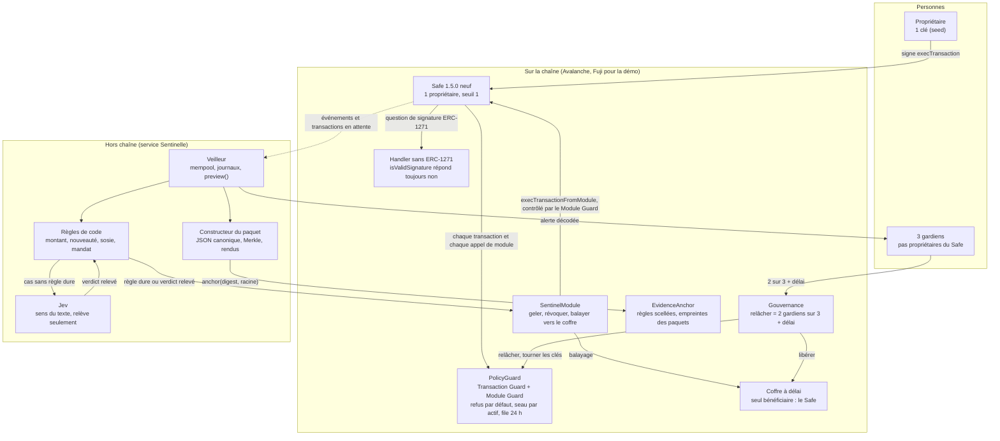
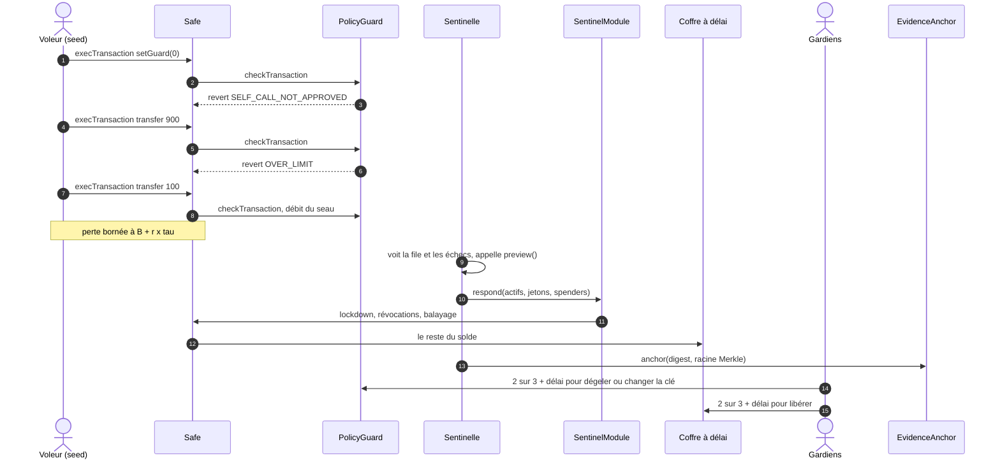

> **Archivé (D-007)** : étude de faisabilité de l ancienne direction « compte protégé Safe + réponse automatique » (D-006), abandonnée au profit de la barrière d intention sur wallet normal. Conservée pour la leçon : sur un Safe, même un Guard laisse fuir via ERC-1271/permit.

# T1 P4 : faisabilité du compte protégé pour particulier, menace par menace (11 oct. 2026)

> **Statut** : recherche et prototypes jetables. Rien n'est déployé, rien n'est commité. Document du worker Claude (lane tech) pour Adem et Titouan.
> **Méthode** : 6 prototypes, un par menace (D-006). Chaque prototype a été attaqué par une red team indépendante, puis un troisième agent a tout rejoué. Pour ce document, j'ai de nouveau rejoué les 12 suites, la mutation d'`ApprovalGuard`, le correctif de la red team « empoisonnement » sur les deux versions de Safe, et j'ai comparé le bytecode Permit2 du prototype à celui de Fuji (le 11/10 vers 00 h 30).
> **Cadre** : chaîne Hardhat locale (chainId 43113), plus un seul passage en fork de Fuji, en lecture seule. Jetons et clés synthétiques (`Wallet.createRandom`). Node 25.6, non supporté par Hardhat 2 : avertissement à chaque lancement, sans effet observé. Aucun audit. Les informations sur les produits concurrents viennent de `research/titouan/J_wallets_perso/` (W2 à W8), de `T1_P4_nouveaute_verdict.md` et de 2 pages relues aujourd'hui. Elles sont à revérifier avant tout affichage.
> **Légende** : **[rejoué]** = relancé par moi pour ce document. **[annoncé]** = chiffre de l'agent prototype, confirmé par l'agent de vérification. **[P]** = source primaire lue. **[S]** = source secondaire. **[À vérifier]** = non confirmé.

## Vocabulaire (le même que `docs/comprendre.html`)

| Mot | En clair | Techniquement |
|---|---|---|
| Safe | le coffre | un compte qui est un contrat ; ici 1 propriétaire, seuil 1 |
| Guard | le vigile | contrat appelé par le Safe avant (`checkTransaction`) et après (`checkAfterExecution`) chaque transaction ; s'il fait `revert`, rien ne se passe |
| Module Guard | le vigile des assistants | Safe 1.5.0 seulement : même contrôle sur les appels des modules (`checkModuleTransaction`) |
| Module | l'assistant | contrat qui fait agir le Safe sans signature (`execTransactionFromModule`) |
| Handler | le guichet | contrat auquel le Safe transmet tout appel qu'il ne connaît pas, y compris la question « cette signature est-elle de toi ? » (ERC-1271, `isValidSignature`) |
| Mandat | le prélèvement automatique | `approve`, `setApprovalForAll`, `permit`, Permit2 : autoriser un tiers à prélever, qui le fera ensuite par `transferFrom` |
| Seau | le compte-gouttes | réserve de sortie de capacité B qui se remplit de r par seconde ; sur une durée τ, il sort au plus B + r·τ |
| Sentinelle | l'agent de sécurité dehors | service hors du téléphone, qui peut seulement resserrer, révoquer et mettre au coffre |
| Coffre à délai | le coffre temporisé | contrat qui ne rend les fonds qu'au Safe, après un délai pendant lequel on peut annuler |
| Gardiens | les proches | 3 personnes ou appareils, qui ne sont pas propriétaires du Safe |

## Résumé en 8 lignes

1. Les 6 prototypes tournent : 197 tests de mécanisme verts **[rejoué]**. Les 6 ont aussi été cassés par leur red team, sur 102 scénarios d'attaque écrits.
2. Ce qui tient partout : retirer le Guard, ajouter un module, changer de propriétaire ou faire un `delegatecall` échoue. Deux exceptions seulement : un module activé avant le Guard sur Safe 1.4.1, et un `delegatecall` qu'on aurait explicitement autorisé. Quand rien ne fuit par ailleurs, le seau borne bien une clé volée. Perte mesurée = B + r·τ (100 sEUR à τ = 0, 124 sEUR à 24 h). La red team n'a trouvé aucun vol au-delà de cette borne en 15 attaques.
3. Ce qui casse, en deux familles. (a) La valeur sort par un chemin que le Guard ne mesure pas : signatures ERC-1271, remboursement de gaz du Safe, sélecteur inconnu, actif non suivi, mandat hérité. (b) La vivacité : une seule clé (un gardien, la Sentinelle ou le propriétaire) peut bloquer la récupération pour toujours.
4. La faille la plus grave : le handler standard du Safe valide toute signature du propriétaire. Un permit vide alors tout le solde sans aucune transaction du Safe (300 000 sUSD en 2 transactions). Correction : un handler sans ERC-1271, posé à la création et verrouillé. Elle est testée dans 3 prototypes et je l'ai rejouée aujourd'hui sur Safe 1.4.1 et 1.5.0.
5. Ce qui n'est pas à nous : plafond, délai, gardiens, liste blanche, « resserrer vite, relâcher lentement » (Ready/Argent, Bitkey, Casa, Coinbase Vault, Safe, Zodiac, et surtout le brouillon ERC-8238). Ce que nous n'avons trouvé nulle part : la réponse automatique hors appareil à pouvoirs bornés, la fermeture du canal des signatures au niveau du compte, et le paquet de preuves vérifiable sans nous croire.
6. Jev ne touche pas la borne de perte : il peut relever une alerte, jamais l'abaisser. Il n'a jamais été appelé (aucune clé, aucun appel API), donc sa précision est inconnue.
7. L'architecture minimale : un Safe 1.5.0 neuf, un seul Guard à refus par défaut (Transaction Guard et Module Guard), un handler sans ERC-1271, un module Sentinelle à 3 gestes, un coffre à délai, une gouvernance asymétrique et une ancre de preuves.
8. Faisabilité : le P0 (seed volée, drainer, réponse, preuve) se construit en assemblant `seed-stolen` et `evidence-pack` avec 6 changements connus : portage en 1.5.0 avec Module Guard, installation atomique avec handler sans ERC-1271, règle `gasPrice == 0` partout, révocation typée, gouvernance asymétrique avec gel qui expire, correctifs A11 et A12 du paquet. Le chantier encore ouvert est la gouvernance (vivacité), pas la borne.

---

## 1. Ce qui marche vraiment, menace par menace

**En clair.** On a construit six maquettes du même coffre : un vigile à la porte, un compte-gouttes pour les sorties, un agent dehors qui peut seulement fermer et mettre l'argent au coffre temporisé. Une maquette par façon de voler un particulier. Puis on a payé des cambrioleurs (la red team) pour les casser. Les six ont été cassées, mais presque jamais par la porte principale : par des fenêtres oubliées, ou en enfermant le propriétaire dehors.

**Techniquement.** Chaque ligne résume un dossier de `scratchpad/feasibility/` (section 7). « Tests verts » = suite du mécanisme. « Cassé » = au moins une attaque de la red team réussit.

| Menace | Mécanisme testé | Tests verts ? | Cassé par la red team ? | Perte maximale (annoncée, puis après red team) | Ce qu'on ne couvre pas |
|---|---|---|---|---|---|
| Drainer par mandat (`approve`, `setApprovalForAll`) | `ApprovalGuard` (Safe 1.4.1) : refuse de créer un mandat vers un spender non listé ; seau mesuré par écart de solde ; handler sans ERC-1271 | Oui : 34/34 en local, fuzz de 300 séquences sans violation, 15/15 mutants tués **[rejoué]** ; 34/34 en fork de Fuji **[annoncé]** | Oui : 11 attaques sur 16, dont 50 000 USDC via `redeem` pour un seau de 1 000 par jour | Annoncé : 0 vers un inconnu, la limite pour un spender listé. Après : non bornée pour tout actif détenu sous une forme non suivie ; limite × nombre de cycles pour un spender listé compromis | mandats antérieurs, gardiens manipulés, sélecteurs absents de la liste, interface détournée |
| Drainer par signature hors chaîne (`permit`, Permit2) | `PermitGate` (handler ERC-1271 à refus par défaut, qui recalcule l'empreinte de la demande) + `HandlerLockGuard` | Oui : 26/26 avec le vrai bytecode Permit2 de Fuji **[rejoué, identité vérifiée]** | Oui : 12 attaques sur 16 ; sans aucune clé, n'importe qui vide la liste blanche | Annoncé : 0 par permit vers un inconnu. Après : tout le solde si l'initialisation n'est pas atomique (10 000 jetons) ou si un relayeur listé paie un destinataire choisi par l'appelant | EOA et EIP-7702 (pas de handler), transactions directes du propriétaire, ordres non recalculés (PermitBatch, Seaport, CoW) |
| Seed ou clé volée | `SentinelGuard` à refus par défaut + `SentinelModule.respond()` + `DelayVault` + handler sans ERC-1271 | Oui : 39/39 ; 150 plannings aléatoires **[rejoué]** | Seulement en disponibilité : la clé Sentinelle seule gèle tout pour toujours. Aucun vol au-delà de la borne en 15 attaques | Σ min(solde, B + r·τ) par actif : 100 sEUR à τ = 0, 124 sEUR à 24 h. Inchangé après la red team | mandats antérieurs, propriétaire + 2 gardiens, DeFi, NFT |
| Empoisonnement d'adresse, nouvelle destination | `NewDestinationGuard` (Safe 1.4.1 et 1.5.0) : carnet d'adresses, voie instantanée plafonnée, file de 24 h, sosie (3 premiers + 3 derniers caractères) = gardien obligatoire | Oui : 58/58 sur les deux versions ; 20/20 sosies détectés dès 3 + 3 caractères **[rejoué]** | Oui : 9 attaques sur 20, dont tout le solde (300 000 sUSD) par ERC-1271. Correctif rejoué : 5 attaques passent à « défendu » | Annoncé : 200 sEUR par jour en instantané. Après : tout le solde par signature (corrigé) ; une destination « assaisonnée » devient illimitée | premier paiement à un inconnu, gardien qui valide sans regarder, sosie de moins de 3 caractères d'un côté |
| Faux support, contrainte physique (le propriétaire signe tout) | `DelayGuard` (Safe 1.5.0) : seau instantané, tout le reste en file de 24 h, un seul gardien peut annuler | Oui : 21/21 **[rejoué]** | Oui : 3 vols et 3 nuisances sur 20. Le propriétaire seul évince le gardien vigilant : 90 AVAX sur 100 partent en 48 h | Annoncé : 1 AVAX + 1 par jour en instantané, tout si personne n'annule en 24 h. Après : il faut 2 gardiens vigilants, pas 1 | séquestration plus longue que le délai, gardiens sous la même menace, alerte réelle (non codée) |
| Après le vol : réponse et paquet de preuves | `SentinelGuard` (Safe 1.5.0) + module + coffre + `EvidenceAnchor` + scripts du paquet | Oui : 19/19 ; perte 260 sur 1 000, 700 mis au coffre, réponse en 4 blocs **[rejoué]** | Oui : 8 attaques sur 15. Remboursement de gaz : 900 aEUR pour un plafond de 100 ; paquet qui sous-déclare | Annoncé : plafond + recharge + anciens mandats. Après : 90 % du solde par remboursement de gaz (correction connue, voir 2.2) | tentatives refusées (aucun événement), natif sorti hors Guard, conformité DORA |

**Ce que ces tests prouvent, et ce qu'ils ne prouvent pas.** Ils prouvent la logique des contrats sur une chaîne locale, avec des attaquants qui détiennent les clés qu'on leur donne. Ils ne prouvent rien sur : l'ordre réel des transactions sur Avalanche, la latence d'une vraie Sentinelle, les jetons réels (USDC v2.2 n'a pas été testé, seulement une imitation), le gaz réel, l'ergonomie, le comportement des gardiens humains, ni la précision de Jev.

### 1.1 Drainer par mandat

*En clair* : un faux site te fait signer un mandat de prélèvement, puis le voleur se sert sans que ton compte ne signe plus rien. Le vigile ne voit jamais le prélèvement : il doit donc refuser le mandat lui-même, ou le faire payer d'avance dans le seau.

*Techniquement* (`drainer-approve/`) :
- `ApprovalGuard.sol` décode `checkTransaction` à la main dans `fallback()`, parce que ses 11 paramètres provoquent « stack too deep ». Ses règles :
  - R1 refuse 10 formes de mandat (`approve`, `increaseAllowance`, `approveAndCall`, `setApprovalForAll`, ERC-6909, `Permit2.approve`…) sauf vers un spender listé et sous `approvalLimit` ;
  - R2 refuse le `delegatecall`, sauf vers `MultiSendCallOnly`, dont il décode chaque sous-appel ;
  - R3 refuse tout appel du Safe vers lui-même, sauf un appel exact approuvé par les gardiens ;
  - R4 exige `gasPrice = 0` ;
  - R5 tient un seau par actif suivi, mesuré par écart de solde dans `checkAfterExecution`.
- Gouvernance : `propose`, `vote`, `cancel`, `execute` (2 gardiens sur 3, délai qui démarre au quorum). Freins immédiats : `revokeSpender`, `tightenBucket`, `freezeAll`. `Protect.sol` contient `SetupHelper.init` (installe Guard et module pendant `setup()`), `ReceiverOnlyHandler` (sans ERC-1271) et `SentinelRevoker`.
- Événements : `ApprovalAllowed`, `OutflowCharged`, `SpenderListed`, `SpenderRevoked`, `BucketTightened`, `Frozen`, `Proposal*`. Un refus est un `revert` avec erreur typée (`ApprovalRefused(token, spender, amount)`) : aucun événement n'est écrit.
- Prouvé **[rejoué]** :
  - sans Guard (témoin), 100 000 USDC sur 100 000 partent ;
  - avec le Guard, 14 formes de mandat sont refusées et le drainer obtient 0 ; la course dans le même bloc donne une perte de 0 ;
  - un spender listé et compromis prend exactement 200, sur un seul cycle ;
  - fuzz : 300 séquences, 1 097 transactions, 0 violation ; le même générateur casse 53 séquences sur 60 sans Guard ;
  - mutation : 15 mutants sur 15 tués, mais souvent par un seul test (M1 seulement par B9, M5 seulement par B5) ;
  - coût : +185 056 gaz par transfert ERC-20 (100 636 sans Guard, 285 692 avec).
- Cassé :
  - ATK-1 : un spender listé boucle `approve(200)` puis prélève ; 8 000 USDC partent pour une limite de 200, et 2 000 dans un seul bloc (ATK-1b) ;
  - ATK-2 : `WAVAX.withdraw` puis envoi natif ; 500 AVAX pour un plafond de 5 ;
  - ATK-3 : `vault.redeem(parts, attaquant, safe)` ; 50 000 USDC, le solde USDC du Safe ne bouge pas ;
  - ATK-4, ATK-5, ATK-6 : `transferAndCall`, `allow` de Comet (30 000 USDC), `transferPunk` ;
  - ATK-7 : un mandat antérieur au Guard ;
  - ATK-8 : le module Sentinelle approuve le NFT n°0 ;
  - ATK-12 et ATK-13 : veto d'un seul gardien, gel permanent.
- Leçon : une liste de sélecteurs interdits est perdue d'avance, il faut un **refus par défaut**. Et un mandat doit **coûter son montant dans le seau au moment où il est donné**.

### 1.2 Drainer par signature hors chaîne

*En clair* : ici, pas même de transaction. Tu signes un message, et c'est le voleur qui l'envoie. Le coffre répond « oui, c'est bien ma signature » à quiconque le lui demande, et le vigile ne regarde jamais ce guichet.

*Techniquement* (`drainer-permit/`) :
- Pourquoi le Guard ne suffit pas (B1, B2) : Permit2 appelle `isValidSignature` sur le Safe. Le handler standard répond « valide » dès que le propriétaire a signé. 10 000 jetons partent, le nonce du Safe ne bouge pas, et un Guard installé n'est jamais consulté.
- Faits établis :
  - un Safe ne peut pas signer un EIP-2612 classique (`ecrecover`) : ERC2612InvalidSigner (B4). Les permits qui n'acceptent que `ecrecover` (OpenZeppelin classique ; DAI et UNI d'après K4, par inférence) ne le touchent donc pas ;
  - Permit2 et les permits à signature `bytes` (forme USDC v2.2) passent par ERC-1271 (B1, B3, B5) ;
  - une EOA, ou une EOA déléguée en 7702, est vidée sans recours (B6) ;
  - l'allocation Permit2 vit dans Permit2 : `token.approve(0)` ne la révoque pas, seul `lockdown()` le fait (G11).
- `PermitGate.sol` est un handler qui sert plusieurs Safe ; son état est indexé par `msg.sender`.
  - Mode 1 : `registerPermit2Single`, `registerPermit2Transfer` et `registerErc2612` recalculent l'empreinte EIP-712 sur la chaîne, avec le domaine lu sur la chaîne. Ils exigent un spender listé, un montant sous le plafond, une signature valable au plus 1 h et une allocation d'au plus 30 jours. `isValidSignature` revérifie tout au moment de la validation.
  - Mode 2 : propriétaire + 2 gardiens sur 3 pour toute autre empreinte.
  - Événements : `SpenderQueued`, `SpenderActivated`, `SpenderRemoved`, `SignatureRequestRegistered`.
- `HandlerLockGuard.sol` refuse les sélecteurs d'administration et le `delegatecall`, ainsi que les mandats vers un spender non listé. Après exécution, il relit les emplacements de stockage du handler et du Guard (`getStorageAt`).
- Prouvé **[rejoué]** : 26/26. Le bytecode Permit2 du prototype est identique, octet pour octet, à celui de `0x000000000022D473030F116dDEE9F6B43aC78BA3` sur Fuji (9 152 octets, keccak `0x1f85f270…`), lu aujourd'hui par un `eth_getCode` en lecture seule.
- Cassé :
  - R1 à R3, sans aucune clé : un inconnu efface la liste blanche, annule 3 tours d'approbation des gardiens et baisse un plafond à 1 wei ;
  - R4 : si l'initialisation est séparée de la création, un inconnu l'initialise avec ses propres gardiens, puis la clé volée vide 10 000 jetons ;
  - R5 : le plafond s'applique par signature, pas en cumul ; 10 × 1 000 = 10 000 ;
  - R5b : le destinataire ne fait pas partie de la signature ; vol de 500 par devancement ;
  - R6 : plafond exprimé en unités brutes ; un jeton à 6 décimales est vidé (1 000 000) ;
  - R7 à R10 et R15 : mandats antérieurs, `approveAndCall` non filtré, aucune voie de récupération, `removeSpender` sans `lockdown`, `delegatecall` autorisé qui change le seuil.
  - Ont tenu : R11 (rejeu sur un autre Safe), R12 (faux domaine), R13, R14.
- Leçon : tout ce qu'on expose dans le handler est appelable par n'importe qui, avec `msg.sender` = le Safe (section 2.2, faille n° 4).

### 1.3 Seed ou clé volée

*En clair* : le voleur a ta clé ; pour la blockchain, il **est** toi. La seule défense est une règle que ta propre clé ne peut pas lever : un compte-gouttes, plus un agent dehors qui ferme et met le reste au coffre. C'est la maquette la plus solide.

*Techniquement* (`seed-stolen/`, Safe 1.4.1) :
- `SentinelGuard.sol` refuse par défaut. Il n'autorise que :
  - (1) une transaction exacte approuvée par 2 gardiens sur 3 + 48 h (`breakGlassId`, usage unique) ;
  - (2) `tighten()` et `lockdown()` sur lui-même ;
  - (3) tout envoi vers le coffre ;
  - (4) l'envoi natif, ou `transfer`, `approve` et `transferFrom(safe, …)` sur un actif suivi, débités du seau.
- Tout le reste est refusé avec `Refused(Verdict)` : `DELEGATECALL`, `SELF_CALL_NOT_APPROVED`, `TARGET_NOT_ALLOWED`, `SELECTOR_NOT_ALLOWED`, `BAD_CALLDATA`, `OVER_LIMIT`, `GAS_REFUND`, `REENTRANT`, `FROZEN`. `preview()` rend ce même verdict pour une transaction encore en attente. `checkAfterExecution` annule si un solde suivi baisse plus que le montant débité.
- `Quorum.sol` : `approve`, `cancel`, `isReady`, `_consume` ; le délai démarre au 2e vote. `SentinelModule.sol` : `respond()` gèle, balaie vers le coffre (destination immuable) et révoque, en une transaction. `DelayVault.sol` : `requestRelease`, `cancelRelease`, `executeRelease`, `lock`, `releaseTo` (quorum). `NoSigFallbackHandler.sol` : `isValidSignature` répond toujours `0xffffffff`.
- Prouvé **[rejoué]**, 39/39 :
  - rafale : il sort exactement B (100 sEUR + 2 AVAX) ;
  - drain lent : 110,0025 sEUR pour une borne de 110,00278 ;
  - `approve` puis prélèvement : débité une seule fois ;
  - contrôle ERC-1271 : 900 sEUR volés avec le handler standard, refus avec le handler sans signature ;
  - courses dans le même bloc : attaquant en premier, perte = B exactement ; Sentinelle en premier, perte 0 ; la Sentinelle décode un `setGuard(0)` en attente et le devance ;
  - 150 plannings aléatoires : pire rapport perte/borne = 0,953.

| τ (délai de réponse) | perte jeton (sEUR) | borne B + r·τ | perte native (AVAX) | borne |
|---|---|---|---|---|
| 0 | 100,0 | 100,0013 | 1,999999 | 2,0028 |
| 10 min | 100,1666 | 100,1680 | 2,3333 | 2,3361 |
| 1 h | 100,9999 | 101,0013 | 3,9999 | 4,0028 |
| 6 h | 105,9999 | 106,0013 | 10,0 (solde épuisé) | 14,0 |
| 24 h | 123,9999 | 124,0013 | 10,0 (solde épuisé) | 50,0 |
| 24 h sans Sentinelle | 123,9999 | 124,0005 | 10,0 | - |

- Attention aux réglages : avec r = 2 AVAX par heure pour un solde de 10 AVAX, tout le natif part en 4 à 5 h si personne ne réagit (mesuré : 10,0 perdus à τ = 6 h). Le seau protège en proportion de B et r. Règle proposée : B + r × (temps de réaction des gardiens) doit rester une petite part du solde.
- Cassé, uniquement en disponibilité : D2 (la clé Sentinelle seule gèle, puis annule chaque tentative de dégel des gardiens, 4 tours de suite), D3 (un gardien hostile oppose son veto à toute récupération), D1 (la clé du propriétaire annule les propositions du coffre via le Safe). Ont tenu : A1 à A9 (réentrance, 20 drains de suite, `delegatecall`, modules, ERC-1271, autres jetons, aller-retour par le coffre, course de mempool).

### 1.4 Empoisonnement d'adresse et nouvelle destination

*En clair* : le voleur t'envoie une poussière depuis une adresse qui commence et finit comme celle d'un proche, et tu copies la mauvaise. Le coffre compare chaque nouvelle destination à ton carnet. Si elle ressemble à un contact sans être lui, l'argent attend 24 h et un gardien doit dire oui.

*Techniquement* (`poisoning-newdest/`, Safe 1.4.1 et 1.5.0) :
- `NewDestinationGuard.sol` sert à la fois de Transaction Guard et de Module Guard. Il applique trois voies :
  - destination connue : libre ;
  - destination nouvelle et petite : instantanée, sous un plafond cumulé par destination (50 sEUR) et un seau par jeton (200 sEUR par jour) ;
  - tout le reste passe par `queue()`, attend 24 h, sort une seule fois avec un montant exact, et reste annulable par le Safe, un gardien ou la Sentinelle. `confirm()` d'un gardien ramène l'attente à 1 h.
- Sosie : la clé de comparaison est formée des 3 premiers et 3 derniers caractères hexadécimaux. Une adresse qui partage cette clé avec une adresse connue n'a jamais la voie instantanée ; elle attend 24 h et exige un gardien. L'événement `LookalikeDetected(to, knownAddress)` nomme le contact imité. `flag()` (Sentinelle) importe sur la chaîne l'historique complet calculé hors chaîne.
- Prouvé **[rejoué]**, 58/58 :
  - scénario complet : le propriétaire copie le sosie et envoie 5 000 ; rien ne part, le gardien annule ;
  - la poussière reçue ne crée aucune confiance ;
  - surcoût d'environ 9,3 k gaz par transfert vers un contact connu ;
  - détection : 20/20 dès 3 + 3 caractères ; en dessous, presque tout passe (0 à 3 sur 20 selon les tirages) ;
  - faux positifs : 16 à 20 sur 2 millions d'adresses honnêtes face à un carnet de 200 (environ 1e-5, attendu ≈ 200/2^24) ;
  - friction sur un utilisateur synthétique (90 jours, 464 transferts) : 96,6 % instantanés ; 1 paiement sur 30 environ attend.
- Cassé :
  - A1 : un permit ERC-1271 vide tout le solde (300 000 sUSD) en 2 transactions qui ne sont pas des transactions du Safe ;
  - A2 : Permit2, 400 000 sEUR ;
  - A3 : un mandat antérieur, 201 000 sEUR ;
  - A4 : `approve(x, 0)` sur un NFT approuve le n°0 ;
  - O1 : le sosie n'est évalué qu'à la mise en file, il est ensuite payé sans gardien ;
  - O2 : un signalement ne rétrograde pas une destination déjà connue (300 000 sEUR) ;
  - G2 à G4 : blocages.
- **Correctif rejoué aujourd'hui** (`NewDestinationGuardFixed.sol` + handler sans signature, `GUARD_NAME=NewDestinationGuardFixed`) : A1, A2, A4, O1 et O2 passent à « DEFENDED » sur 1.4.1 (20 tests verts) et sur 1.5.0 (21 verts). Restent A3, G2, G3 et G4.

### 1.5 Faux support et contrainte physique

*En clair* : ici on ne te vole rien, on te convainc (faux support) ou on te force (clé à molette) de signer toi-même. Toute grosse sortie attend 24 h, et n'importe lequel de tes proches peut l'annuler. Le délai achète du temps et de la visibilité ; il ne détecte pas la contrainte et peut prolonger une séquestration.

*Techniquement* (`fake-support-social/`, Safe 1.5.0) :
- `DelayGuard.sol` sert de Transaction Guard et de Module Guard.
- `queue(to, value, data, op)` doit être signé par le propriétaire. Il émet `Queued(id, to, value, selector, readyAt, expiresAt, data)`, qui sert d'alerte silencieuse aux gardiens.
- `cancel(id)` est ouvert à n'importe quel gardien ou au Safe. Un gardien visé par un remplacement ne peut pas annuler ce remplacement.
- Relâcher (`loosenBucket`, `trust`, `replaceGuardian`) passe aussi par la file. Un indicateur interne n'est vrai que pendant l'exécution d'un appel arrivé à maturité ; `checkAfterExecution` le remet à zéro.
- Prouvé **[rejoué]**, 21/21 : un attaquant glouton qui tient la clé 3 jours sort 3,7501 AVAX pour une borne de 4,0. Changements d'administration : file obligatoire. Un module ne dépasse pas le seau.
- Cassé :
  - A8, éviction : le propriétaire seul met en file `replaceGuardian(G1, attaquant)` ; G1, seul vigilant, ne peut pas l'annuler ; 48 h plus tard, 90 AVAX sur 100 partent. Avec 2 gardiens vigilants, l'attaque échoue (A8b). Variante A8c : plusieurs encodages du même remplacement, à annuler un par un ;
  - A5 : ERC-1271 avec un mandat déjà posé, 1 000 000 mUSD sans file ;
  - A7 : mandat antérieur, 500 000 mUSD ;
  - A9b et A10 : fatigue d'alerte (60 leurres), remise en file aussitôt après chaque annulation ;
  - ont tenu : réentrance, course d'annulation ordonnée en premier, `delegatecall`, remboursement de gaz, troncature, rejeu.

### 1.6 Après le vol : réponse et paquet de preuves

*En clair* : quand la Sentinelle voit une sortie anormale, elle serre le compte-gouttes, révoque les mandats et met le reste au coffre. Puis elle écrit un dossier dont l'empreinte est gravée sur la chaîne.

*Techniquement* (`evidence-pack/`, Safe 1.5.0) :
- `SentinelGuard.sol` (seau natif + 1 jeton ; `approve` consomme le seau ; `tighten` réservé au module lié ; `proposeLoosen`, `approveLoosen`, `executeLoosen` ; fenêtre d'administration). `SentinelModule.sol` : `tighten`, `revokeApproval`, `sweepToken`, `sweepNative`, avec le coffre comme destination constante. Événements `SentinelAction(kind, ruleId, ref, target, asset, amount)` et `ApprovalRevoked`. `DelayVault.sol`, `EvidenceAnchor.sol`, et les scripts `evidencePack.js`, `renderers.js`, `classifier.js` (sections 4 et 5).
- Scénario rejoué **[rejoué]** :
  - une approbation de 500 existe avant le Guard ;
  - l'attaquant tente 5 actions refusées, sort 60 sous le plafond, et le tiers prélève 200 avec l'ancien mandat ;
  - la Sentinelle répond. Perte : 260 sur 1 000 ; 700 mis au coffre ; mandat de 300 supprimé ; réponse au bloc 23 pour une première sortie au bloc 19 (4 blocs, dont 2 de latence injectée par le test) ;
  - paquet : 33 événements, 23 756 octets ; 4 falsifications détectées.
- Cassé :
  - A1 et A2 : le Guard ignore `gasPrice`, `gasToken` et `refundReceiver`. L'attaquant signe une transaction anodine avec `baseGas = 900e18`, `gasToken = aEUR` : 900 aEUR pour un plafond de 100, seau intact. Variante native : 10 AVAX tombent à ≈ 2 pour un plafond de 1 ;
  - A5 : ERC-1271 avec un mandat antérieur, 500 aEUR ;
  - A8 : un gardien bloque chaque libération du coffre (700 aEUR bloqués) ;
  - A9 : le délai de relâchement court depuis la proposition, donc une vieille proposition s'exécute dès le 2e vote ;
  - A10 : faux positif + un gardien hostile = blocage ;
  - A11 : le paquet déclare 50 pour 100 volés ;
  - A12 : 400 poussières font passer le paquet de 5 645 à 176 753 octets.

---

## 2. La faille la plus grave trouvée, et sa correction

**En clair.** Le vigile surveille la porte du coffre, mais le coffre a aussi un guichet où l'on présente une signature. Par défaut, ce guichet dit « oui » à toute signature du propriétaire, et le vigile ne le regarde jamais. Avec la seule clé volée, le voleur vide tout sans passer par la porte : pas de plafond, pas de délai, pas d'événement du Guard.

**Techniquement.**

### 2.1 Mécanique exacte

1. Le Safe est créé avec le `CompatibilityFallbackHandler`, le handler standard que les outils de Safe posent par défaut. Ce handler répond à `isValidSignature(hash, sig)` en vérifiant les signatures des propriétaires du Safe. Avec un seuil de 1, la signature de la seule clé volée suffit.
2. L'attaquant signe hors chaîne un `PermitSingle` Permit2, ou un permit `bytes` (forme USDC v2.2), au nom du Safe.
3. Depuis son propre compte, il appelle `Permit2.permit(safe, …)`. Permit2 voit que `safe` a du code, donc il appelle `safe.isValidSignature`. Le Safe relaie l'appel à son handler, qui répond `0x1626ba7e` (valide).
4. Il appelle `transferFrom`. Les jetons partent sans aucune `execTransaction` : le nonce du Safe ne bouge pas, `checkTransaction` n'est jamais appelé, et le seau reste plein.

Preuves, dans 5 prototypes sur 6 :

| Prototype | Résultat |
|---|---|
| `drainer-permit` B1, B2 | 10 000 jetons, nonce inchangé, Guard installé mais jamais consulté |
| `drainer-approve` A5 (témoin) | 15 000 P1271 en une transaction |
| `seed-stolen` (témoin) | 900 sEUR pour un seau de 100 |
| `poisoning-newdest` A1, A2 | tout le solde, 300 000 sUSD ; 400 000 sEUR via Permit2 |
| `fake-support-social` A5 | 1 000 000 mUSD sans file ni événement `Queued` |
| `evidence-pack` A5 | 500 aEUR, nonce inchangé, 0 événement du Guard |

Pourquoi c'est la plus grave :
- Il suffit de la clé, c'est-à-dire du cas pour lequel le produit existe.
- La perte est le solde entier, en une ou deux transactions.
- C'est le handler par défaut des outils de Safe : il n'y a rien à mal configurer pour être exposé.
- C'est le premier vecteur réel. Selon K2 (`research/titouan/K_delais_drainers.md`, Scam Sniffer), permit et Permit2 pèsent 56,7 % des gros cas de 2024 et au moins 38 % des gros cas de 2025 **[S]**.
- Même famille dans la nature : l'exploit Gnosis Pay du 1er juin 2026. Il a pris ≈ 1,5 M$ dans des Safe protégés par les modules Zodiac Delay et Roles, et Gnosis a restitué les fonds. La cause était une vérification ERC-1271 qui ne contrôlait pas le succès de l'appel, ce qui laissait passer des approbations forgées. Le post-mortem a été relu aujourd'hui **[P]**. Le bug n'est pas le même que le nôtre, mais la leçon l'est : le chemin des signatures de contrat est l'endroit où les protections d'un Safe tombent.

### 2.2 Correction

- **P0, simple et testée.** Créer le Safe avec un handler qui garde la réception des NFT mais répond toujours « invalide » à `isValidSignature` (`NoSigFallbackHandler` ou `ReceiverOnlyHandler`, 11 lignes). Le Guard refuse `setFallbackHandler` (`0xf08a0323`), sauf via un appel exact approuvé par 2 gardiens + délai.
  - Testé dans `drainer-approve` (B10, ATK-11), `seed-stolen` (fichier 2, A5) et `poisoning-newdest` corrigé (A1 et A2 en BAD_SIG sur 1.4.1 et 1.5.0, **[rejoué]**).
  - Coût, à dire franchement : plus de Permit2, plus d'ordres Seaport ou CoW, plus de connexion SIWE par ERC-1271. Pour un compte de patrimoine, c'est acceptable. Pour un compte DeFi, non.
- **P1, plus utilisable.** Remplacer ce handler par un `PermitGate` corrigé, qui laisse passer un permit seulement vers un spender listé :
  - authentifier l'appelant : le Safe relaie tout appel inconnu au handler en ajoutant 20 octets, l'adresse de l'appelant d'origine. Le code est dans `FallbackManager.fallback` (`mstore(add(ptr, calldatasize()), shl(96, caller()))`, lu dans Safe 1.5.0). Une fonction « réservée au Safe » doit donc exiger `msg.sender == safe` **et** ces 20 derniers octets `== safe`. C'est ce qui casse R1 à R4 ;
  - initialisation seulement dans le `setup()` atomique, et refus de toute validation tant que le Safe n'est pas initialisé ;
  - plafond cumulatif par (spender, jeton) et par fenêtre, en unités du jeton (R5, R6) ;
  - destinataire lié : ne lister que des spenders qui paient l'appelant, sinon mode 2 (R5b) ;
  - `removeSpender` accompagné de `Permit2.lockdown` dans le même appel de module (R10).

### 2.3 Les autres failles, classées

| n° | Faille | Ce qu'il faut à l'attaquant | Pire perte démontrée | Prototypes touchés | Correction | Correction testée ? |
|---|---|---|---|---|---|---|
| 1 | Signatures ERC-1271 acceptées par défaut (ci-dessus) | la clé du propriétaire, ou un mandat Permit2 déjà posé | tout le solde (300 000 sUSD) | 5 sur 6 | handler sans ERC-1271, posé à la création et verrouillé | oui (3 prototypes, et rejoué aujourd'hui) |
| 2 | Remboursement de gaz du Safe : `handlePayment` paie (gaz + `baseGas`) × `gasPrice` à `refundReceiver`, après `checkTransaction` et avant `checkAfterExecution` (ordre lu dans Safe 1.5.0) | la clé | 900 aEUR pour un plafond de 100 | `evidence-pack` | exiger `gasPrice == 0` (et `refundReceiver == 0`) ; en défense en profondeur, un contrôle d'écart de solde dans `checkAfterExecution` le verrait aussi | oui, dans les 4 autres prototypes |
| 3 | Valeur qui sort par un chemin non mesuré (sélecteur inconnu, parts de coffre, WAVAX, position de prêt) | la clé | 50 000 USDC pour un seau de 1 000 par jour | `drainer-approve` | refus par défaut des cibles et des sélecteurs ; WAVAX suivi comme le natif | oui : `seed-stolen` A6 et `poisoning` B1 tiennent |
| 4 | Fonctions « réservées au Safe » appelables par tous via le handler | rien ; pour voler : un `init` séparé + la clé | liste blanche effacée ; 10 000 jetons | `drainer-permit` | vérifier les 20 derniers octets ; `init` atomique | non |
| 5 | Mandat rafraîchi en boucle par un spender listé | un spender listé compromis | 8 000 pour une limite de 200 | `drainer-approve`, `drainer-permit` (R5) | débiter le seau au moment du mandat ; budget cumulatif | oui, dans `seed-stolen` |
| 6 | Une seule clé bloque la récupération | une clé de gardien, ou la clé Sentinelle, ou la clé du propriétaire | gel permanent (4 tours) ; 700 aEUR bloqués | 5 sur 6 | gouvernance asymétrique, gel qui expire, rotation (section 6) | non |
| 7 | Éviction du seul gardien vigilant | la clé du propriétaire + 48 h | 90 AVAX sur 100 | `fake-support-social` | changer un gardien exige l'accord d'un autre gardien | non |
| 8 | Contrôles faits seulement à la mise en file | la clé + le bon ordre d'opérations | sosie payé sans gardien ; 300 000 vers une adresse signalée | `poisoning-newdest` | revérifier au moment de la libération | oui (rejoué aujourd'hui) |
| 9 | Mandats antérieurs à la protection | rien | 201 000 sEUR | 5 sur 6 | Safe neuf : un compte neuf n'a aucun mandat | par construction |
| 10 | Révocation par `approve(x, 0)` sur un NFT, qui approuve le jeton n°0 | la clé Sentinelle ou la clé du propriétaire | NFT n°0 | `drainer-approve`, `poisoning-newdest` | révocation typée : ERC-20 seulement si `allowance()` répond ; NFT par `setApprovalForAll(op, false)` | côté propriétaire oui (A4) ; côté module non |
| 11 | Paquet qui sous-déclare, ou que l'on gonfle | la clé ; n'importe qui pour le gonflement | 50 déclarés pour 100 volés ; 176 Ko de bruit | `evidence-pack` | appariement 1 pour 1 des journaux ; filtre des entrées inconnues | non |

---

## 3. Ce qui existe déjà, et ce qui est vraiment à nous

**En clair.** Les serrures, les alarmes et les coffres à ouverture retardée existent tous, y compris pour la crypto. Ce que nous n'avons trouvé nulle part, c'est le service qui ferme tout seul quand on t'a volé tes clés, sans pouvoir se retourner contre toi, et qui te remet ensuite un constat que l'assureur peut vérifier sans nous croire.

**Techniquement.** Grille : chaque colonne est une propriété précise. Les cases viennent des recherches W2, W3, W4 et W8, de `T1_P4_nouveaute_verdict.md` et des recherches web des agents prototypes. Plusieurs pages officielles ont renvoyé 403 ou 404 (Argent, Bitkey, Webacy) : ces cases sont tirées d'extraits.

| Produit | Plafond que la seule clé ne lève pas | Délai ou file annulable | Gardiens ou 2e appareil | Réponse automatique après compromission | Ferme le canal des signatures (ERC-1271, permit) | Preuve d'incident | Source |
|---|---|---|---|---|---|---|---|
| Ready (ex-Argent) | limite sur 24 h ; au-delà, retard de 24 h annulable | oui | oui (quorum de gardiens) | non | non trouvé | non | [S] et extraits [P], pages 403 |
| Bitkey | plafond quotidien côté téléphone, au-delà l'appareil matériel | « Delay and Notify » pour la récupération | 2 sur 3 (téléphone, matériel, serveur) | non | sans objet (Bitcoin) | non | [P]/[S], W4 |
| Casa | multisig ; Guardian Mode (appel vidéo, 2 jours ouvrés, ≈ 2 100 $ par an) | délai sur la clé d'urgence | oui | non | sans objet (multisig, Bitcoin surtout) | non | [P] W4, prix [À vérifier] |
| Coinbase Vault | retrait sous 48 h annulable, réglages figés | oui | approbateurs par e-mail | non | sans objet (custodial) | non | [P], page ancienne |
| Safe (Allowance, Delay, Roles, Recovery) | limites par délégué, que les signataires peuvent lever | Delay modifier | multisig | non | non : le handler par défaut accepte | non | [P] W3 |
| Gnosis Pay (Safe + Roles + Delay) | plafond carte ; délai de 3 min | oui | non | non | non : exploit ERC-1271 du 1er juin 2026 | non | [P] post-mortem relu |
| Hypernative Safe Shield (Guardian) | politiques de blocage dans un Guard ; le retirer prend 24 h | retrait du Guard retardé | non (cible : trésoreries, comptes à forte valeur) | blocage avant exécution, pas de mise au coffre | non trouvé | non | [S] W2, nouveauté |
| Revoke.cash Ultimate | non | non | non | révocation automatique seulement (199 $ par an, MetaMask, 7702 et ERC-7715, « au mieux ») | non | non | [P] W2 |
| Webacy | non | non | non | bouton panique manuel (1 % sur les ERC-20) | non | non | [S] W4 |
| Harpie | liste de confiance on-chain | non | non | interceptait des vols | non | non | fermé le 27 mars 2025 [S] |
| Blockaid, Kerberus, Scam Sniffer, MetaMask, Trust Wallet | non | non | non | non : avertissement avant signature, alerte sosie côté client | non | non | [P]/[S] W2 |
| ERC-8238 « Coercion-Resistant Vault » (brouillon, avril 2026) | plafond par époque | coffre froid à délai, annulable | oui (2 sur 3 donné en exemple) | non : pause de 24 h qui expire, déclenchée à la main par un gardien | non mentionné | non | [P] forum relu aujourd'hui ; 71 tests Foundry, Sepolia, sans audit |
| Tripwire (ETHGlobal Tokyo, sept. 2026) | non | non | humain | détection + clé qui peut seulement mettre en pause | non | non | [S] nouveauté |
| Rhinestone ColdStorageHook (ERC-7579) | sortie seulement vers le propriétaire, après délai | oui | non | non | non | non | [S] nouveauté ; audit avec problèmes sévères |

**Ce qui n'est pas à nous, et qu'il ne faut pas présenter comme nouveau** :
- le plafond par période (Bitkey, Ready, Safe Allowance, Coinbase spend permissions, ERC-8238) ;
- le délai annulable (Coinbase Vault, Zodiac Delay, Casa, ERC-8238) ;
- les gardiens (Ready, Casa, Safe, ERC-8238) ;
- la liste blanche de spenders (`approveToken` d'ERC-8238, Zodiac Roles) ;
- « resserrer vite, relâcher lentement » (Morpho, IPOR, Spark, ERC-8238) ;
- la révocation automatique (Revoke.cash Ultimate) ;
- la simulation avant signature (Blockaid et les autres) ;
- l'alerte de sosie côté client (MetaMask, Trust Wallet) ;
- le Guard qui bloque sur un Safe (Hypernative, Safenet, Optimism Timelock Guard).

Le brouillon **ERC-8238** est le voisin le plus proche du « compte protégé » : plafond par époque, coffre à délai annulable, resserrer tout de suite, relâcher sous délai, pause qui expire seule, gardiens. Il faut le citer nous-mêmes, avant que le jury le fasse.

**Ce que nous n'avons trouvé nulle part** (absence de résultat, pas preuve d'absence) :
1. **La réponse automatique après compromission, par un service hors appareil dont les pouvoirs on-chain sont bornés par construction** : geler, révoquer, déplacer vers un coffre dont la seule destination est le Safe. Les voisins sont manuels (Webacy, la pause d'ERC-8238), se limitent à révoquer (Revoke.cash Ultimate), visent les institutions (Hypernative, Hexagate) ou restent des projets de hackathon (Tripwire, SafePanicModules). Prouvé par `seed-stolen` : une transaction `respond()` ; avec une Sentinelle en premier, perte 0 ; avec l'attaquant en premier, perte = B.
2. **La fermeture du canal des signatures au niveau du compte** : un handler verrouillé par le Guard. En P1, un filtre de permits qui recalcule l'empreinte Permit2 sur la chaîne et vérifie le spender. K4 n'a trouvé aucun handler filtrant ; ERC-8238 ne parle ni de permit ni d'ERC-1271.
3. **Le paquet de preuves ancré** : vérifiable par un tiers sans nous croire, divulgation d'un seul événement par preuve de Merkle, deux rendus (police et assureur, brouillon DORA). Aucun outil grand public trouvé (W4) ; côté DORA, la génération existe, pas le lien champ par champ vers la chaîne (nouveauté N3).
4. **Le contrôle du sosie appliqué on-chain contre le carnet du compte**, qui force un gardien. Ailleurs, ce sont des avertissements côté client (MetaMask, Trust Wallet), ou des listes blanches d'exchange sans détection de sosie.

**Phrase jury proposée** : *« Le compte protégé lui-même (plafond, délai, gardiens) existe déjà, jusqu'au brouillon ERC-8238. Ce que nous n'avons trouvé nulle part : un service hors de ton téléphone qui, ta clé volée, resserre, révoque et met tes fonds au coffre tout seul, avec des pouvoirs qu'il ne peut pas retourner contre toi, et qui te remet un dossier vérifiable sans nous croire. »*

**Risque business connu** : Harpie, le plus proche dans l'esprit, a fermé faute de modèle économique (W4). La disposition à payer des particuliers n'est pas mesurée (W5).

---

## 4. Le rôle exact de Jev, et celui du code

**En clair.** Le code est le comptable et le vigile : il mesure, il compare, et c'est lui qui décide. Jev est le collègue qui lit le texte de la page et dit « ça sent l'arnaque », avec une probabilité. Il peut tirer la sonnette, jamais ouvrir la porte.

**Techniquement.** Code : `evidence-pack/scripts/classifier.js`. Doc TypeSafe résumée dans W7.

| Question | Qui répond | Pourquoi |
|---|---|---|
| Faut-il refuser cette transaction ? Quel plafond ? Quel délai ? | le **contrat** (Guard), sur la chaîne | ne dépend d'aucun modèle ni d'aucun serveur ; c'est la borne de perte |
| Montant en part du solde, âge de la contrepartie, sosie, mandat illimité, délégué 7702 hors liste, bytecode de drainer connu, liste de refus | le **code** (`computeFacts`), traduit en paliers nommés (`under_10_pct`, `under_10_minutes`…) | la doc dit que Jev se trompe sur les nombres, les comparaisons, l'hexadécimal et les dates : il ne voit jamais une adresse ni un montant brut |
| Règle dure franchie (`R-UNLIMITED-APPROVAL-YOUNG-UNKNOWN`, `R-7702-DELEGATE-NOT-ALLOWLISTED`, `R-LOOKALIKE-DESTINATION`, `R-DENYLIST-OR-DRAINER-BYTECODE`, `R-PERMIT-UNKNOWN-SPENDER-LARGE`) | le **code** : réponse immédiate, sans appel au modèle | aucune phrase de la page ne peut l'annuler |
| De quel type de demande s'agit-il (7 classes : `drainer_approval`, `drainer_permit`, `malicious_7702_delegation`, `lookalike_address_transfer`, `legit_routine`, `legit_new_counterparty`, `other_unclear`) ? | **Jev**, Choice, posé 2 fois avec les options inversées | Jev penche vers la première option ; on exige la même réponse aux 2 passes |
| Le but affiché diffère-t-il de l'effet réel ? Imitation de marque ? Instructions adressées à une IA (injection) ? Urgence ? Demande de phrase secrète ? | **Jev**, 5 Noul | jugement sémantique sur un texte hostile, isolé dans `untrusted_text_from_the_page_or_dapp` |
| Gravité si c'est signé (4 niveaux) | **Jev**, Score | idem |
| Décision finale (`allow`, `hold_and_ask_guardian`, `respond_now`) | le **code** (`decide`) | le modèle peut seulement relever la sévérité |

Seuils codés :
- probabilité « malveillant » ≥ 0,6, cohérente sur 2 passes, avec une confiance ≥ 0,6 : `respond_now` ;
- probabilité ≥ 0,35 : on retient et on demande à un gardien ;
- injection ou demande de secret > 0,5 : on retient ;
- gravité ≥ 2 avec décalage de but ou imitation de marque > 0,5 : on retient ;
- confiance < 0,6 ou passes incohérentes : on retient.

Ce qui est prouvé, et ce qui ne l'est pas :
- Prouvé **[rejoué]** : sur 20 000 réponses de modèle tirées au hasard, la décision n'a jamais été abaissée sous le verdict du code. Elle a été relevée 6 660 fois. Une requête marquée par une règle dure reste `respond_now`, même si le modèle répond « légitime à 99 % » après une injection.
- Non prouvé : la précision de Jev. Il n'a jamais été appelé : pas de clé, pas d'appel API, et les réponses sont fabriquées pour tester `decide`. Ni la latence (absente de la doc), ni la calibration (la doc ne garantit pas qu'une confiance de 0,8 vaut 80 % de réussite).
- Coût : 0,042 $ par million de jetons d'entrée (doc, W7). Avec ≈ 1 500 jetons par passe, une double passe coûte de l'ordre de 0,0001 $ **[calcul, taille d'état supposée]**.

**Où Jev compte vraiment** :
- Il n'a **aucun effet sur la borne de perte**. Celle-ci tient même si Jev se trompe, s'arrête ou se fait injecter.
- Il change seulement **quand** la Sentinelle agit, et **quand** on dérange un gardien, sur les cas qu'aucune règle dure ne tranche.
- Un faux positif coûte un gel. Il n'est réversible que si la gouvernance l'est vraiment : les attaques D2 et A10 montrent qu'un gel peut devenir un blocage. D'où le gel qui expire, en section 6.

**À corriger** :
- Le classifieur exige 4 + 4 caractères identiques pour un sosie, alors que le Guard on-chain en exige 3 + 3. Il faut aligner sur 3 + 3.
- Avant d'afficher un chiffre de précision, il faut un jeu étiqueté de vraies demandes de signature (drainers publiés, trafic légitime de référence) et une calibration des seuils.

---

## 5. Le format « preuve d'incident »

**En clair.** C'est un constat d'huissier écrit par la blockchain. Chaque ligne du dossier renvoie à une écriture publique, et l'empreinte du dossier entier est gravée sur la chaîne avant qu'on le remette. Un assureur ou un enquêteur peut tout revérifier sans nous croire sur parole, et on peut lui montrer une seule ligne sans dévoiler le reste.

**Techniquement.** Code : `evidence-pack/scripts/evidencePack.js`, schéma `sentinel.incident-evidence/1`.

**Structure du JSON (`core`)** :
- `chain` : `chainId` et fenêtre de blocs ; `protectedAccount` : Safe, coffre, Guard, module, jeton, ancre ; `knownAddresses` : contacts connus.
- `rules` : hash des règles scellé sur la chaîne avant l'incident (`RulesCommitted`), hash attendu, définitions, et `sealedBeforeFirstAttack`.
- `events` : la liste des journaux décodés (bloc, horodatage, tx, contrat, événement, arguments, feuille), leur nombre et leur `merkleRoot`.
- `derived` : sorties (`guarded` vrai ou faux), adresses destinataires suspectes (« attribution non établie »), actions de la Sentinelle avec la règle qui les a déclenchées, resserrements, mandats révoqués, décisions des gardiens (qui a proposé, qui a approuvé, exécuté ou non), métriques (premier bloc d'attaque, premier bloc de réponse, délai en blocs et en secondes, montants perdus, montants mis au coffre).
- `offChainObservations` : tentatives refusées, vues par simulation, avec la mention « attestées par la clé Sentinelle, non reproductibles depuis la chaîne » ;
- `limits` : ce que le paquet ne prouve pas.

**Les empreintes** :
- feuille = `keccak256(canon({chainId, address, blockHash, txHash, logIndex, topics, data}))`. Arbre de Merkle à paires ordonnées, où un nœud impair est promu.
- `digest = keccak256(canon(core))`. La forme canonique : JSON UTF-8, clés triées récursivement, sans espaces, entiers seulement, uint256 en chaîne décimale.
- La clé « ancreur », distincte de la clé Sentinelle, appelle `EvidenceAnchor.anchor(incidentId, kind, digest, eventsRoot, toBlock)`. Le contrat ne fait qu'ajouter et numérote les révisions. Son propre événement `Anchored` est exclu du paquet, pour éviter la circularité.

**`verifyPack`** fait 4 contrôles indépendants :
1. le `digest` recalculé ;
2. les journaux relus sur la chaîne donnent la même racine ;
3. chaque feuille et chaque argument correspondent ;
4. il existe un `Anchored` avec ce `digest` et cette racine.

`proofFor` et `verifyProof` prouvent un seul événement contre la racine ancrée (divulgation sélective).

**Deux niveaux de confiance**, dits dans le paquet lui-même :
- Les faits de chaîne sont couverts par la racine de Merkle.
- Les tentatives refusées n'ont laissé aucun événement, puisqu'un Guard qui refuse fait `revert`. Elles sont seulement attestées : couvertes par le `digest`, pas par la racine.
- Piste non codée : une tentative refusée mais **minée quand même** (statut 0) reste un fait public. Son calldata et son bloc permettent de rejouer l'erreur par trace. Seules les tentatives vues dans le mempool ou en simulation sont de pures attestations.

**Les deux rendus**, fonctions pures du même paquet (aucun fait nouveau, aucun modèle) :
- `renderPolice` : un markdown avec résumé, adresses suspectes, règles et acteurs, chronologie, tentatives refusées, procédure de vérification et limites. Extrait du rendu généré par le test (données synthétiques, adresses abrégées) **[rejoué]** :

```
- Outflows to addresses that are not known contacts: 1 address(es). Amounts by asset (raw units): {"0xDc64…F6C9":"260000000000000000000"}
- First suspicious outflow at block 19; first automatic response at block 23; lag 4 block(s) / 4 s.
- Moved to the delay vault by the Sentinel (raw units): {"0xDc64…F6C9":"700000000000000000000"}.
- Approvals revoked: 1; allowance removed (upper bound): 300000000000000000000.
```

- `renderDora` : un brouillon calqué sur l'Annexe I du règlement d'exécution (UE) 2025/302, au statut `DRAFT_FOR_HUMAN_REVIEW`.
  - Le code remplit seulement les champs qu'il peut prouver : 2.1, 2.2, 2.4, 2.7 et 2.10.
  - Il laisse aux humains 1.x, 2.3, 2.5, 2.6, 2.8 et 2.9 (classification « majeur », critères, sous-traitance, continuité).
  - Le lien vers l'article 2 du règlement délégué 2025/301 n'est pas vérifié (texte non lu).
  - Pour un particulier, DORA ne s'applique pas : c'est l'export pour une plateforme ou un assureur.

**Ce qui doit changer avant de montrer le paquet** (red team) :
- A11 : le paquet apparie un `Transfer` du jeton à une sortie du Guard par (tx, destinataire, montant). Un prélèvement de 50 par un ancien mandat, caché dans la même transaction qu'une sortie gardée de 50, disparaît : 100 volés, 50 déclarés, et `verifyPack` passe quand même. Correction : apparier 1 pour 1 par `logIndex`, et faire calculer à la Sentinelle Σ `Transfer` depuis le Safe − Σ `Outflow` du Guard, par transaction.
- A12 : n'importe qui peut émettre des `Transfer` vers le Safe ; 400 poussières font passer le paquet de 5 645 à 176 753 octets. Correction : garder seulement un agrégat pour les entrées d'expéditeurs inconnus sous un seuil.
- A2b : un remboursement de gaz en natif ne laisse aucun `Transfer` (seulement `ExecutionSuccess(payment)`). Le paquet ne le verrait pas. La vraie correction est en amont (faille n° 2).
- L'ancre prouve l'existence et l'intégrité à une date, pas la vérité juridique des faits. Sur Fuji, ce n'est pas un horodatage qualifié eIDAS (nouveauté N4).

---

## 6. L'architecture minimale qui en découle

**En clair.** Un coffre neuf, avec un seul vigile qui dit non par défaut. Le guichet des signatures est muré. Un agent dehors n'a que trois gestes : serrer, révoquer, mettre au coffre temporisé. Trois proches rouvrent lentement, à deux. Un greffier tient le dossier. Chaque choix ci-dessous vient d'un test qui a cassé ou d'un test qui a tenu.

**Techniquement.**



Déroulé d'un vol de seed. Chaque étape correspond à un test vert de `seed-stolen` (refus, seau, `preview()`, `respond()`, dégel et rotation par les gardiens) ou d'`evidence-pack` (ancrage) :



### 6.1 Les pièces, et la preuve qui justifie chacune

| Pièce | Choix | Pourquoi (test) | Base à réutiliser |
|---|---|---|---|
| Compte | **Safe 1.5.0 neuf**, 1 propriétaire. Créé par `createProxyWithNonce`, dans une seule transaction : le handler est passé en paramètre de `setup()`, puis `setup()` fait un `delegatecall` vers un assistant d'installation qui active le module, pose le Module Guard, puis le Transaction Guard en dernier | Sur 1.4.1, un module contourne le Guard (PoC `safe15-moduleguard`, `poisoning` D2 : 450 000 sEUR). Un Safe neuf n'a aucun mandat hérité (ATK-7, A3, A7, B1). Une installation atomique empêche le devancement de l'initialisation (R4). Pas d'EIP-7702 : aucun chemin documenté (W8) et un permit vide une EOA (B6) | `SetupHelper` (`drainer-approve`), montage 1.5.0 d'`evidence-pack` |
| Vigile | **Un seul `PolicyGuard`**, Transaction Guard + Module Guard | Réunit les règles qui ont tenu (liste ci-dessous) | `seed-stolen/SentinelGuard` (classification), `poisoning-newdest-redteam/NewDestinationGuardFixed` (voies), `fake-support-social/DelayGuard` (file) |
| Guichet | **Handler sans ERC-1271**, non modifiable sans 2 sur 3 + délai | Faille n° 1 | `NoSigFallbackHandler` ; P1 : `PermitGate` corrigé |
| Agent | **`SentinelModule`** à cibles fixes : `lockdown`, révocation typée, balayage vers le coffre (adresse immuable). Ses appels passent aussi par le Module Guard | `respond()` tient (`seed-stolen`) ; ATK-8 montre qu'un module non contrôlé peut donner un mandat | `seed-stolen/SentinelModule` + événements `SentinelAction` d'`evidence-pack` |
| Coffre | **`DelayVault`** : rend seulement au Safe après délai ; ailleurs, seulement par 2 sur 3 + délai | aller-retour par le coffre borné à B (A7) | `seed-stolen/DelayVault` |
| Gouvernance | **asymétrique** (règles ci-dessous) | D1, D2, D3, A8, A9, A10, ATK-12, ATK-13, G2, G3 | `Quorum.sol` à réécrire |
| Preuve | **`EvidenceAnchor`** + `evidencePack.js` avec les correctifs A11 et A12 | 4 falsifications détectées | `evidence-pack` |
| Service | veilleur (mempool + journaux + `preview()` + inventaire des mandats), règles de code, Jev en relève seulement, clé de réponse, clé d'ancrage séparée, alertes décodées aux gardiens | course gagnée quand la Sentinelle passe en premier ; `preview()` classe une transaction en attente | `seed-stolen` (veilleur de test), `classifier.js` |

**Les règles du `PolicyGuard`** (toutes déjà écrites quelque part, et testées) :
1. Seul le Safe appelle ; verrou contre la réentrance.
2. `gasPrice == 0` et `refundReceiver == 0`.
3. Pas de `delegatecall`. En P1 : `MultiSendCallOnly` avec décodage de chaque sous-appel.
4. Aucun appel du Safe vers lui-même (Guard, Module Guard, modules, propriétaires, seuil, handler), sauf un appel exact approuvé par 2 gardiens sur 3 + délai, à usage unique et à durée limitée.
5. Refus par défaut. Seuls passent : l'envoi natif ; `transfer`, `approve` et `transferFrom(safe, …)` sur un actif suivi, avec des données de longueur exacte et des adresses propres ; les appels au coffre ; `tighten` et `lockdown`. Toute autre cible ou tout autre sélecteur doit être ajouté par 2 sur 3 + délai.
6. Un seau par actif. `approve` est débité au moment du mandat. Après exécution, on vérifie que l'écart de solde réel ne dépasse pas le débit.
7. Destinations : vers un contact connu, sortie sous le seau ; vers une nouvelle destination, voie instantanée seulement pour un petit montant ; sinon file de 24 h. Un sosie ou une destination signalée exige un gardien. Tout est revérifié au moment de la libération (O1, O2).

**La gouvernance asymétrique** (nouveau ; répond aux 12 blocages trouvés : D1, D2, D3, ATK-12, ATK-13, G2, G3, G4, A8 et A10 d'`evidence-pack`, R2 et R9 de `drainer-permit`) :
- **Resserrer est immédiat**, ouvert à une seule clé parmi la Sentinelle, un gardien et le Safe : baisser un seau, geler, verrouiller le coffre, annuler une demande **du propriétaire**.
- **Relâcher demande 2 gardiens sur 3 + délai**. Le délai court depuis le 2e vote (A9). Une proposition expire.
- **Annuler ce que 2 gardiens ont approuvé demande 2 gardiens**. Ni la Sentinelle ni le Safe ne peuvent le faire (D1, D2). Un seul gardien non plus (D3, A8, ATK-12).
- **Un gel expire de lui-même** (24 à 72 h, comme ERC-8238 et les GateSeal de Lido). Il n'est réarmable qu'un nombre limité de fois sans un gardien (ATK-13, D2, A10). Le gel ne borne pas la perte, le seau la borne : laisser le gel expirer ne rouvre que B + r·τ.
- **Remplacer un gardien ou la Sentinelle** : 2 sur 3 + délai, avec au moins un gardien autre que la cible. La cible ne peut pas l'annuler, et le propriétaire seul ne peut jamais le faire (A8).
- **Un gardien n'est pas une copie de la seed** : il doit être sur un autre appareil ou une autre personne, sinon la clé volée vaut déjà 1 gardien sur 3.

**Invariants à tester sur l'assemblage** (rejouer les 102 scénarios des red teams comme suite de non-régression) :
- I1, perte bornée : pour tout actif suivi a et tout intervalle τ, sortie(a) ≤ B_a + r_a·τ, quel que soit le chemin (transaction du Safe, module, signature, remboursement).
- I2, rien d'invisible : aucun solde suivi ne baisse sans débit du Guard, ou la Sentinelle l'écrit dans le paquet en N blocs.
- I3, pas d'administration sans quorum : propriétaires, seuil, Guard, Module Guard, modules et handler ne changent pas sans 2 sur 3 + délai.
- I4, Sentinelle bornée : ses appels ne peuvent qu'abaisser la capacité de sortie ou déplacer vers le coffre ; jamais créer un mandat.
- I5, vivacité : 2 gardiens honnêtes rendent toujours l'accès en un temps borné, quoi que fasse une seule autre clé (propriétaire, Sentinelle ou 3e gardien). C'est l'invariant violé 12 fois par les red teams.
- I6, preuve fidèle : le total des sorties du paquet égale Σ `Transfer` depuis le Safe sur la fenêtre.

**Ordre de construction** (le temps fixe l'ordre, pas le périmètre) :
- **P0, démo D-006** :
  - Safe 1.5.0 neuf + `PolicyGuard` (règles 1 à 6) + handler sans ERC-1271 + `SentinelModule` + `DelayVault` + gouvernance asymétrique ;
  - Sentinelle à règles de code ; paquet avec les correctifs A11 et A12 ; ancrage ;
  - rejeu des scénarios.
  - Point de départ : `seed-stolen` (porté sur 1.5.0) et `evidence-pack`.
- **P1** :
  - règle 7 (destinations et sosies, base `NewDestinationGuardFixed`) et file anti-contrainte (base `DelayGuard`) ;
  - Jev branché en relève ;
  - `PermitGate` corrigé ; MultiSend décodé ;
  - snapshot du seau en stockage transitoire (EIP-1153 ; disponibilité sur la C-Chain **[À vérifier]**) pour réduire le surcoût de 185 k gaz.
- **Hors périmètre de cette architecture** : EIP-7702 sur l'adresse existante, DeFi ouverte, multi-chaînes.

**Correspondance avec les référentiels**, à reporter dans les tâches (sous-catégories NIST à vérifier sur csrc.nist.gov, comme le reste du dépôt) :

| Fonction | NIST CSF 2.0 | ATT&CK | D3FEND |
|---|---|---|---|
| Plafond, refus par défaut, handler muré | PR.AA, RS.MI | T1657 Financial Theft, T1078 Valid Accounts | D3-AZET |
| Veilleur, règles de code, Jev | DE.CM, DE.AE | T1566 Phishing, T1656 Impersonation, T1657 | D3-UBA, D3-RAPA |
| `respond()` : geler, révoquer, mettre au coffre | RS.MI, RS.MA | T1657 | D3-UAP [À vérifier] |
| Alerte aux gardiens | RS.CO | T1656 | sans objet |
| Paquet de preuves ancré | RS.AN, RS.CO | T1657 | sans objet |

---

## 7. Les dossiers de prototypes réutilisables

**En clair.** Ce sont des maquettes d'atelier. Chacune prouve qu'une pièce marche seule ; aucune ne prouve qu'elles marchent ensemble. Elles vivent dans un dossier temporaire de Windows, qui peut être vidé : il faut les mettre à l'abri avant de s'en servir.

**Techniquement.** Racine : `C:/Users/Adem/AppData/Local/Temp/claude/C--Users-Adem-Secure-Horizon/1802da7a-af03-4cde-bcb5-fe043c52629b/scratchpad/feasibility/`. Chaque dossier est un projet Hardhat 2 (`npm install` déjà fait, `npx hardhat test` pour rejouer). Dépendances : OpenZeppelin 5, Safe 1.4.1 (`@safe-global/safe-contracts`, alias `s141`) et/ou 1.5.0 (`@safe-global/safe-smart-account`, alias `s15`), ethers 6.

| Dossier | Contenu | À réutiliser pour | Résultat rejoué le 11/10 | Ne pas réutiliser tel quel parce que |
|---|---|---|---|---|
| `drainer-approve/` | `ApprovalGuard`, `SetupHelper`, `ReceiverOnlyHandler`, `SentinelRevoker`, mocks (jeton permit ERC-1271, drainer, routeur), fuzz | décodage de `checkTransaction` et de MultiSend, fuzz d'invariants, seau par écart de solde | 34 verts ; mutation 15/15 ; fork : 34 verts **[annoncé]**, et `fork-output.txt` montre que Hardhat a bien démarré le fork | liste de sélecteurs interdits (ATK-2 à ATK-6), boucle de mandats (ATK-1), +185 k gaz |
| `drainer-approve-redteam/` | 16 attaques (`test/redteam.test.js`) | suite de non-régression | 50 verts (34 + 16 attaques réussies ou tenues comme décrit) | les assertions « réussite » doivent passer à « échec » une fois corrigé |
| `drainer-permit/` | `PermitGate`, `HandlerLockGuard`, `permit2.bytecode.txt` (identique à Fuji), `IPermit2` | P1 : filtre de permits ; Permit2 réel en local par `hardhat_setCode` | 26 verts | faille du fallback (R1 à R4), plafonds non cumulatifs (R5, R6) |
| `drainer-permit-redteam/` | R1 à R15 + `Attack.sol` | non-régression du handler | 42 verts | idem |
| `seed-stolen/` | `SentinelGuard` (refus par défaut, `preview()`), `Quorum`, `SentinelModule.respond()`, `DelayVault`, `NoSigFallbackHandler` ; tableau τ ; 150 plannings | **base du P0** | 39 verts | Safe 1.4.1 (à porter sur 1.5.0), vétos de `Quorum` (D1 à D3) |
| `seed-stolen-redteam/` | 15 attaques (A1 à A9, B1, D1 à D5) | non-régression, en particulier la vivacité | 54 verts | |
| `poisoning-newdest/` | `NewDestinationGuard` (1.4.1 et 1.5.0), simulation de friction, mesure des faux positifs | règle 7 (P1) | 58 verts | O1, O2, ERC-1271 |
| `poisoning-newdest-redteam/` | 20 attaques × 2 versions, **`NewDestinationGuardFixed.sol`**, `NoSigHandler` | **la version corrigée** | 88 verts et 10 rouges (le banc de test manque d'ETH sur la moitié 1.5.0, pas un défaut de contrat) ; `--grep "1.5.0"` seul : 49 verts ; version corrigée : 20 et 21 verts | financer chaque test séparément ; G2 à G4 restent |
| `fake-support-social/` | `DelayGuard` (file, annulation, gardiens) | file anti-contrainte (P1) | 21 verts | éviction du gardien (A8) |
| `fake-support-social-redteam/` | 20 attaques | non-régression | 41 verts | |
| `evidence-pack/` | `SentinelGuard` 1.5.0, `SentinelModule`, `DelayVault`, `EvidenceAnchor`, `scripts/evidencePack.js`, `renderers.js`, `classifier.js`, `out/` (paquet, rendus) | **base du P0** (preuve, montage 1.5.0, classifieur) | 19 verts | remboursement de gaz (A1, A2), A11, A12 |
| `evidence-pack-redteam/` | 15 attaques | non-régression | 34 verts | |
| `mutate.py` | 15 mutants d'`ApprovalGuard` | à généraliser au `PolicyGuard` | 15/15 tués | lancer depuis le dossier du Guard, en gardant une copie de sauvegarde |

**Preuves déjà dans le dépôt** :
- `research/poc/connectors/safe15-moduleguard/` : le Module Guard de 1.5.0 bloque un module ; en 1.4.1, le module contourne le Guard. 7 tests verts en local et en fork de Fuji.
- `research/poc/connectors/zodiac-roles/` : Zodiac Roles v2, avec le bytecode officiel 2.1.0, limite une clé « Sentinelle » à `tighten()`. 9 tests verts dans 3 modes. C'est une alternative au module maison, mais elle passe par un module (donc par le Module Guard en 1.5.0).

**Pour rejouer** : `cd <dossier> && npx hardhat test`. Variantes : `FORK=1` dans `drainer-approve` (lecture seule de Fuji) ; `GUARD_NAME=NewDestinationGuardFixed npx hardhat test test/redteam.test.js --grep "1.5.0"` dans `poisoning-newdest-redteam`.

**Besoin (à décider par Adem)** : copier ces dossiers, sans `node_modules`, `artifacts` ni `cache`, dans `research/poc/feasibility/` via une tâche dédiée. Les contrats et les tests ne contiennent aucun secret : clés générées à la volée, aucun `.env`.
