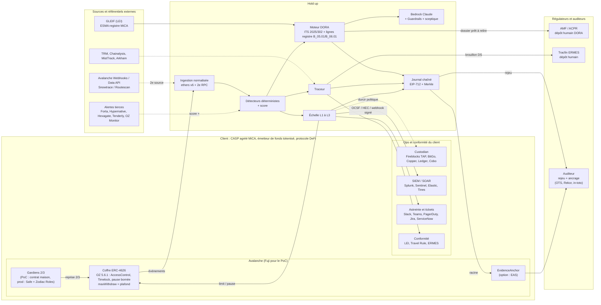

# T1 P4 : Hold up, carte d'intégration à l'écosystème du client (10 oct. 2026)

Périmètre : Track 1 sous-track 4. Critère jury visé : « Faisabilité et intégration 20 % : le PoC marche-t-il ? S'intègre-t-il aux outils d'une banque, d'une fintech ou d'un protocole ? ». Règlement de référence : `context/notion_guide.md`. Architecture : `docs/architecture.md` (v0).

Légende de fiabilité :
- **[V]** vérifié le 10 oct. 2026 sur une page éditeur, un registre de paquets ou une réponse réelle (URL donnée).
- **[S]** seule une source secondaire (agrégateur, éditeur tiers) le dit.
- **[C]** connaissance stable de l'auteur, non re-vérifiée aujourd'hui. À vérifier avant de l'afficher en slide.
- **[?]** introuvable ou contradictoire. Ne pas affirmer.

Effort PoC (avant dimanche matin) : **S** moins d'1 h, **M** 1 à 3 h, **L** plus de 3 h.

---

## 1. TL;DR

1. **Huit intégrations réelles dans le PoC** (section 12) : OpenZeppelin Contracts, ethers v6 sur Fuji avec double RPC, tests d'invariants Foundry, sortie OCSF + Slack, GLEIF + registre ESMA, sorties DORA alignées sur les modèles officiels, signature EIP-712 + ancrage, Bedrock + Guardrails. Toutes sont publiques, sans contrat commercial.
2. **Plusieurs produits cités ont changé ou fermé.** OpenZeppelin Defender : arrêt annoncé le 1er juil. 2026 [V]. « Glacier » est devenu la Data API d'Avalanche (Builder Hub), mais l'en-tête `x-glacier-api-key` est resté [V]. Hexagate est passé chez Chainalysis [S]. Le registre MiCA ESMA est passé de fichiers CSV à un système IT intégré « mi-2026 » [V], à re-vérifier.
3. **Trois trous de plateforme à connaître sur Fuji** : EAS n'est pas déployé officiellement sur Avalanche [V], le Safe Transaction Service ne liste pas Fuji [V], et les Webhooks Avalanche n'exposent que `address_activity` [V]. Ça pousse vers notre propre `EvidenceAnchor` et un contrat de gardiens maison pour le PoC, avec les connecteurs Safe/EAS montrés « prêts ».
4. **Deux limites honnêtes** : aucune API publique trouvée pour déposer à l'AMF (DORA) ni à Tracfin (ERMES) [?]. On le dit : Hold up produit le dossier, un humain le dépose.
5. **Ce que ça démontre au jury** : on parle le langage du RSSI (OCSF, SIEM, ticket), du conformité (LEI, registre d'information, Travel Rule), du dev Solidity (OZ, ERC-4626, invariants) et de l'auditeur (rejeu, ancrage, signature).

---

## 2. Écarts et mises à jour 2026 à connaître

| Sujet | Statut au 10 oct. 2026 | Source |
|---|---|---|
| OpenZeppelin Defender | Service hébergé : arrêt programmé le **1er juil. 2026**. Remplacés par Relayer et Monitor open source, images Docker, licence AGPL-3.0. Les pages consultées datent d'avant l'arrêt : l'état après le 1er juil. n'est pas confirmé, ni la durée exacte du « an de transition » (le FAQ se contredit : « full year » / « 12-month runway ») [V pour le plan, ? pour l'après]. | https://www.openzeppelin.com/news/defender-sunset-faq |
| OpenZeppelin Monitor | Dépôt actif. Réseaux : EVM, Stellar, Solana, Midnight (partiel). Notifications : Slack, Discord, e-mail SMTP, Telegram, webhooks, scripts Python/JS/Bash. Licence AGPL-3.0 [V]. | https://github.com/OpenZeppelin/openzeppelin-monitor |
| OZ Contracts | npm `latest` = **5.6.1** [V]. La page des releases GitHub liste aussi une 5.7.0 (29 juil.) qui modifie AccessManager (`canCall` et `setAuthority`, annulation par admin de rôle). Les deux sources ne concordent pas : **épingler 5.6.1**, vérifier 5.7.0. | https://registry.npmjs.org/@openzeppelin/contracts/latest ; https://github.com/OpenZeppelin/openzeppelin-contracts/releases |
| « Glacier » | Devenu la **Data API** : base `https://data-api.avax.network/v1`, clé dans l'en-tête `x-glacier-api-key`, clés créées dans le Builder Hub (`build.avax.network`) [V]. | https://build.avax.network/docs/api-reference/data-api/getting-started |
| AvaCloud / Webhooks | Un seul type d'événement : `address_activity`. C-Chain mainnet et testnet cités. L'exemple de payload est en `chainId` 43114. Fuji n'est pas nommé [V pour le contenu, ? pour Fuji]. | https://build.avax.network/docs/api-reference/webhook-api |
| Snowtrace | Explorateur de Routescan (Etherscan-compatible). ChainList donne pour Fuji : `testnet.snowtrace.io` (Routescan) et `testnet.snowscan.xyz` (famille Etherscan) [V]. | https://chainlist.org/chain/43113 |
| Hexagate | Racheté par Chainalysis (annoncé déc. 2025, prix non confirmé) [S]. Incident d'alertes résolu le 24 juin 2026 [S]. | https://isdown.app/status/chainalysis/incidents/610941-hexagate-alerts-issues |
| ERC-7265 (circuit breaker) | `eips.ethereum.org/EIPS/eip-7265` renvoie **404** : pas de standard publié sous ce numéro. Reste une proposition de 2023 (PR ethereum/EIPs #7265, fil Ethereum Magicians sans activité après oct. 2023). Un soutien d'Aave est cité [V pour l'absence, S pour le reste]. À présenter comme « inspiré de ». | https://ethereum-magicians.org/t/eip-7265-circuit-breaker-standard/14909 |
| EAS | Dépôt `eas-contracts` : Avalanche et Fuji **absents** de la liste des déploiements [V]. Le contrat reste déployable soi-même. | https://github.com/ethereum-attestation-service/eas-contracts |
| Safe Transaction Service | Instance Avalanche mainnet (43114) répond (v6.11.0) [V]. Fuji absent de la liste des réseaux [V]. | https://api.safe.global/tx-service/avax/api/v1/about/ ; https://docs.safe.global/core-api/transaction-service-overview |
| Registre MiCA ESMA | Provisoirement 5 fichiers CSV, publication hebdomadaire, intégration au système IT d'ESMA « mi-2026 » : **format actuel à re-vérifier** [V pour l'annonce]. Nom `CASPS.csv` [S]. | https://esma.europa.eu/esmas-activities/digital-finance-and-innovation/markets-crypto-assets-regulation-mica |
| OCSF | Version stable la plus récente affichée : **1.9.0** (1.10.0-dev en cours). Classes : Detection Finding `2004`, Incident Finding `2005` [V]. | https://schema.ocsf.io/ |
| Azure Monitor / Sentinel | Logs Ingestion API (DCR, jeton Entra, scope `https://monitor.azure.com`) documentée, TLS 1.2 minimum depuis le 1er mars 2026 [V]. La retraite annoncée de l'ancienne HTTP Data Collector API n'a pas pu être re-vérifiée [?]. | https://learn.microsoft.com/en-us/azure/azure-monitor/logs/logs-ingestion-api-overview |
| Sigstore Rekor v2 | « rekor-tiles », instance publique `log2025-1` (valide depuis 2025-10-06), URL à changer environ tous les 6 mois, clients non configurés par défaut à la date de la page [V pour la page, ? pour 2026]. | https://github.com/sigstore/rekor-tiles |
| Hardhat | Notre dépôt : `hardhat ^2.29.1`, `hardhat-toolbox ^5.0.0`, Solidity 0.8.24, réseau `fuji` 43113 déjà configuré [V, `blockchain/`]. npm `latest` est 3.19.0 [V] : **ne pas migrer pendant le hackathon**. | https://registry.npmjs.org/hardhat/latest |

---

## 3. Contrats (côté client : développeurs Solidity, auditeurs)

Pour tous : NIST CSF 2.0 **PR.PS** (plateforme), **RS.MI** (confinement) ; ATT&CK **T1657** (vol financier), **T1078** (comptes valides) ; D3FEND **D3-AZET** (seuil d'autorisation) pour le plafond de sortie [D3-ID vérifié dans D4 : source https://d3fend.mitre.org/ontologies/d3fend.csv]. OWASP ASI / ATLAS : non applicable (pas d'agent IA dans le contrat).

### 3.1 OpenZeppelin Contracts 5.x (choisi pour le PoC)

| | |
|---|---|
| Quoi | Bibliothèque Solidity de référence. `Pausable`, `AccessControl`, `AccessManager`, `TimelockController`, `ReentrancyGuard` (et variante `ReentrancyGuardTransient`). |
| Qui | Quasi tous les protocoles et émetteurs de tokens ; les auditeurs l'attendent. |
| Branchement | `npm i @openzeppelin/contracts@5.6.1` [V npm]. Import `@openzeppelin/contracts/utils/Pausable.sol`, `.../access/AccessControl.sol`, `.../utils/ReentrancyGuard.sol`, `.../token/ERC20/extensions/ERC4626.sol`. |
| Conception | Rôles `SENTINEL_ROLE` (peut seulement `limit()` et `pause()` avec expiration), `GUARDIAN_ROLE` (reprise, 2 sur 3), `DEFAULT_ADMIN_ROLE` derrière un `TimelockController`. Le Sentinel ne peut **jamais** retirer ni ajouter de rôle : c'est ce qui rend l'automate acceptable à un RSSI. |
| Attention | 5.5.0 a rendu `ReentrancyGuard` et `ReentrancyGuardTransient` « stateless » (non transpilés pour le paquet upgradeable) [V release notes]. `ReentrancyGuardTransient` demande l'opcode `TSTORE` (Cancun) : support C-Chain [C], utiliser `ReentrancyGuard` classique par prudence. |
| Effort | **S** (déjà dans le plan). |
| Démontre | Contrats lisibles par un auditeur, rôles séparés, pause réversible et bornée : rapport de force « machine freine, humain reprend ». |
| Sources | https://github.com/OpenZeppelin/openzeppelin-contracts/releases ; https://docs.openzeppelin.com/contracts/5.x/ [C] |

### 3.2 ERC-4626 (choisi : interface du coffre)

| | |
|---|---|
| Quoi | Standard de coffre tokenisé (Final) [C]. Interface `deposit/withdraw/redeem`, `maxWithdraw`, `maxRedeem`. |
| Qui | Presque tous les coffres DeFi et la plupart des fonds tokenisés sur EVM. |
| Branchement | Hériter de `ERC4626` d'OZ, **surcharger `maxWithdraw` et `maxRedeem`** pour renvoyer le plafond de sortie courant (la spec demande que ces fonctions tiennent compte des limites globales, par [C] à vérifier dans https://eips.ethereum.org/EIPS/eip-4626). Ainsi tout intégrateur (agrégateur, UI, custodian) voit la limite sans connaître Hold up. |
| Effort | **S** à **M**. |
| Démontre | « Notre plafond est lisible par n'importe quel intégrateur standard » : c'est l'argument d'intégration le plus fort côté protocole. Aussi : protection contre l'attaque d'inflation via l'offset de décimales d'OZ [C]. |

### 3.3 ERC-7265 circuit breaker (montré en inspiration, pas en dépendance)

Voir section 2 : pas de standard publié. Reprendre le vocabulaire (seuil sur flux sortant, période de grâce, override) dans la doc, citer la proposition, ne pas dire « conforme ERC-7265 ». Effort **S** (texte). Démontre qu'on connaît la littérature, sans surpromettre.

### 3.4 Safe{Wallet}, Safe guards/modules, Zodiac Roles (connecteur prêt)

| | |
|---|---|
| Quoi | Multisig de référence (smart account). Un **Guard** vérifie chaque transaction avant/après exécution ; un **Module** peut exécuter sans signatures. **Zodiac Roles Modifier** (v2) : permissions fines par rôle, avec allowances, limites de dépense et conditions logiques [S]. |
| Qui | La majorité des trésoreries de protocoles et beaucoup de CASP/émetteurs pour leurs gardiens. |
| Statut Fuji | Safe Transaction Service : Avalanche mainnet **oui**, Fuji **non listé** [V]. Roles v2 sur Avalanche : non vérifié [?]. |
| Branchement | `@safe-global/protocol-kit@8.0.7` et `@safe-global/api-kit@5.0.3` [V npm] ; Python `safe-eth-py 7.26.1` [V PyPI]. Service : `https://api.safe.global/tx-service/avax/api/v1/` (clé API requise selon les quotas [C]). |
| Traduction | « Reprise 2 sur 3 » = transaction Safe vers `GuardedVault.resume()` ; « le Sentinel peut seulement plafonner/pauser » = module Roles dont la permission est limitée à ces deux sélecteurs (Zodiac Roles v2). |
| PoC | Sur Fuji : contrat `GuardianMultisig` minimal (OZ `AccessControl` + compteur de 2 signatures EIP-712). Montrer le connecteur Safe en « prêt » avec un payload d'exemple de transaction de reprise. |
| Effort | PoC maison **M** ; connecteur Safe **M** (non réalisé). |
| Démontre | « En production vous gardez votre Safe : on lui ajoute seulement un module à droits minimaux. » |
| Mapping | NIST **PR.AA** (contrôle d'accès), **GV.RR** ; ATT&CK **T1078** ; D3FEND **D3-MFA** (multi-signature). |
| Sources | https://api.safe.global/tx-service/avax/api/v1/about/ ; https://docs.safe.global/core-api/transaction-service-overview ; https://forum.safe.global/t/draft-obra-roles-wallet-integration-phase-2-pilot-gnosis-guild/5368 |

Exemple de payload de reprise (à signer par 2 gardiens) :

```json
{
  "to": "0xVAULT",
  "value": "0",
  "data": "0x046f7da2",
  "operation": 0,
  "safeTxGas": "0",
  "nonce": 7
}
```
(`0x046f7da2` = sélecteur supposé de `resume()` : à recalculer avec `cast sig "resume()"`.)

### 3.5 Tests : Foundry invariant, Echidna, Medusa

| Outil | Version vérifiée | Rôle |
|---|---|---|
| Foundry (forge) | **v1.8.5**, 5 oct. 2026 [V] https://github.com/foundry-rs/foundry/releases | `invariant_*` : `sortie_cumulée ≤ réserve`, `prix dans la bande`, `la pause expire`. |
| Echidna | **2.3.3**, 27 juil. [V] https://github.com/crytic/echidna/releases | Fuzzer à propriétés, standard chez Trail of Bits. |
| Medusa | **v1.5.1**, 11 mars [V] https://github.com/crytic/medusa/releases | Fuzzer parallèle, même format de propriétés qu'Echidna. |

Effort : **M** pour une suite Foundry (3 invariants), à côté du projet Hardhat (Foundry lit `contracts/` via `foundry.toml` et `libs`). Echidna/Medusa : fichier de config prêt, non exécuté si manque de temps. Démontre : l'invariant n'est pas qu'une promesse, il est testé par fuzzing, et c'est exactement la pièce que demande un auditeur de contrats. Mapping : NIST **ID.RA**, **PR.PS** ; ATT&CK **T1190** ; D3FEND **D3-CV** (content validation, vérifié D4).

---

## 4. Lecture de la chaîne Avalanche

Mapping commun : NIST **DE.CM** (surveillance continue), **DE.AE** (analyse d'événements) ; ATT&CK **T1657** ; D3FEND **D3-IRA** (analyse de réputation d'identifiant) pour l'analyse d'adresses. OWASP/ATLAS : non applicable.

| Brique | Statut / version | Qui l'utilise | Branchement | Effort | Décision |
|---|---|---|---|---|---|
| **ethers v6** | `6.17.0` [V npm] | Standard dans Hardhat toolbox | `new WebSocketProvider(url)`, `provider.on({address, topics}, cb)` ; `getLogs` pour le rejeu | S | **PoC** (cœur) |
| **viem** | `2.57.4` [V npm] ; chaîne `avalancheFuji` fournie [C] | Équipes front et bots récents | `createPublicClient({chain: avalancheFuji, transport: webSocket()})`, `watchContractEvent` | S | Mentionné : équivalent, même ABI |
| **RPC Fuji public** | `https://api.avax-test.network/ext/bc/C/rpc` (déjà dans `hardhat.config.js`) [V repo] | Tous | Interroger **2 fournisseurs** et comparer hash de bloc/état : écart = alerte (registre des tiers, §6 de l'archi) | S | **PoC** |
| **Data API (ex-Glacier)** | Actif, `data-api.avax.network/v1`, en-tête `x-glacier-api-key` [V] | Wallets, dApps Avalanche | `GET /v1/chains/43113/...` (Fuji, non confirmé dans la doc lue [?]) | M | Connecteur prêt |
| **Webhooks Avalanche** | `address_activity` seul ; secrets partagés et signature, nom d'en-tête non documenté sur la page [V/?] | Idem | Voir payload ci-dessous | M | Connecteur prêt (2e source indépendante du RPC) |
| **Snowtrace / Routescan** | Etherscan-compatible ; Fuji 43113 [V] ; format d'URL non lu [?] | Tous : explorateur de référence | Lien `https://testnet.snowtrace.io/tx/<hash>` pour chaque champ DORA ; API `module=account&action=txlist` à valider | S (liens) | **PoC** (liens) |
| **The Graph / Goldsky / Sentio** | Non vérifié aujourd'hui [C] | Protocoles DeFi pour leurs tableaux de bord | Subgraph sur les événements du coffre | L | Citer seulement |
| **ICM / Teleporter** | Non vérifié aujourd'hui [C] | L1 Avalanche, ponts natifs | Surveiller les événements d'envoi/réception cross-chain ; lire la configuration du vérificateur | L | Citer : le « 1 seul vérificateur » du mock reprend le cas KelpDAO |

Sources : https://build.avax.network/docs/api-reference/data-api/getting-started ; https://build.avax.network/docs/api-reference/webhook-api ; https://chainlist.org/chain/43113 ; https://docs.routescan.io/ ; https://registry.npmjs.org/ethers/latest ; https://registry.npmjs.org/viem/latest

Payload d'exemple Webhook Avalanche [V, structure de la doc ; `chainId` 43113 supposé pour Fuji] :

```json
{
  "webhookId": "wh_xxx",
  "eventType": "address_activity",
  "messageId": "msg_xxx",
  "event": {
    "transaction": {
      "txHash": "0x...", "blockNumber": "12345678",
      "from": "0x...", "to": "0xVAULT", "value": "0",
      "chainId": "43113",
      "erc20Transfers": [], "internalTransactions": []
    }
  }
}
```
Pour recevoir les logs, il faut `"includeLogs": true` et `"includeInternalTxs": true` [V]. Conséquence de conception : on ne peut pas filtrer par topic côté Avalanche, donc Hold up filtre elle-même. L'adaptateur normalise vers le même `ChainEvent` que le provider ethers.

---

## 5. Détection et monitoring existants à brancher

Mapping commun : NIST **DE.CM**, **DE.AE**, **ID.RA-02** (renseignement sur les menaces) ; ATT&CK **T1657**, **T1190** ; D3FEND **D3-IRA**, **D3-AZET**. OWASP/ATLAS : non applicable.

| Outil | Statut 2026 | Qui l'utilise | Comment on s'y branche | Effort | Décision |
|---|---|---|---|---|---|
| **OpenZeppelin Monitor** | Actif, open source, Rust, AGPL-3.0, Docker [V] | Anciens utilisateurs de Defender (arrêt le 1er juil. 2026) | Config JSON (réseau, moniteur, trigger). Hold up peut **être appelée par un trigger webhook** de Monitor, ou l'inverse. AGPL : ne pas le copier dans notre code, le brancher par HTTP | M | Connecteur prêt ; argument « vous avez migré de Defender ? Voici où on se branche » |
| **Forta** | Docs « latest » : Firewall (screening avant exécution), bots, Risk Graph MCP. Avalanche supporté dans les anciennes docs 0.1 ; couverture du Firewall sur Avalanche non confirmée [S/?] | Protocoles DeFi | Bot Forta émet une alerte → webhook → `POST /ingest/external-alert` de Hold up | M | Connecteur prêt (entrée) |
| **Tenderly** | « 98+ réseaux », Fuji non confirmé dans la page lue [V/?] | Développeurs (simulation, Virtual TestNets) | Alerte Tenderly → webhook ; simulation d'une tx de reprise avant de la signer | M | Connecteur prêt, vérifier Fuji |
| **Hypernative** | API et webhooks (le guide Cantina décrit URL + secret d'en-tête) [S] ; doc officielle derrière login [?] | CASP, émetteurs, protocoles | Entrée : webhook vers Hold up ; sortie : Hold up appelle leur API de screening si le client a une licence | M | Connecteur prêt, **adaptateur à contrat ouvert** |
| **Hexagate (Chainalysis)** | Racheté [S] ; incident d'alertes juin 2026 [S] | Idem | Idem Hypernative | M | Connecteur prêt |
| **TRM** | `POST https://api.trmlabs.com/public/v1/sanctions/screening` [V, cf. `research/docs/D4_apis_protocoles_referentiels.md`] ; 1 req/s, 100/jour sans clé | CASP, banques | Screening sanctions de chaque adresse de sortie dans le traceur | S | **Option PoC** (bien pour le traceur) |
| **Chainalysis** | Oracle de sanctions on-chain **déprécié**, absent de Fuji [V, D4] ; API KYT/Reactor sous contrat | CASP, banques | Connecteur « demande de gel / traçage » | M | Citer, ne pas promettre |
| **MistTrack, Arkham, SEAL 911** | Non vérifiés aujourd'hui [C/?] | Chasseurs d'hacks, équipes de réponse | MistTrack (MistTrack API de SlowMist) et Arkham : enrichissement d'adresses ; **SEAL 911** : canal humain d'urgence ; la fiche « demande de gel » liste aussi ce contact | S (texte) | Citer |

Sources : https://github.com/OpenZeppelin/openzeppelin-monitor ; https://docs.forta.network/en/latest/ ; https://docs.cantina.xyz/clarion/integrations/hypernative.md ; https://docs.tenderly.co/supported-networks ; https://docs.trmlabs.com/api/sanctions/screening/submit-one-or-more-addresses-to-be-screened.md

Adaptateur d'entrée normalisé (proposé) :

```json
POST /ingest/external-alert
{ "source": "forta|hypernative|hexagate|tenderly|openzeppelin-monitor",
  "chain_id": 43113, "severity": "high",
  "tx_hash": "0x...", "addresses": ["0x..."],
  "rule": "large-outflow", "raw": { } }
```
Règle de conception : une alerte externe **n'active jamais seule** L3. Elle augmente le score ; seuls les détecteurs déterministes locaux et l'invariant coupent (évite qu'un faux positif tiers pause un coffre).

---

## 6. Custody et ops des CASP : comment pause et plafond se traduisent chez eux

Principe : le coffre on-chain est **un** des actifs du CASP. Le reste de ses fonds est chez un custodian. Hold up utile doit pouvoir **aussi** durcir la politique du custodian. Tout ce qui suit est **[C] sauf mention contraire** ; aucune API de custodian n'a pu être testée (accès sous contrat).

Mapping commun : NIST **PR.AA**, **RS.MI** ; ATT&CK **T1657** ; D3FEND **D3-AZET**. OWASP/ATLAS : non applicable.

| Custodian | Primitive proche | Traduction « pause » | Traduction « plafond » | Entrée (événements) |
|---|---|---|---|---|
| **Fireblocks** | **Transaction Authorization Policy (TAP)** : règles évaluées dans l'ordre ; modifiables par API en publication directe ou via brouillon puis publication [V] ; tags protégés [V] | Publier une règle `BLOCK` en tête pour la source/destination concernée | Règle limite par montant/période (types de règles exacts non lus [?]) | Webhooks (en-tête de signature `Fireblocks-Signature` [C]) |
| **Copper** | Politiques et approbations de retrait [C] | Gel de portefeuille/compte via politique | Limites de retrait [C] | API/webhooks [?] |
| **BitGo** | Politiques de portefeuille (vélocité, liste blanche) et webhooks [C] | Politique `lockdown`/blocage [C] | Politique de limite de vélocité [C] | Webhooks signés [C] |
| **Ledger Enterprise** | Workflows et règles d'approbation, Trusted Apps [C] | Retirer le rôle d'approbateur | Règle de montant maximal | [?] |
| **Cobo** | Contrôles de risque / Argus (MPC et smart wallet) [C] | Désactiver le rôle côté Cobo | Limite par transaction/par jour | [?] |

Sources : https://developers.fireblocks.com/docs/set-transaction-authorization-policy [V pour TAP uniquement]. Les autres lignes sont **à vérifier sur leurs docs** avant toute affirmation en slide.

Proposition : un **adaptateur `CustodyPolicyPort`** avec deux méthodes (`hardenPolicy(level)`, `restorePolicy(token)`) et un mock `FireblocksTapMock` qui renvoie la requête qu'il enverrait, sans la rejouer. Effort **M** pour l'interface + mock + un payload d'exemple. Démontre : « notre échelle L2/L3 devient une règle chez votre custodian, qui est aussi réversible ». Statut : connecteur prêt.

---

## 7. SOC, SIEM, SOAR, ticketing

Mapping commun : NIST **RS.CO** (communication de la réponse), **RS.MA** (gestion d'incident), **DE.AE** ; ATT&CK **T1657** ; D3FEND **D3-AZET** (le déclencheur) ; OWASP/ATLAS : non applicable.

### 7.1 Formats

| Format | Version / statut | Usage | Effort |
|---|---|---|---|
| **OCSF** | 1.9.0 stable, 1.10.0-dev [V] https://schema.ocsf.io/ | Schéma neutre accepté par Splunk, AWS Security Lake, Google SecOps, etc. [C] | **S** : sortie JSON, **PoC** |
| **ECS** (Elastic) | Version courante non vérifiée [C] | Index Elastic ; OCSF et ECS se mappent | S (connecteur prêt) |
| **STIX 2.1 / TAXII 2.1** | `stix2 3.0.2` PyPI [V] ; `taxii2-client` [C] | Partage de renseignement : indicateur = adresse attaquante | S pour l'objet, M pour TAXII |

Exemple OCSF « Detection Finding » (classe 2004) : champs à valider contre le schéma 1.9.0 avant démo [V pour numéro de classe et version, C pour les noms de champs] :

```json
{
  "class_uid": 2004, "class_name": "Detection Finding",
  "category_uid": 2, "activity_id": 1, "type_uid": 200401,
  "severity_id": 4, "time": 1760119200000,
  "metadata": { "version": "1.9.0",
    "product": { "name": "Hold up", "vendor_name": "Secure Horizon" } },
  "finding_info": { "uid": "inc-0001", "title": "Drain rate above threshold",
    "types": ["onchain-outflow-velocity"],
    "analytic": { "name": "velocity@v3", "type_id": 1 } },
  "message": "L2 outflow cap applied then L3 pause at block 12345690",
  "observables": [
    { "name": "tx_hash", "type": "Other", "value": "0x..." },
    { "name": "attacker_address", "type": "Other", "value": "0x..." } ],
  "unmapped": { "chain_id": 43113, "response_tier": "L3", "evidence_root": "0x..." }
}
```

### 7.2 Cibles SIEM (adaptateur + payload)

| Cible | Mécanisme | Exemple minimal | Statut |
|---|---|---|---|
| **Splunk** | HEC : `POST https://<hôte>:8088/services/collector/event`, en-tête `Authorization: Splunk <token>` [C] | `{"time":1760119200,"sourcetype":"sentinelle:ocsf","event":{...OCSF...}}` | Connecteur prêt (+ vérifier doc https://docs.splunk.com/Documentation/Splunk/latest/Data/UsetheHTTPEventCollector) |
| **Microsoft Sentinel** | **Logs Ingestion API** : `POST {endpoint}/dataCollectionRules/{dcrImmutableId}/streams/Custom-SentinelleFuji_CL?api-version=2023-01-01`, jeton Bearer scope `https://monitor.azure.com`, rôle « Monitoring Metrics Publisher » sur la règle de collecte, corps = **tableau JSON** [V] | `[{"TimeGenerated":"...","Tier":"L3","TxHash":"0x..."}]` | Connecteur prêt |
| **Elastic** | `POST /<index>/_doc` ou Elastic Agent en HTTP [C] | ECS | Connecteur prêt |
| **Google SecOps** | Ingestion API / parseur UDM [C] | OCSF via parseur | Citer |

Sources : https://learn.microsoft.com/en-us/azure/azure-monitor/logs/logs-ingestion-api-overview

### 7.3 SOAR, astreinte, chat, tickets

| Outil | Entrée | Statut | Décision |
|---|---|---|---|
| **Slack** | Webhook entrant : `POST <url>` `{"text":"...","blocks":[...]}` [C] | Simple, démontre la boucle humaine | **PoC** (URL en `.env`, jamais commitée) |
| **Teams** | Webhook Workflows ou connecteur [C] : l'ancien connecteur Office 365 est en retraite [C/?] | Format Adaptive Card | Connecteur prêt |
| **PagerDuty** | Events API v2 : `POST https://events.pagerduty.com/v2/enqueue` `{"routing_key","event_action":"trigger","dedup_key","payload":{"summary","source","severity","custom_details"}}` [C, fetch échoué] | `dedup_key` = id d'incident | Connecteur prêt |
| **Opsgenie** | Fin de vente annoncée par Atlassian, arrêt prévu 2027 [C/?] | À vérifier avant de le citer | Éviter |
| **Tines, Splunk SOAR, Cortex XSOAR** | Webhook d'entrée → playbook (enrichissement, ticket, approbation) [C] | Même payload OCSF | Connecteur prêt |
| **Jira** | `POST /rest/api/3/issue` (corps ADF) [C] | Ticket « Incident DORA » avec champs d'échéance | Connecteur prêt |
| **ServiceNow** | `POST /api/now/table/incident` ou module Security Incident [C] | Champ `correlation_id` = id d'incident | Connecteur prêt |

Effort PoC : OCSF + Slack ensemble **S à M** (un module `sinks/` avec une interface `emit(event)`). Démontre : « on se branche à votre SOC sans que vous changiez vos outils ».

Sécurité à afficher : chaque webhook sortant signé HMAC-SHA256 (en-tête `X-Sentinelle-Signature`), horodaté, idempotent (`dedup_key`).

---

## 8. Réglementaire (le cœur du critère « intégration au monde du client »)

Mapping commun : NIST **GV.OC** (contexte organisationnel et obligations légales), **GV.SC** (chaîne d'approvisionnement), **RS.CO** ; ATT&CK **T1657** pour le scénario ; D3FEND non applicable (c'est de la conformité). OWASP/ATLAS : non applicable.

### 8.1 Déclaration d'incident DORA

| Point | Ce qui est vérifié | Source |
|---|---|---|
| Autorité | ACPR ou AMF selon l'entité. Les CASP français relèvent de l'AMF. | https://acpr.banque-france.fr/system/files/2026-01/20260115_presentation_bilan_dora.pdf |
| Modèles | RTS **2025/301** (contenu) et ITS **2025/302** (modèles d'initial/intermédiaire/final). Annexe de notification des cybermenaces significatives (volontaire). | Cf. `docs/architecture.md` §5 ; recoupé par recherche web [S] |
| Délais | 4 h après classification (24 h max après détection), 72 h pour l'intermédiaire, 1 mois pour le final. Une source tierce dit 24 h pour l'intermédiaire : **erreur probable**. | https://www.regulation-dora.eu/dora-incident-reporting [S] |
| Canal technique de dépôt | **Non confirmé**. Aucune source n'établit que ONEGATE soit le canal du dépôt d'incident [?]. | recherche web 10 oct. |
| Bilan 2025 | L'AMF a publié un rapport sur les incidents majeurs 2025 (33 incidents majeurs français, plus de 80 % venant de prestataires) [S, un site juridique citant l'AMF] | https://www.lemondedudroit.fr/banque-finance/304-finance/105970-amf-rapport-sur-les-incidents-majeurs-en-2025-au-titre-du-reglement-dora.html |

Conséquence produit : Hold up génère un **dossier de déclaration structuré** (JSON + PDF) dont les rubriques portent les numéros officiels des champs, et dit explicitement « dépôt manuel ». Ne pas annoncer d'API AMF.

### 8.2 Registre d'information DORA (ITS 2024/2956)

| Point | Détail | Fiabilité |
|---|---|---|
| Format | **xBRL-CSV** : un fichier CSV par modèle (`B_01.01`, `B_02.01`, `B_05.01`, `B_06.01`...) + `report.json` de métadonnées, en ZIP, selon la taxonomie EBA. | [S] https://www.regulation-dora.eu/de/register-of-information ; vendeur Orbiq https://www.orbiqhq.com/templates/dora-register-of-information-starter |
| Volume | 15 modèles en 8 groupes, liés par clés relationnelles (référence de contrat, LEI, identifiant de fonction). Les incohérences de clés sont la première cause de rejet. | [S] vendeur FR |
| Taxonomie | « DORA Reporting Framework 4.0 » citée dans la Q&R EBA 2025_7362 ; renvoi vers la FAQ EBA « Reporting of registers of information under DORA ». | [V] https://eba.europa.eu/single-rule-book-qa/qna/view/publicId/2025_7362 |
| Calendrier | Référence 31 déc., transmission des autorités nationales aux AES au 31 mars (selon FAQ EBA du 28 mars 2025, d'après un vendeur). | [S] |
| Outils open source | Aucun outil de référence vérifié [?]. L'EBA publie la taxonomie et les règles de validation. | https://www.eba.europa.eu/node/18087 |
| Excel | L'EBA dit ne pas pouvoir fournir une solution Excel qui garde l'intégrité référentielle. | [S] |

Ce que Hold up produit sans prétendre faire le dépôt officiel :
- des **lignes de type `B_05.01`** (prestataires TIC : oracle, vérificateur de pont, RPC, hébergeur) et `B_06.01` (fonctions) en CSV, **clés cohérentes** avec LEI, pour que le CASP n'ait qu'à les fusionner à son registre ;
- **un contrôle de cohérence** (toutes les clés étrangères existent, LEI valide) ;
- **l'indication des points uniques de défaillance**.
Les noms exacts de colonnes viennent de la taxonomie EBA : **à lire dans le paquet de taxonomie avant de coder** (non téléchargé ici). Effort **M** pour 2 modèles. Démontre : la preuve la plus parlante qu'on connaît le format réel du régulateur.

### 8.3 LEI (GLEIF API) : choisi pour le PoC

- API publique, JSON:API, recherche par nom/BIC, relations parent/enfant. Docs : https://api.gleif.org/docs ; démo : https://api.gleif.org/demo [V, page d'accès]. Clé et quota non confirmés sur la page [?]. Appel type [C] : `GET https://api.gleif.org/api/v1/lei-records?filter[lei]=<LEI>`.
- Usage : valider le LEI du CASP et celui de chaque prestataire TIC (champ 2.8 `NOM;CODE;LEI|EUID;info`), ajouter le nom légal officiel, détecter un LEI échu.
- Données de test : **uniquement des LEI publics de grandes entités**, aucune donnée de client réel. Effort **S**. Mapping NIST GV.SC.

Source : https://www.gleif.org/en/lei-data/gleif-lei-look-up-api/access-the-api

### 8.4 Registre MiCA de l'ESMA (CASP agréé ?) : choisi pour le PoC

- Cinq fichiers CSV : livres blancs, émetteurs d'ARTs, émetteurs d'EMTs, **CASP autorisés (Titre V)**, entités non conformes ; mise à jour hebdomadaire ; intégration aux systèmes IT d'ESMA « mi-2026 » [V]. Nom `CASPS.csv` [S] ; JSON/API non trouvée [V absence].
- Usage : au démarrage, Hold up vérifie que le client déclaré figure dans le registre (statut, État membre d'origine, services autorisés) et affiche la date de fraîcheur de la source ; elle sait aussi dire « entité absente ».
- Le chiffre de l'architecture (362 CASP, 36 en France, 7 oct. 2026) vient de `research/tracks/T1_P4_chiffres_2026.md` (agrégateur) : à faire confirmer avec le fichier officiel.
- Effort **S** (télécharger, parser, mettre en cache). Aucune donnée personnelle.

Source : https://esma.europa.eu/esmas-activities/digital-finance-and-innovation/markets-crypto-assets-regulation-mica

### 8.5 Travel Rule (Notabene, Sumsub, TRP, IVMS101)

- **IVMS101** est le modèle de données commun pour originateur et bénéficiaire [S]. **TRP** (Travel Rule Protocol) est un protocole d'échange [C].
- **Notabene** : API pour identifier la contrepartie, échanger en IVMS101, gérer l'autorisation ; points d'entrée `txValidate`, `txCreate`, `txUpdate`, webhook de notification, webhook d'adresse entrante, bac à sable, routage UE ou US [S, devx.notabene.id].
- **Sumsub** : KYC, AML, surveillance de transactions et Travel Rule ; protocoles supportés annoncés (TRP, TRISA, Sygna) [S] ; lien direct Notabene-Sumsub non trouvé [?].
- Pour Hold up : au moment de L3, une sortie bloquée ne doit pas déclencher un envoi Travel Rule ; la **demande de gel** doit citer les VASP contreparties identifiables. Connecteur prêt avec un exemple IVMS101 minimal (`originator.originatorPersons`, `beneficiary.beneficiaryPersons`, `originatingVASP`). Effort **M**, non fait.
- Sources : https://devx.notabene.id/docs/welcome ; https://docs.dfns.co/integrations/travel-rule/notabene

### 8.6 Tracfin (ERMES) et déclaration de soupçon

- ERMES est le téléservice de Tracfin pour déposer une déclaration de soupçon (DS) ; le déclarant doit être inscrit. Nouveau formulaire modulaire généralisé en 2024 pour les 49 professions déclarantes [S, pages Tracfin, actu-juridique]. **Aucune API de dépôt automatisée** trouvée [?].
- La DS doit en principe être faite avant l'exécution, sinon « sans délai » [S].
- Pour Hold up : un **brouillon de texte d'analyse du soupçon** (faits on-chain, adresses, montants, preuves) que la personne en charge de la conformité colle dans ERMES. Pas d'envoi. Le LLM n'écrit pas les faits, seulement la mise en forme, avec le sceptique. Effort **S**, après la fiche DORA.
- Sources : https://ermesdemo.tracfin.finances.gouv.fr/Documentation/GuideUtilisateurs.pdf ; https://www.avocatparis.org/actualites/lbc-ft-dematerialisation-de-la-declaration-de-soupcon-depuis-le-1er-juin-2024

---

## 9. Émetteurs de tokens : freeze et pause chez eux (connecteur de la « demande de gel »)

Tout est **[C]**, à vérifier :
- **Stablecoins réglementés** (USDC, USDT sur Avalanche) : l'émetteur peut geler une adresse ; il n'existe pas d'API publique pour cela : le canal est une demande documentée (contact conformité de l'émetteur, SEAL 911 pour l'urgence). Le produit génère donc un **dossier de demande de gel** standard (adresses, hashs, montants, sauts, preuve ancrée).
- **ERC-3643 (T-REX)**, utilisé pour les titres/fonds tokenisés permissionnés : `pause()`, `setAddressFrozen()` côté émetteur. Hold up déclenche ces fonctions seulement si elle a le rôle `agent`, ce qui correspond au `SENTINEL_ROLE` limité du §3.1.

Démontre : « l'émetteur de fonds tokenisé » du client-cible (archi §1). Effort **S** (texte et un adaptateur factice).

---

## 10. Preuve et audit

Mapping commun : NIST **DE.AE**, **RS.AN** (analyse de l'incident, preuve), **GV.OC** ; ATT&CK **T1657** (scénario) ; D3FEND : **D3-MAN** (authentification de message) pour les signatures [vérifié D4]. OWASP/ATLAS : non applicable.

| Brique | Version / statut | Branchement | Effort | Décision |
|---|---|---|---|---|
| **EIP-712** | Standard Ethereum [C] ; `signer.signTypedData(domain, types, value)` natif dans ethers v6 [C] | Signer chaque « règle de réponse » (version, seuils) par la direction (DORA art. 5) et chaque reprise par les gardiens | S | **PoC** |
| **`@openzeppelin/merkle-tree`** | `1.0.8` [V npm] | Racine Merkle du dossier d'incident, preuves d'inclusion pour « un champ = une transaction » | S | **PoC** (ou Merkle maison) |
| **`EvidenceAnchor` sur Fuji** | notre contrat (archi §2) | `anchor(bytes32 root, bytes32 incidentId)` + événement | S | **PoC** |
| **EAS** | `@ethereum-attestation-service/eas-sdk 2.10.0`, ethers `^6.13.2` [V npm] ; **pas de déploiement officiel sur Avalanche/Fuji** [V] | Possibilité de déployer `EAS` + `SchemaRegistry` sur Fuji ; schéma ex. `bytes32 root, bytes32 incidentId, uint8 tier` | M | Connecteur prêt : le même enregistrement lisible par les outils d'attestation |
| **OpenTimestamps** | npm `opentimestamps 0.4.9` [V] ; calendriers publics [C] | Horodater la racine dans Bitcoin (preuve `.ots` acquise après quelques heures) | S/M | Connecteur prêt : « preuve hors Avalanche » |
| **Sigstore / Rekor v2** | rekor-tiles, instance publique dont l'URL change ~tous les 6 mois [V] ; PyPI `sigstore 4.5.0` [V] | Signer le *build* de Hold up (version des règles) et publier dans le journal de transparence | M | Citer seulement (le CI GitHub est réservé à Adem) |
| **in-toto** | Attestation de chaîne d'approvisionnement logicielle [C] | Prédicat « règle@version exécutée sur blocs A..B » | M | Citer : correspond à notre « règle@version » |
| **SOC 2 / ISAE 3402** | Cadres d'assurance, pas des API [C] | Le journal chaîné et rejouable est une **preuve candidate** de contrôle (qui a décidé, quand, avec quelle règle) | S (texte) | Fiche de défense : « se range sous un contrôle SOC 2 » sans prétendre être certifié |

Note : pas de PII on-chain, uniquement des empreintes (archi §7). Sources : https://registry.npmjs.org/@ethereum-attestation-service/eas-sdk/latest ; https://github.com/ethereum-attestation-service/eas-contracts ; https://github.com/sigstore/rekor-tiles

---

## 11. LLM : Bedrock Claude et Guardrails

Mapping : NIST **GV.OC**, **MG/PR.AA** (périmètre limité) ; **OWASP ASI01** (Agent Goal Hijack), **ASI02** (Tool Misuse), **ASI09** (Human-Agent Trust Exploitation) ; **ATLAS AML.T0051.001** (injection indirecte), **AML.M0030** (Restrict AI Agent Tool Invocation on Untrusted Data) ; D3FEND **D3-CV** [ID vérifiés dans D4 : https://github.com/mitre-atlas/atlas-data].

| | |
|---|---|
| Quoi | Claude via Bedrock pour le **texte libre** des champs DORA et le brouillon Tracfin ; « sceptique » qui retire toute phrase sans preuve. |
| SDK | `@aws-sdk/client-bedrock-runtime 3.1149.0` [V npm] ; commande `ConverseCommand` [C] ; `ApplyGuardrailCommand`. |
| Guardrails | `POST /guardrail/{guardrailIdentifier}/version/{guardrailVersion}/apply` avec `{"source":"INPUT\|OUTPUT","content":[{"text":{"text":"..."}}],"outputScope":"INTERVENTIONS\|FULL"}` ; réponse `action: NONE \| GUARDRAIL_INTERVENED` + `assessments` (contenu, PII, sujets, mots, ancrage contextuel) [V]. |
| Limites déjà connues | ApplyGuardrail ne voit ni les résultats d'outils ni les arguments d'outils (D4, [V]). Pour nous c'est sans importance : le LLM n'appelle aucun outil. |
| Données externes | Les champs issus de la chaîne (noms de tokens, mémos) sont de la **donnée non fiable** : ils entrent dans le prompt en bloc délimité ; `source: INPUT` du Guardrail avant l'appel, `source: OUTPUT` après. |
| Effort | **S** si Bedrock déjà utilisé ; le guardrail se crée en console (seuils, PII). |
| Démontre | « Le LLM ne décide rien et chaque phrase est tracée » ; réponse prête à la question piège du jury sur l'IA en conformité. Un test d'injection dans un champ `symbol()` de token le prouve en 10 s. |

Source : https://docs.aws.amazon.com/bedrock/latest/APIReference/API_runtime_ApplyGuardrail.html

---

## 12. Proposition d'architecture d'intégration

### 12.1 À faire réellement dans le PoC (8 intégrations)

Classées de la plus démonstrative au meilleur ratio coût/effet. Total estimé : environ 10 à 14 h de développement réparties sur 3 personnes ; les 1 à 4 sont déjà dans le plan.

| # | Intégration | Pourquoi | Effort | Mapping NIST / réf. |
|---|---|---|---|---|
| 1 | **OZ Contracts 5.6.1** (`Pausable`-like avec expiration, `AccessControl`, `TimelockController`) + **ERC-4626** avec `maxWithdraw` surchargé | Le jury technique le reconnaît en 10 s ; plafond lisible par tout intégrateur | S à M | PR.PS, RS.MI / T1657, D3-AZET |
| 2 | **ethers 6.17.0** sur Fuji, **double RPC** + liens Snowtrace sur chaque champ DORA | Cœur du détecteur ; écart de RPC = alerte | S | DE.CM, DE.AE / T1657, D3-IRA |
| 3 | **Foundry v1.8.5** : 3 invariants (sortie ≤ réserve, prix borné, pause qui expire) | Prouve l'invariant ; preuve auditeur | M | ID.RA, PR.PS / T1190, D3-CV |
| 4 | **Sortie OCSF 1.9.0 + Slack webhook** (module `sinks/`, signature HMAC) | « On se branche à votre SOC » ; boucle humaine visible en démo | S à M | RS.CO, RS.MA / T1657 |
| 5 | **GLEIF API + registre ESMA MiCA (CSV)** | Vrai appel à une source officielle ; vérifie que le client est un CASP agréé et que les LEI sont valides | S | GV.OC, GV.SC |
| 6 | **Brouillon ITS 2025/302 + lignes `B_05.01/B_06.01`** avec clés cohérentes + contrôle de cohérence | Le format réel du régulateur ; preuve de connaissance du métier | M | GV.SC, RS.CO |
| 7 | **EIP-712 + Merkle + `EvidenceAnchor`** (ancrage Fuji) + bouton « rejouer comme auditeur » | Preuve vérifiable par un tiers sans nous croire | S à M | RS.AN / D3-MAN |
| 8 | **Bedrock Claude + ApplyGuardrail** autour du texte libre + sceptique | Répond à la question IA ; test d'injection en direct | S | GV.OC / ASI01, ASI02, AML.T0051.001, AML.M0030 |

Priorité de coupe si manque de temps : on coupe d'abord 3 (remplacer par tests Hardhat sur l'invariant), puis 8 (sceptique seul sans Guardrail), jamais 1, 2, 4, 7.

### 12.2 À montrer en « connecteurs prêts » (adaptateur + payload d'exemple, non exécutés)

Un dossier `connectors/` avec, par connecteur : `README.md`, `adapter.ts` (interface `Port` implémentée par un mock), `example.payload.json`, case dans le tableau de bord « Intégrations » (grisée si non configurée). Ça prouve la modularité sans promettre ce qu'on n'a pas testé.

1. **Safe{Wallet}** (reprise 2/3 et module Roles) : mainnet via Transaction Service, Fuji non listé.
2. **Fireblocks TAP** (durcissement de politique, `hardenPolicy`) et webhooks entrants ; BitGo/Copper/Ledger/Cobo en lignes « traduction » sans code.
3. **Splunk HEC**, **Microsoft Sentinel (Logs Ingestion API)**, **Elastic ECS**, **STIX 2.1** pour l'IOC « adresse attaquante ».
4. **PagerDuty Events v2**, **Jira/ServiceNow**, **Tines / SOAR** (même payload OCSF).
5. **Alertes entrantes** : Forta, Hypernative, Hexagate, Tenderly, OpenZeppelin Monitor.
6. **Avalanche Webhooks / Data API** : seconde source d'événements indépendante du RPC.
7. **TRM / Chainalysis** (sanctions et traçage), **Notabene** (IVMS101, TRP).
8. **EAS** (déployable sur Fuji), **OpenTimestamps**, **Sigstore/Rekor v2**, **in-toto**.
9. **Émetteurs** : ERC-3643 (`setAddressFrozen`, `pause`), stablecoins (dossier de demande de gel).
10. **Dépôts humains** : AMF (DORA) et Tracfin (ERMES) : génération du dossier, aucun envoi.

### 12.3 Schéma : Hold up dans l'écosystème du client



Lecture : traits pleins = intégrations réelles du PoC ; pointillés = connecteurs prêts (adaptateur et payload d'exemple).

### 12.4 Script de démo « intégration » (30 secondes)

1. Le tableau de bord affiche en haut : « Client : CASP agréé (source : registre ESMA, LEI vérifié par GLEIF) ».
2. Attaque simulée → L2 puis L3 → message Slack + ligne OCSF affichée côté SIEM simulé.
3. Clic sur un champ DORA → transaction sur Snowtrace ; clic sur « registre » → CSV `B_05.01` avec LEI valides.
4. Onglet « Intégrations » : 8 connecteurs vivants, 10 « prêts » (Safe, Fireblocks, Splunk, Sentinel, PagerDuty, Jira, Forta...), chacun avec son payload.
5. Phrase de clôture : « On ne remplace pas votre Safe, votre SIEM ni votre custodian : on leur donne un cerveau qui freine en 12 secondes et un dossier que le régulateur peut lire. »

---

## 13. À vérifier avant la soumission (liste courte)

1. Version OZ : 5.6.1 (npm) contre 5.7.0 (GitHub) ; compatibilité avec Solidity 0.8.24 et l'EVM cible de Fuji.
2. Noms exacts des colonnes `B_05.01` et `B_06.01` dans la taxonomie EBA 4.0.
3. Format actuel du registre ESMA (CSV ou nouvelle interface) et nom de fichier CASP.
4. Fuji sur Data API, Webhooks Avalanche, Tenderly ; en-tête de signature des Webhooks.
5. Types de règles TAP Fireblocks (limites de montant/période) et nom exact des endpoints.
6. Champs OCSF 1.9.0 de la classe 2004 (noms, ids de type).
7. Statut Opsgenie et retraite de l'ancienne HTTP Data Collector API de Microsoft.
8. Canal de dépôt DORA à l'AMF (ONEGATE ou autre) : demander à un contact AMF/ACPR ou citer « dépôt manuel ».
9. Chiffres CASP (362 / 36) : recompter dans le fichier officiel.

## Sources principales (liste)

- https://github.com/OpenZeppelin/openzeppelin-contracts/releases
- https://registry.npmjs.org/@openzeppelin/contracts/latest
- https://www.openzeppelin.com/news/defender-sunset-faq
- https://github.com/OpenZeppelin/openzeppelin-monitor
- https://ethereum-magicians.org/t/eip-7265-circuit-breaker-standard/14909
- https://github.com/foundry-rs/foundry/releases
- https://github.com/crytic/echidna/releases
- https://github.com/crytic/medusa/releases
- https://api.safe.global/tx-service/avax/api/v1/about/
- https://docs.safe.global/core-api/transaction-service-overview
- https://build.avax.network/docs/api-reference/data-api/getting-started
- https://build.avax.network/docs/api-reference/webhook-api
- https://chainlist.org/chain/43113
- https://docs.routescan.io/
- https://registry.npmjs.org/ethers/latest ; https://registry.npmjs.org/viem/latest
- https://docs.forta.network/en/latest/
- https://docs.cantina.xyz/clarion/integrations/hypernative.md
- https://docs.tenderly.co/supported-networks
- https://developers.fireblocks.com/docs/set-transaction-authorization-policy
- https://schema.ocsf.io/
- https://learn.microsoft.com/en-us/azure/azure-monitor/logs/logs-ingestion-api-overview
- https://acpr.banque-france.fr/system/files/2026-01/20260115_presentation_bilan_dora.pdf
- https://www.regulation-dora.eu/dora-incident-reporting
- https://eba.europa.eu/single-rule-book-qa/qna/view/publicId/2025_7362
- https://www.regulation-dora.eu/de/register-of-information
- https://www.gleif.org/en/lei-data/gleif-lei-look-up-api/access-the-api
- https://esma.europa.eu/esmas-activities/digital-finance-and-innovation/markets-crypto-assets-regulation-mica
- https://devx.notabene.id/docs/welcome
- https://ermesdemo.tracfin.finances.gouv.fr/Documentation/GuideUtilisateurs.pdf
- https://github.com/ethereum-attestation-service/eas-contracts
- https://registry.npmjs.org/@ethereum-attestation-service/eas-sdk/latest
- https://github.com/sigstore/rekor-tiles
- https://docs.aws.amazon.com/bedrock/latest/APIReference/API_runtime_ApplyGuardrail.html
- `research/docs/D4_apis_protocoles_referentiels.md` (IDs ATLAS, D3FEND, TRM, Chainalysis)
